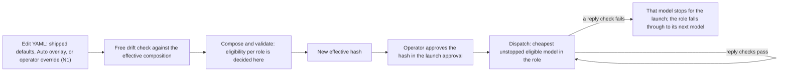

# Plan 12.4 — Auto mode: classify each turn into a tier (v7)

- **Goal:** an opt-in Auto mode. Each turn is classified easy, medium or complex, then sent to the cheapest eligible model in that tier. **The tiers are fixed. Models are configuration:** adding, removing or re-pricing a model that the existing adapters and wire controls support is a YAML change and a hash approval, never a plan or a code change. In the registry the operator's tiers are the roles `easy`, `medium` and `complex` (`registry.py:95-102`); the field named `tier` is a price band and does not drive selection.
- **Authority:**
  - **The operator, 2026-10-25, verbatim:** "What I wanted was the tiers to remain the same and we choose from among each tier on a given set of attributes. Every time we add a model why do we need a new plan? This is one thing that is a given that will change frequently".
  - **The operator, 2026-10-25, the v7 instruction:** "Draft Plan 12.4 v7: fixed tiers, models as configuration, per-model admission evidence, a conservative default estimator, no per-model task tests; Gemini and Luna as first inputs only. Get Codex's review, then bring it back."
  - **The operator, 2026-09-30 (ADR-004), verbatim:** "Model selection will change throughout the life of the project and should be configurable, so tests are not needed just to check tasks". The one exception they kept is ADR-006's summary quality check.
  - **The operator, 2026-10-23, verbatim:** "for Auto we need to research Jev vs DSPy first". ADR-007 stays Proposed and frozen until the pilot's acceptance record.
- **Supersedes** v6 (`433bb8eb…`), now unchanged in the plans archive (`archive/2026-10-23-plan-12-4-auto-mode_v6.md`). This file is the complete successor. The plan file wins over chat.
- **Workflow:** Claude (Opus 5.5) implements; Codex reviews through the CLI at Checkpoints A and B. Targeted tests per change; one full suite at the end; Linux CI failures are fixed in the PR.
- **Estimate:** **10–14 active days**, excluding approval, service and paid-run waits (Codex's figure, kept until N1 and the migration scope are settled). Removing the paid qualification saves little; the override authorization and the admission migration add cross-cutting work.
- **Research:** the Jev-versus-DSPy report, posted verbatim on #395. **Reviews:** Codex's reviews of every draft, posted verbatim on #395.

## What v7 changes from v6

| v6 | v7 | Why |
|---|---|---|
| Admission keyed by snapshot hash and model, in Python (`experimental.py:50-88`) | **Admission evidence is a block on each model's YAML entry**, reviewed through the effective-hash approval (Design 1) | Any change to the canonical policy changes the effective hash (`registry.py:403-417`), so a code-pinned exception breaks on every model or price change (`defaults.yaml:17-18`) |
| A verified estimator, or Haiku's code-pinned empirical one (`validation.py:135-136`; `capacity.py:87-90`) | **A conservative empirical default estimator any model may name**, kept `verified: false`; a measured one replaces it with an evidence-backed estimate | Lets a model without a published tokenizer be admitted, with its assumptions and residual risk stated (Design 1) |
| Gemini implementer qualification: 10 paid turns and a receipt (v6 Design 2, Task 2) | **Removed.** No per-model task tests | ADR-004, operator 2026-09-30 |
| A `gemini-qualification` snapshot | **Removed** | Nothing runs on it |
| Gemini named in the design and the acceptance | **Gemini and Luna are data:** the first entries in the Auto overlay (Task 2). No task depends on which models they are | The 2026-10-25 instruction |
| One empirical route stop per Gateway process (`model_policy.py:105`; `responses.py:260-264`) | **One stop per model**, and the tier falls through to its next unstopped model | A failure on one model must not stop the others or empty a tier that still has a routable model |
| The operator override exists in `load_registry`, but launch never loads it (`binding.py:97` passes `None`) | **Decision N1:** wire it (recommended) | ADR-004 chose option C, "shipped defaults plus a validated operator override"; without it every model change is a release |

## Decisions

**Carried from v6:** P1(a), A3, A4, A4-ii and A5(a) are unchanged. A1 keeps the **$15** pilot cap (which includes the Jev reachability probe) and the **$2** live-slice cap; the **$5** qualification cap is retired, unused. A2 ("qualify Gemini") becomes "Gemini is a first input", with no qualification.

**New, decided by the operator on 2026-10-25 (Source S11):**

| # | Decision | Options | Status |
|---|---|---|---|
| N1 | How the operator changes models without a release | **(a) Recommended by Claude:** wire the ADR-004 override. One fixed file, resolved through the existing trusted operator-path machinery (`operator_paths.py:235-257`), is combined over the shipped defaults (and over the Auto overlay, in the `auto` composition) by the launch gate and the Gateway independently. It applies only after the operator approves the resulting effective hash, as today. No caller-supplied path, hash or environment value is accepted, and test profiles never read it. **`optimus-trust run-gateway` today signs whatever registry it composes without checking an approval** (`launch_approval_cli.py:1039-1069`), so under (a) it signs only a registry hash that a valid launch approval for the workspace already binds, and refuses otherwise. **(b) Not recommended by Claude:** shipped YAML only. A model change is a YAML-only PR and a release: no plan, but a release per change | **Approved (a)** |
| N2 | Admission evidence moves from reviewed code to approved data | **(a) Recommended by Claude:** accept the broader admission policy. Any model entry may be admitted on an empirical estimate, a provider-family slug, or both, each with its recorded evidence and limitations (Design 1), once the operator approves the effective hash. **The residual risk you accept:** a model's first call can exceed its estimate, or be charged, before the per-reply check stops its later calls. This reverses `experimental.py:14` ("It is never a YAML flag") and the code-pinned part of ADR-023, so a new ADR, Proposed until you approve it, records it at Task 1. **(b) Not recommended by Claude:** keep one code-pinned exception per model. Each model change stays a code change and a PR | **Approved (a)** |

**The operator's approval, 2026-10-25, verbatim:** "Approved: Plan 12.4 v7 (r3, 0cb60e50), with N1(a) wire the operator override and N2(a) accept the per-entry admission policy and its first-call risk. Prepare the filing."

## Prerequisites

| Prerequisite | Satisfied today? | Owner | If unsatisfied: genuinely hard, or merely unauthorized? |
|---|---|---|---|
| Decisions P1(a), A1, A3, A4, A4-ii, A5(a) | yes | The operator, 2026-10-23 | — |
| Decisions N1 and N2 | yes | The operator, 2026-10-25: (a) for both | — |
| The decision source for 2026-10-25: Source S11, the app's export of this session, registered in `docs/decisions/README.md` (ADR-011) | yes | Claude, at filing | — |
| **A4-i:** SWE-chat; the operator accepts its Hugging Face conditions and downloads `conversations.parquet`. DevGPT is the fallback | no | The operator | Merely unauthorized: Claude never signs in or handles a token |
| The operator's archived prompts: 4,977 distinct typed prompts in 1,444 local Claude Code transcripts (counted 2026-10-23, without reading their text) | yes | Claude extracts them at Task 3 | — |
| **Code/state:** admission as entry data, the conservative estimator, per-model stops, and (under N1(a)) the override and the `run-gateway` approval check | no | Claude, Task 1 | Genuinely absent: buildable now |
| **Code/state:** the classifier role activated narrowly, with its own capacity, estimator and output-reserve rules; a `classification` settlement stage; the Jev Gateway adapter | no | Claude, Task 1 | Genuinely absent: buildable now |
| **Code/state:** a production Auto composition, with per-turn route and context capture and ordinary compaction | no | Claude, Task 4 | Genuinely absent: buildable now |
| The operator's approval of each effective hash before its calls: the ordinary and `evaluation` compositions after Task 1, and `auto` at Checkpoint A | no | The operator | Merely unauthorized: approvals of reviewed hashes |
| OpenRouter's Jev decision API is reachable through the Gateway's adapter, with the Gateway's existing credentials | unknown | The operator (credentials; Claude never reads or handles a key). Claude probes it after Task 1 and the `evaluation` approval, inside the pilot cap | Genuinely hard: an external dependency. If the provider is unreachable through the working adapter, the Jev arms are dropped and the pilot runs without them. A missing adapter is never a reason to drop them |
| The Gateway and its services (the shared Redis, never stopped by Claude) running for the pilot and the live slices | unknown | The operator (machine state); Claude checks at Task 0 | Merely unauthorized: the operator starts them |
| An isolated pilot environment: Python 3.14 with DSPy 3.4.1 and LiteLLM, pinned by hash, outside the product's `pyproject.toml` | no | Claude, Task 0 | Genuinely absent: buildable now from PyPI |
| An execution checkout from current main, with its own `.venv` | unknown | Claude inventories it at Task 0 | Merely unauthorized |
| A second rater for the labelled set: a Codex CLI session, independent of Claude | yes | Claude runs it | — |
| `acpx` 0.12.0, for the live slices | unknown | The operator (machine state); Claude checks `acpx --version` at Task 0 | Merely unauthorized: the operator installs or updates it |

**Task 0 settles every `unknown` row it can.** The Jev row is settled after Task 1, before any pilot call depends on it.

## Design

### 1. Models as data (Task 1)

**A model entry carries everything its admission needs:**
- **Route facts** (window, max output, quantization, provider slug), each endpoint with `verified` and `observed_on`, taken from the free drift check. Unchanged from today.
- **An `admission` block,** replacing the `EXPERIMENTAL_ROUTES` table. It has two independent parts; an entry uses neither, either or both, and using one never relaxes the other's checks:
  - **`empirical_estimate`:** the entry's estimator may be unverified. It records the evidence (source and date), the assumptions, and the known limitations.
  - **`provider_family`:** the route may use a provider's base slug. It records the provider name every reply's router metadata must report, the evidence, and the limitation that a base slug can reach any variant or region of that provider.
- **The estimator.** A shipped `conservative-utf8` profile, `verified: false`: 1 token per UTF-8 byte of message and tool text, 16 per message, 256 fixed (Haiku's values today, `defaults.yaml:28`). It is a conservative empirical estimate, not a proven bound:
  - **Its assumptions:** text-only input, and a tokenizer that does not expand text by normalization beyond one token per original byte.
  - **What is not proven:** that provider framing fits the fixed and per-message allowances, and the route's finish semantics.
  - **The residual risk** (accepted under N2): a first call can exceed its estimate, or be charged, before the per-reply check stops later calls. Unknown-cost handling is unchanged.
  - A measured estimator, when one exists, replaces the empirical estimate with an evidence-backed estimate, which may be higher or lower.
- **A summarizer receipt,** for the summarizer role only (ADR-006). Unchanged.

**The per-reply checks** (`model_policy.py:216-254`), on every reply of a model admitted with either `admission` part:
- **Always:** the usage and finish checks, one router attempt, and no pipeline stage.
- **`empirical_estimate` adds:** billed input at most the estimate.
- **`provider_family` adds:** the reported provider equals the recorded one (`:233-235`), including when the entry's estimator is verified.

A failure is permanent for that launch, and now stops **that model** only. Disabled provider fallback, fixture-policy rejection, disclosure and receipt-first accounting are unchanged.

**Stops, per model:**
- The Gateway keeps one stop per model, not one per process.
- The host already recognizes a stopped route from the Gateway's refusal (`planning_loop.py:1582-1583`). It records the stopped model for the rest of the launch, and resolution skips it.
- **One synchronized, launch-scoped stop map** serves every session and the answer, classifier and summarizer paths. This safety state is the one exception to Design 4's rule that no shared model-selection state is mutated.
- A turn whose call failed is never redispatched, since the failed call may have been billed: it ends as today, and the next turn takes the role's next unstopped model.
- One model is one stop: a stopped Haiku stops its answers, its summaries and any classifier use together, as today.

**Selection is unchanged:** within a role, the cheapest eligible model first by per-token price dominance, a declared blend for crossed prices, and an exact price tie broken by origin (`validation.py:165-218`). Explicit role assignment stays required. The attributes in each entry (price, origin, data use, capabilities, window) are the "given set of attributes". Three consequences stay configuration, not code:
- **Removing a model** from a role means replacing that role's list. The combiner merges maps and replaces lists, so omitting an entry from an override does not delete it (`registry.py:187-195`).
- **A crossed-price pair in a role** (cheaper input, dearer output) leaves the role unresolved until a blend is declared in YAML; the validator reports it.
- **A selection filter,** such as excluding models that train on inputs, is a later YAML policy option (#398), not this plan.

**Haiku moves with no change in behaviour.** Its admission moves from `experimental.py` into its entry, so the shipped defaults compose a new effective hash, which the operator approves once. Its summarizer receipt and implementer capacity are unchanged. The two Haiku test profiles move the same way and get new pinned hashes. **The historical Stage C release** builds its envelope from those pinned hashes (`stage_c.py:173-177`), so its profile-to-hash mapping is pinned separately and kept unchanged, and the release refuses the migrated profiles. A regression check proves the migration neither changes that envelope's identity nor renews its authority. Sealed records are unchanged.

**The classifier role** is activated narrowly:
- **Its own context ceiling,** set from the complete-request bound (Design 3), not the global 262,144.
- **Its own output reserve:** none for Jev, which returns no free text, and 256 tokens for a model that writes text.
- **Its estimator:** `conservative-utf8`, with the same per-reply checks.
- **A `classification` settlement stage,** so the classifier's cost is its own stage (ADR-007).
- **A Gateway adapter for Jev's decision API,** recording usage, with a typed-request capacity check before the provider call.
- **It stays dormant** in every composition except `evaluation` and `auto`.

**The compositions:**

| Composition | What it is | Approved |
|---|---|---|
| Ordinary | Shipped defaults, plus the operator override under N1(a) | Before the next launch after Task 1 |
| `evaluation` | The pilot's test profile: the classifier role for Jev and Haiku. It never reads the operator override | After Task 1, before any pilot call |
| `auto` | Production: shipped defaults, plus a shipped Auto overlay, plus the operator override under N1(a) | At Checkpoint A |

**A5(a) holds:** only `auto` loads the Auto overlay, so **with no operator override** launches without Auto keep today's default model. An operator override that admits a medium model in the ordinary composition changes the ordinary default planner (`agent/defaults.py:25-28`); that is the operator's configuration choice, and the launch approval shows the new hash.

### 2. The first inputs (Task 2: data only, no paid calls)

- **The Auto overlay** gets two entries:
  - **Gemini 3.8 Flash** in medium, complex and escalation;
  - **Luna** in easy.
- **Their route facts** come from a free drift-check read of the effective `auto` composition. Both name `conservative-utf8` and carry the `admission` parts their routes need.
- **What this does in Auto:** Luna ($0.10 / $0.50) is cheaper than Haiku on both prices, so it leads easy, with Haiku next; Gemini is the only medium and complex model.
- **Luna's known gaps stay visible in its entry:** its tokenizer, framing and finish behaviour are unverified (the 2026-10-08 disposition). They are covered by the conservative estimate and the per-reply checks, within the N2 residual risk. If Luna stops, easy falls through to Haiku.
- **Replacing either model later** is an edit to the overlay or the operator override, then a hash approval. No task changes.

### 3. The pilot experiment (Task 3)

The pilot names models because it compares approaches. **The winner fills the classifier role as data,** like any other entry.

**The classifier's input contract, frozen before any labelling or optimisation.** One bounded representation is shared by the dataset, the optimisers and production (ADR-007:73-74):

| Field | What it carries |
|---|---|
| `prompt` | The current prompt's text, cut to the excerpt budget (below), at most its first 4 KB |
| `truncated` | `true` if the prompt was cut |
| `mode` | Chat or Agent |
| `attachments` | The count of attached files or ranges, a total-size bucket (<4 KB, <64 KB, larger), and up to 5 distinct file extensions |
| `previous_tier` | The previous turn's routed tier, if any |

- **Never included:** history or file contents.
- **Raters label the full request,** after redaction and the confidentiality review. The classifier sees only this representation.

**The complete-request bound, frozen with the contract:**
- **One bound for the whole serialized classifier request:** 8,192 estimated tokens, by the route's own estimator. It covers the instructions or template, any few-shot examples, the contract fields, the framing, and the output reserve. Haiku's estimator counts 1 token per byte (`defaults.yaml:28`; `capacity.py:62-67`), so the bound is in estimated tokens, not bytes.
- **The excerpt budget:** for each frozen configuration, the fixed parts are measured once. The prompt excerpt gets what remains, up to 4 KB.
- **Overflow, identical in the pilot and in production:**
  - **Fixed parts that leave no excerpt budget make a configuration invalid.** An example is a DSPy program with too many examples. It is rejected when it is frozen, never at run time.
  - **A longer prompt is cut to the budget,** with `truncated: true`.

**The arms, all through the Gateway on the `evaluation` snapshot:**

| Arm | What it is |
|---|---|
| A | Rules only |
| B | Jev; its variant (`choice` or ordinal `score`) is frozen on dev |
| C | Haiku 5.5 with a hand-written prompt |
| D | Haiku 5.5 optimised by DSPy; the optimiser (BootstrapFewShotWithRandomSearch, MIPROv2 light or GEPA light) is frozen on dev. **Its few-shot examples come only from the hand-written train items,** so that a winning program can ship without any archived or public prompt text |
| H | Rules first; a learned arm decides only the uncertain middle. Its backend and rule thresholds are frozen on dev |

**Two rules apply to every arm:**
- **Low confidence or abstention routes one tier up** (ADR-007). The confidence thresholds are frozen on dev.
- **The test split is evaluated once per frozen configuration,** in 3 repeats.

**The labelled set (a pilot, not a definitive benchmark):**
- **Size and mix:** 300 requests, roughly 30/40/30 easy/medium/complex, so about 45 complex items reach the test split.
  - **120 from the operator's archived chats** (A4):
    - **Which prompts:** only prompts the operator typed, from local Claude Code transcripts, and from Codex's interactive sessions.
    - **Extraction filters:** these are excluded:
      - subagent and sidechain records, and tool results;
      - meta records, and harness-injected messages (anything opening with a tag, and system reminders);
      - compaction summaries and interruption markers;
      - pasted material (pasted-content blocks, and agent text the operator relayed, such as signed Claude or Codex reports);
      - every Codex `codex exec` session, since those carry briefs written by Claude.

      **A record whose authorship is uncertain is excluded.**
    - **Preparation:** deduplicated, sampled across projects and months, and then:
      1. redacted by the existing redaction gate;
      2. **given a local confidentiality review by Claude:** any prompt naming people, clients or confidential matters that the gate cannot catch is dropped, and not edited;
      3. labelled only after both steps.
  - **60 real prompts to coding agents from a public set** (A4-i):
    - **SWE-chat** (Claude's recommendation): prompts to Claude Code, Codex and Gemini CLI from 2026, licensed ODC-BY.
      - **Access:** it is gated, so the operator accepts its conditions on Hugging Face and downloads `conversations.parquet`. The files total 47 GB, but only this one is needed.
      - **Records used:** only those with `turn_type == 'user_prompt'`, never `system_injected`.
      - **The conditions** are read when they are accepted, and must allow sending the excerpts to the pilot's model providers. If they do not, DevGPT is used instead.
    - **The alternative, DevGPT:** developer–ChatGPT conversations from 2023, licensed CC BY 4.0, and open. Its archive, `DevGPT.zip`, is 926.8 MB (Zenodo record 8303722); Claude downloads it, after approval. It is evidence about developer chat, not about coding-agent use, and is reported as such.
    - **The public items get the same confidentiality review** as the archived ones.
  - **60 SWE-bench Verified items:** the 500-row test split, 2.1 MB, downloaded by Claude after approval. Its `difficulty` column (time-to-fix buckets) is an independent check on the labels.
  - **60 hand-written edge cases:** short but dangerous, long but trivial, questions, and review requests.
- **Handling:**
  - **Downloaded files** go into their own empty folder, and are read only by scripts run in isolated mode.
  - **The prompt text stays outside the repository,** in the local review kit beside the worktrees.
  - **The repository gets the aggregate results and a content-free manifest.** For each item, the manifest holds:
    - its SHA-256 digest;
    - its source and provenance class;
    - its source version and licence;
    - any modification (cut or redacted);
    - its split and group;
    - both raters' labels;
    - every arm's prediction.

    That is enough to recompute every metric without the private text.
  - **What leaves the machine, in full:**
    - **The raters:** each redacted, reviewed request goes in full to Claude (Anthropic) and to Codex (OpenAI).
    - **The pilot's calls:** the contract representation, with at most 4 KB of prompt excerpt, goes through the Gateway to Jev's provider (no training on it; retention is not stated) and to Anthropic (Haiku).
  - **Licences:**
    - **Kept:** each public item's source, version, licence notice and modification record.
    - **ODC-BY** covers the SWE-chat database, not the individual prompts. CC BY attribution applies to anything from DevGPT that is published.
    - **Publication:** no public or private prompt text is published, other than the shipped examples below.
- **The rubric:**
  - **easy:** one file, explicit and mechanical;
  - **medium:** 2–5 files or one module, or a bounded investigation;
  - **complex:** crosses modules, open-ended debugging, or touches security, data or concurrency.
- **Raters:** two independent raters, Claude and Codex, with Cohen's kappa reported. **Disagreements take the higher label,** since routing up is the safe direction.
- **Deduplication** runs across all sources, before the split.
- **The split:** 100 train / 50 dev / 150 test, stratified by class and source.
  - **It is grouped,** so that prompts from the same conversation or task never cross splits.
  - **Optimisation and every threshold** see train and dev only.

**The metrics.** Each is computed on the final routed tier, after any route-up, with requests as the sampling unit:
- **The penalty score:** under-routing costs 3 per tier, over-routing 1 per tier. Sensitivity runs at 2× and 5×. It is a penalty, not dollars.
- **The registry-weighted cost:** reported separately, at the eligible models' real prices.
- **The under-route rate:** the fraction of test requests whose first repeat routes below their label.
- **The flip rate:** the fraction of test requests whose final routed tier is not the same in all 3 repeats, with caching off.
- **Per source:** every metric is reported for each source alongside the pooled figure.
- **The rest:** accuracy and macro-F1; the route-up rate; latency p50 and p95 through the Gateway; classifier cost per 1,000 requests, from Gateway accounting; expected calibration error.
- **How they are reported:** each gate is an observed rate, with a Wilson interval. Paired differences use a bootstrap over requests.

**The decision rule (pre-registered, fixed before any run):**
1. **The gates apply to every arm, A and H included.** An arm passes if its observed under-route rate is at most 5%, and its observed flip rate is at most 5%.
2. **Among the passing arms, the lowest mean penalty score wins.** A learned arm (B, C, D or H) must beat A on penalty, with a 95% paired-bootstrap interval that excludes zero. Otherwise A wins, if A passes.
3. **Ties** (two passing learned arms whose paired difference has an interval that includes zero) go to the lower measured cost per 1,000 requests, then to the lower p95 latency. So C wins only by passing, beating A, and winning on these rules.
4. **No arm passes:** there is no winner. Phase B does not start, and the evidence goes to the operator.

**Budget enforcement:**
- **Per-call caps:** the complete-request bound. That is 8,192 estimated tokens, with 256 output tokens reserved inside it for Haiku and none for Jev. The cap is reconciled with the bound before any run.
- **Reservations versus spend:** reservations use the estimate, which runs high, and are released at settlement. The cap applies to billed spend.
- **Fixed ceilings:** the optimiser trials and the GEPA metric calls are fixed.
- **Proposer calls** count against the cap.
- **Retries:** only the Gateway's existing ones.
- **Calls run sequentially,** each with a cost reservation before it. **An unknown cost stops the run.**

**The first calls:**
- **The Jev reachability probe** (Prerequisites).
- **Then a smoke test:** 10 calls per arm through the real Gateway. It checks the DSPy binding and parsing, and that repeats really run with caching off, all inside the cap.

**The output:** an evidence report with the content-free manifest, and a draft acceptance record for ADR-007 naming the arm that the rule selects, or "no winner".

### 4. Minimal opt-in Auto (Tasks 4–5)

**A production composition:**
- **The bootstrap:** `OPTIMUS_AGENT_MODEL=auto` (today refused at `src/optimus/agent/defaults.py:50-51`) extends the ordinary path (`src/optimus/acp/bootstrap.py:255-294`) to load the approved `auto` snapshot. It keeps the Context Engine and ordinary compaction.
- **Not a test profile:** it is not built on the test profiles, which pin one planner.
- **Testing:** it is tested through the real launch path.

**Each turn:**
1. **Classify the turn** from the input contract.
2. **Map the tier to its role.**
3. **Pick the cheapest eligible model that has not stopped in this launch,** using the existing selection and the stops the host has seen (Design 1).
4. **Capture that model's route and context limits** for this turn.

**Routing up:**
- **Low confidence or abstention** routes one tier up.
- **A tier whose eligible models have all stopped, or that has none,** routes up to the next routable tier.
- **If no tier at or above is routable,** the default planner (ADR-023) is used, and the notice says so. It must itself be eligible and unstopped; otherwise the turn is refused recoverably, without dispatch.

**Classifier failure:** a failure or timeout counts as an abstention on the medium tier, so the turn routes up, and the notice says why.

**Binding per turn:**
- **Frozen for the turn:** the turn's model, route and context limits (ADR-007).
- **No shared state changes:** the runner sends the turn's bound model, not the launch-time one it holds today (`src/optimus/agent/runner.py:294`, `:335`, `:517`), and no runner or session state is mutated. The launch-scoped stop map (Design 1) is the one exception.
- **Unchanged:** the summarizer stays Haiku.

**The classifier backend is whichever arm won:**
- rules need no call;
- Jev uses the production Gateway adapter;
- DSPy ships its compiled prompt as data, through chat completions.

**The record and the notice:**
- **The record:** a content-free routing record per turn (arm, tier, confidence band, model). The classifier's cost goes in the `classification` stage.
- **The notice:** one line per turn in the ACP session, for example "Auto: medium → google/gemini-3.8-flash".

**Without `auto`, and with no operator override, nothing changes,** under A5(a) (Design 1).

## Tasks and checkpoints

| Task | Work | Targeted tests |
|---|---|---|
| 0 | **Records:** none beyond Source S11, registered at filing. **Checks:** settle the `unknown` prerequisites it can; build the pilot environment; freeze the input contract (Design 3) | `tests/unit/docs`, after staging |
| 1 | **Models as data (Design 1):** - the `admission` block and `conservative-utf8`, replacing `EXPERIMENTAL_ROUTES`; - per-model stops in the Gateway and the host; - under N1(a), the override and the `run-gateway` approval check; - the classifier role, the `classification` stage and the Jev adapter; - the `evaluation` composition; - the new ADR. **Then the operator approves the ordinary and `evaluation` hashes** | The model-policy, binding, launch-gate, approval-CLI, settlement and Gateway unit tests, and the migration checklist below |
| 2 | **The first inputs (Design 2):** the Auto overlay with the Gemini and Luna entries, from a free drift-check read | Validation of the `auto` composition |
| 3 | **The pilot (Design 3):** the Jev probe, the smoke test, the labelled set and kappa, the harness, the runs, the analysis, the evidence report and the draft ADR-007 acceptance | The harness's own self-checks |
| **Checkpoint A** | **Codex CLI review** of Tasks 0–3 and the evidence. **The operator decides** the ADR-007 acceptance, and approves the `auto` hash. If there is no winner, the plan stops here | — |
| 4 | **The production Auto composition (Design 4):** the resolver, routing up, per-turn route and context capture, ordinary compaction, failure handling | `tests/unit/agent` and `tests/unit/acp`: the real launch path; successive turns on different models; concurrent sessions; no shared-state mutation |
| 5 | The production classifier backend, the routing record, the per-turn notice, and the opt-in | The backend's tests; `tests/unit/acp` (the notice) |
| **Checkpoint B** | **The full suite once,** plus Ruff; the PR; Linux CI fixed in the PR; a **Codex CLI review** of the full diff; the documentation freshness audit; one live acpx slice per routable tier, within the A1 cap | — |

**The Task 1 migration checklist.** Every current reader of the code-pinned admission or the single stop moves to the entry data and the per-model stop:
- **Policy:** `validation.py`, `capacity.py`, `binding.py`, `test_profiles.py`, both test-profile YAMLs and their pinned hashes, and `defaults.yaml` (packaged through `pyproject.toml`'s `package-data`).
- **Gateway:** `model_policy.py` (admission, the reply checks, the stop), `responses.py`, `request_diagnostics.py`, and the child-manifest and startup composition in `optimus_gateway/__main__.py`.
- **Host:** `gateway/route_binding.py`, `gateway/attempts.py`, `context/maintenance.py` and `context/assembly.py` (the summarizer binding), `agent/planning_loop.py` and `agent/runner.py` (stop recognition), `acp/spec.py`, default resolution in `agent/defaults.py`, and the preflight binding in `acp/preflight.py:160-175`.
- **Launch:** `launch_gate.py` and `launch_approval_cli.py` (approval, re-approval of a changed hash, and the `run-gateway` check).
- **Tools:** `tools/evaluate_context_summarizer.py`, and `tools/check_model_registry_drift.py`, which checks the effective composition rather than the defaults alone.
- **Tests:** all test modules that reference the pinned hashes or `experimental_route`.
- **Tests to add:**
  - a model added in YAML alone becomes eligible with no code change;
  - an unapproved changed registry is refused, including by `run-gateway`;
  - host and Gateway refuse to start when their compositions disagree;
  - one model's stop leaves the others routable, and a stopped default planner is refused without dispatch;
  - the reply checks for an entry with neither `admission` part, each part alone, and both;
  - the historical Stage C envelope's identity is unchanged by the migration, and its authority is not renewed.
- **Unchanged:** sealed evidence, expired releases and their recorded hashes.
- **Documentation:** the current-state documents this changes, updated at Checkpoint B.

## Acceptance

- **Models are configuration:** a test adds a model in YAML alone and it becomes eligible in its role after hash approval, with no code change. Changing a price re-orders the role; replacing a role's list removes a model.
- **No regression:** with no operator override and without `auto`, the ordinary composition's eligible models, default model and behaviour are unchanged. Haiku keeps its receipt and capacity.
- **Approval:** an unapproved changed registry is refused, by the normal launch and by `run-gateway`.
- **Isolation:** one model's stop leaves the other models routable, and its role falls through to its next unstopped model.
- **The pilot** ran under the pre-registered rule and the frozen input contract, within its cap. The evidence report shows every arm's metrics on the test split, with intervals, and the operator accepted the result: the selected arm, or no winner.
- **The resolver,** with `OPTIMUS_AGENT_MODEL=auto`, through the real launch path:
  - each turn is classified and sent to the cheapest unstopped eligible model of its role, with that model's route and context limits captured for the turn;
  - ordinary compaction still works;
  - it routes up as specified;
  - concurrent sessions do not interfere.
- **The record and the notice:** every Auto turn records its routing decision, with the classifier's cost in the `classification` stage, and shows its notice.
- **Live:** one live acpx slice per routable tier passes, or is recorded as UNRUN if not released.
- **Final checks:** the full suite and Ruff pass once at the end, and CI is green.

## Explicit Exceptions

Each row names its owning issue.

| Deferred | Owning issue |
|---|---|
| Escalation to a stronger model after a misroute (ADR-009, rung 2) | #397 (loop control Phase 3, shared with Plan 12.3) |
| The ACP model picker in Zed (ADR-004) | #398 |
| Auto as the default | #398 |
| Selection filters beyond price and origin, such as excluding models that train on inputs | #398 |
| The user-facing savings report (the Auto / Sonnet 5.5 / Opus 5.5 table, with the benchmark footnote) | #248 |
| The typed telemetry boundary for the routing record | #303 |

**Dropped, not deferred:** per-model task-quality evaluation (ADR-004, the operator, 2026-09-30). Quality is the operator's configuration choice, guided by ADR-004's coding benchmarks.

## Codex review (v7, round 1) corrections mapping

| # | Correction | Applied in |
|---|---|---|
| 1 | The estimator is conservative and empirical, not a proven bound; its assumptions and residual risk stated; explicit acceptance | Design 1 (the estimator); N2 |
| 2 | `run-gateway` signs only an approved registry hash | N1(a); Task 1; the migration checklist; Acceptance |
| 3 | A small evidence schema, with empirical estimation and provider-family routing independent | Design 1 (the `admission` block); N2 |
| 4 | Override scope and precedence; the A5(a) guarantee qualified; test profiles isolated; the trusted-path machinery | N1(a); Design 1 (the compositions, A5(a)) |
| 5 | The cheapest unstopped model; the host learns stops; no redispatch; one stop per model | Design 1 (stops); Design 4; Acceptance |
| 6 | The migration checklist | Tasks (the Task 1 migration checklist) |
| 7 | A complete successor, with the full prerequisite table | Prerequisites; Designs 3 and 4 in full |
| 8 | Roles, not tiers; list replacement; the canonical hash; the flowchart | Goal; Design 1 (selection, the flowchart); the change table |
| 9 | 10–14 days kept | Header (the estimate) |

## Codex review (v7, round 2) corrections mapping

Verdict: approve with changes. Round-1 findings 2, 4, 7 and 9 were resolved; the corrections below close the rest.

| # | Correction | Applied in |
|---|---|---|
| 1 | A measured estimate may be higher or lower | Design 1 (the estimator); the change table |
| 3 | The per-reply checks split by `admission` part; tests for neither, each and both | Design 1 (the per-reply checks); the migration checklist |
| 5 | The default fallback must be eligible and unstopped; one synchronized launch-scoped stop map, the one shared-state exception | Design 1 (stops); Design 4 (routing up; no shared state changes); the migration checklist |
| 6 | The historical Stage C envelope pinned separately, refusing migrated profiles, with a regression check | Design 1 (Haiku moves); the migration checklist |
| 8 | Source references: `planning_loop.py:1582-1583`; `runner.py:294`, `:335`, `:517`; `acp/preflight.py:160-175`; "all matching test modules" | Design 1 (stops); Design 4; the migration checklist |
