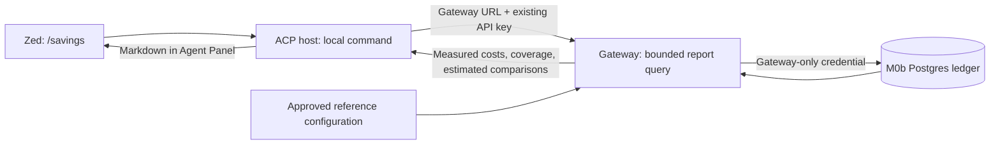

# Plan 12.9: User-facing net cost-savings report

> **For agentic workers:** Claude Opus implements using `superpowers:executing-plans`; Codex reviews read-only at the three checkpoints below. The operator approves the saved plan’s exact SHA-256 and answers the operator decisions before Task 1. Each live operation requires its own release.

**File:** `docs/superpowers/plans/2026-11-01-plan-12-9-cost-savings-report-implementation.md`  
**Work:** [#248 — P12-FU-2](https://github.com/vibhanshu-agarwal/optimus-cost-agent/issues/248)  
**Verified authoring base:** `9e87d67f575e390966ba1c82e6004fda5a1b097a`, branch `agent/claude/plan12-9-cost-savings-report`, supplied worktree `optimus-cost-agent-wt-claude-p129sav`.

## Operator summary

Show users what Optimus actually spent, what portion is durably accounted, and how Auto turns compare with explicitly chosen reference prices. Keep measured expenditure separate from estimated savings and matched measured comparisons.

**Operator premise, verbatim, 2026-10-22, Round 92 source:**

> “Cost Analytics are absolutely needed. We need to show cost savings with "Auto" mode. This is a core premise”.

The recommended first surface is `/savings` inside the ACP IDE: a session overview, Auto comparison table, and paginated turn/stage/request detail. Reporting makes no model call and writes no workspace report. It introduces neither cost stops nor a dashboard, model picker, or new accounting authority.



The following remain **operator decisions**, not choices inferred from plan approval:

| Decision | Options and question answered | Recommendation |
|---|---|---|
| D1 — Surface | ACP command: visible in the working IDE, requires advertisement and rendering proof. Workspace Markdown: shareable, but creates files and stale copies. Dashboard: richer navigation, but adds a separate product surface. | ACP `/savings`, advertised after successful session setup; Markdown output in the Agent Panel. |
| D2 — Aggregation | Current session with turn/stage drill-down: existing identities, smallest useful scope. UTC day: crosses sessions and needs a broader completeness boundary. Project: needs durable project attribution and membership rules. | Current session, with an Auto subset and per-turn/stage detail. |
| D3 — Auto reference and comparison columns | **Configured fixed-selection role/tier:** “What would this same reported workload cost at the model I would otherwise select without Auto?” Resolve the configured choice through each turn’s captured registry snapshot. **Only §7’s three references:** “What would these tokens cost at each reference’s prices?” This does not identify the user’s non-Auto choice. **Measured Auto-on/Auto-off runs:** answers the observed behavioral question, but requires a separately commissioned B3 campaign. | Operator names the fixed-selection role/tier they would otherwise use; make it the primary estimated Auto comparison. Also show §7’s three configured, dated reference columns. Neither is a measured Auto-off result. |
| D4 — Paid comparisons | No paid calls; or a separately released, bounded B3 campaign with task, quality, call-count and cost authority. | Zero paid calls here. Show B2/B3 as separate unavailable sections; their first commissioned producers define their input contracts. |

Recommendations define this draft’s implementation. Different selections that change its scope or mechanism require a complete successor plan before Task 1.

## Goal

Deliver #248’s acceptance criteria and memory design v4 §7’s presentation clause through a real ACP IDE surface, using the existing durable ledger for measured costs, honest coverage, dated B1 estimates, clearly distinguished unavailable B2/B3 comparisons, and B4 context.

**Authority:**

- [ADR-012](../../decisions/ADR-012-cost-savings-report.md), SHA-256 `aab39e3abdc92c6e150892c121820f7db1fedec1e41cf8aa2bfee779bb55f584`.
- [Memory design v4](../specs/2026-10-22-plan12-memory-design_v4.md), especially §7 and K4, SHA-256 `708e0e7831f6d4c56b5f6442cd37c4e02eecffd2659db04f3e6a6b1c54506ff9`.
- ADR-032, accepted by ADR-033; ADR-007, accepted by ADR-028; ADR-029; ADR-025; ADR-005.
- P12-FU-2’s migrated acceptance text: the current backlog entry points to Git blob `d3114bea54d742abffcf104b630cb7104301de15`, lines 2712–2745. That pinned text was read locally; current issue state must be refreshed by Claude.
- Archived Plan 12.8 and Plan 12.7 v4 provide implementation/evidence precedents, not new authority.

### Pre-approval review disposition

| Finding | Disposition |
|---|---|
| 1 — Authoring-note tail | Accepted. Removed; product limitations remain in the plan body. |
| 2 — Prerequisites separator | Accepted. Corrected to four columns. |
| 3 — Ambiguous ADR range | Accepted. Records and acceptance relationships are named explicitly. |
| 4 — Speculative B2/B3 readers | Accepted. Separate labelled unavailable sections satisfy this delivery’s distinction requirement. No bundle formats, readers, loaders or campaign-specific bindings are built. |
| 5 — OC-4 closure dependency | Amended. Remove D5 and early issue creation. File the campaign follow-up during normal authorized closure; #248 retains custody until transfer. Report acceptance does not require a campaign. |
| 6 — Auto premise/reference | Accepted. D3 distinguishes the fixed-selection alternative, premium reference columns and measured Auto-off comparisons. |

## Scope and Explicit Exceptions

Scope is a multi-file production, migration, configuration, test and documentation changeset. It includes the Gateway reader, snapshot persistence, narrow Auto attribution, B1 calculations, B2/B3 unavailable sections, B4 context, deterministic accounting fixtures and real Postgres/Zed verification.

| Explicit exception | Owning issue and boundary |
|---|---|
| Broad telemetry consolidation | [#303](https://github.com/vibhanshu-agarwal/optimus-cost-agent/issues/303). This plan takes only report contracts, price snapshots and minimal turn attribution. It does not replace telemetry fanout or consolidate other event families. |
| OC-4: B2 alternative-workload generation, B3 campaigns and their input contracts | **#248 owns this until the OC-4 follow-up issue is filed at closure with operator approval; record its actual number in #248’s closing handoff.** The follow-up owns commissioning, formats, quality gates and paid authority. Neither its implementation nor a campaign is required for report acceptance. |
| Day/project aggregation under the recommended session selection | #248 records the operator’s D2 scope choice. These are unselected alternatives, not automatically deferred commitments; a later request receives its own owning issue. |
| Loop-control episode accounting and alert activation | [#396](https://github.com/vibhanshu-agarwal/optimus-cost-agent/issues/396); spend-policy custody remains [#257 / P9.85-FU-3](https://github.com/vibhanshu-agarwal/optimus-cost-agent/issues/257). Read known costs without adding alert thresholds or cost stops. |
| Model picker | [#398](https://github.com/vibhanshu-agarwal/optimus-cost-agent/issues/398). Reference selection is report configuration, not model selection for dispatch. |
| Missing usage from empty/truncated replies | [#423](https://github.com/vibhanshu-agarwal/optimus-cost-agent/issues/423). Preserve unknowns; no invented usage. |
| General Gateway processing deadline | [#442](https://github.com/vibhanshu-agarwal/optimus-cost-agent/issues/442). This plan bounds its own report path without claiming general delivery deadlines. |

Under the operator’s 2026-10-30 rule, a defect that actually blocks this plan is repaired inside its owning task here. An exception is not permission to leave a required report path broken.

## Design choices

All mechanisms and numeric bounds below are **agent-selected**, subject to approval. Operator decisions are D1–D4 and the accepted policies cited above.

### 1. Verified starting point

At the authoring base:

- `attempt_receipt` contains canonical identity, cost and coverage links. Model, route, tokens, strategy and session facts come from its exact linked `capture_event.payload`; do not add duplicate receipt columns.
- `UsageStore` offers migration and ingestion, but no reader. The Gateway exposes POST routes, including capture.
- Auto decisions reach telemetry, not the ledger. Role/model receipts do not by themselves prove that a turn selected Auto.
- Registry prices cover input/output only. Their date is a YAML comment; `price_snapshot_id` is not populated by the Gateway, and no durable hash-to-registry snapshot map exists.
- ACP has no advertised commands. Its usage meter is insufficient for this report. Existing alerts have no production policy caller.
- Plan 12.5’s savings contracts/grader are useful vocabulary and fixture precedent. Their rule treating a missing price snapshot as unknown actual cost is **not** adopted: a provider-reported charge remains known without a list-price snapshot.
- No B2 counterfactual producer or B3 campaign is commissioned. Golden-task records do not provide matched cost-per-successful-task comparisons.

### 2. Gateway read contract and credential boundary

Add **`POST /v1/observability/usage-report`**, following the existing code-defined capture contract rather than introducing OpenAPI/Postman infrastructure.

The strict versioned request supports:

- `operation: "capabilities"`: report schema/features, without database access;
- `operation: "report"`: required session identity, optional turn identity, configured reference IDs, page size and cursor; optional host capture frontier identifying the committed prefix expected by this host.

No caller-supplied user ID, SQL, filesystem path, database name or credential reference is accepted.

Authenticate with the existing bearer API key **before reading the body or opening Postgres**. The configured Gateway principal owns the configured ledger; arbitrary multi-tenant sharing is unsupported. The host obtains all ledger data through this route and never imports `psycopg`, resolves `optimus-gateway-accounting`, or receives a DSN.

**Bounds:** 16 KiB request, 100 detail rows per page, 1 MiB response, at most 10,000 canonical attempts and 10,000 turn/epoch records per selected report. Use indexed predicates and parameterized SQL. Over-limit scopes return an explicit unavailable-total state and offer turn selection; never silently truncate an aggregate.

Use a short-lived **repeatable-read, read-only transaction**. Report-specific connection, statement and lock waits must fit a five-second database budget; body/read/write handling and host transport have a fifteen-second total budget. Bound outstanding report workers to two; expiry/cancellation suppresses late publication and retains capacity until the worker actually exits. Do not reuse the model transport’s unbounded response-body read.

Each page carries ledger instance, as-of time and a revision binding the selected facts and coverage. Use keyset pagination. An opaque authenticated cursor binds principal, filters, revision and last key; alteration, replacement ledger or changed revision returns `409 REPORT_CHANGED`. No transaction remains open between requests. The summary covers the whole bounded selection, not merely the displayed page.

Return allowlisted cost/provenance/coverage facts, decimal money strings and stable error codes. Never return raw capture payloads, exception messages, prompts, secrets or local configuration paths.

Unconfigured accounting returns `ACCOUNTING_NOT_CONFIGURED`; outages/timeouts return `LEDGER_UNAVAILABLE` or `REPORT_TIMEOUT`. The IDE displays that state. Ordinary Optimus work continues; reporting performs no implicit drain, migration, service start or model call.

### 3. Durable dated snapshots and configured references

Add migration **`002_savings_report.sql`**, leaving migration 001 unchanged. It adds an immutable registry/price snapshot table and the indexes needed for report joins. Pin its digest using the existing migration mechanism and protect its facts against UPDATE, DELETE and TRUNCATE.

At request use, the Gateway derives an allowlisted snapshot from its trusted effective registry: effective hash, model IDs, tiers, role assignments, routes and available prices. Capture it through the Gateway’s durable outbox and existing drain, with a content-derived snapshot ID. A failed snapshot write does not stop dispatch.

Populate the existing `gateway_usage.price_snapshot_id` only when the corresponding snapshot has been durably accepted locally. Cover completion, decision, failed-but-billed and routed-attempt response paths. Database lag may temporarily leave its lookup unavailable; never manufacture a resolved snapshot.

Keep these dates distinct:

- `captured_at`: when Optimus observed/captured the configuration;
- `price_as_of`: the source’s declared price date, nullable;
- source/revision and configuration digest.

Capturing old prices today does not make them current prices. Existing receipts remain unchanged; missing historical snapshots remain unavailable. No automatic Git-history or log reconstruction establishes authoritative history.

Add validated packaged **reference configuration**, with a trusted operator override using existing authorized-path/launch-binding patterns. It contains:

- D3’s primary fixed-selection role/tier selector;
- §7’s three reference model/route columns;
- dated price sources, nullable category prices and token-category assumptions;
- the dated benchmark footnote and its source/quality limitations.

Resolve the primary selector using the existing eligible-model selection rules against each turn’s captured registry snapshot. Record the resolved model, route, registry/snapshot identity and date in the report. Do not substitute today’s registry or infer a historical runtime stop set. Missing snapshot, eligibility or pricing leaves that comparison unavailable.

Model identities appear only in configuration, never code branches or model-specific tests. Bind override bytes into the approved launch; absent overrides preserve ordinary launch behavior. There are **no B2/B3 input files, loaders or launch-binding fields**.

Reference snapshots are immutable and identified independently from the actual request’s registry snapshot. Report requests select approved reference IDs, never inject prices.

### 4. Auto attribution and coverage

Add one content-free host record, **`turn.report_context`**, at admitted model-work turn entry, before classification:

- session and run/turn identity;
- explicit `selection: auto|fixed`;
- registry hash and captured strategy.

Join receipts by their existing turn/epoch identities. Join tier/role composition through the captured registry snapshot; retain requested and resolved routes, including escalation receipts. Do not infer Auto from a model name or role.

This minimal record is sufficient for the financial Auto subset. Do **not** copy the full routing telemetry or add a new task-class taxonomy. Task class remains unavailable where not independently recorded; tier is not relabelled task class.

Negotiate the new capture feature before emitting new record kinds to an older Gateway. Unsupported peers retain existing receipt capture and show Auto attribution unavailable. Preserve old payload validation, receipt fingerprints and replay semantics.

The session overview includes every selected canonical receipt, including summarization, classification, review where present, retries, fallback and escalation. Standalone startup/probe operations without session attribution appear as explicitly unallocated overhead; do not silently assign them to a session or claim the session includes them.

Coverage has separate dimensions:

1. **Accounting:** complete/open/incomplete epoch states and reasons, known costs, unknown attempts, conflicts and late receipts.
2. **Delivery/freshness:** committed frontiers, the host’s expected frontier, backlog and unresolved gaps.
3. **Attribution:** turns known to be Auto/fixed versus unavailable.
4. **History:** prospective durable boundary and qualified earlier history.

A complete epoch does not prove complete session history. A definitive scoped total requires all expected session turns accounted, terminal complete epochs, known costs and satisfied frontiers. Missing context/begin records or delivery uncertainty blocks that claim. Never repair a historical gap with a later complete epoch.

### 5. Arithmetic and B1–B4

Use `Decimal`; aggregate canonical receipts once. Aliases and replayed events add no charge. Conflicts preserve the original known charge and expose the contradiction; unknown charges remain unknown. Late receipts update the next report and invalidate stale pagination.

**One subtraction:** comparable baseline total minus actual fully loaded total. Optimus overhead is already in actual cost and is never deducted again.

| Baseline | Delivered behavior |
|---|---|
| **B1 — same reported tokens repriced** | Reprice every selected attempt’s reported categories at each dated configured reference. The Auto table uses all costs of turns explicitly attributed Auto, including overhead. Its primary column uses D3’s configured fixed-selection alternative; §7’s three references remain separate columns. This is price substitution across the same realized attempt workload, not a simulation of an alternative agent. |
| **B2 — no-optimization counterfactual** | A separate section labelled estimated, displaying `Unavailable — no qualifying no-optimization workload evidence`. Explain that optimized receipts do not establish full-verbatim-history token counts or the workload with caching/routing removed. No amount, percentage, bundle format or reader is supplied. |
| **B3 — matched measured comparisons** | A separate section displaying `No qualifying matched-run comparison available`. State that no Auto-on/Auto-off or other matched campaign is represented. The follow-up must commission its task/harness/strategy revisions, cost-per-successful-task accounting, outcome/quality criteria and input contract. No amount, percentage or speculative reader is supplied. |
| **B4 — benchmark context** | A dated, sourced footnote identifying tasks/harness, quality and comparability limits, including below-margin results. External results are context only, never evidence of this user’s savings. Missing qualified results are unavailable. ADR-028 may be linked separately as historical internal pilot context; it is neither production savings nor a matched Auto-off measurement. |

The primary Auto column answers the operator-selected **fixed-selection price question**. It does not predict changes in classification calls, context, retries, output tokens or quality if Auto were disabled. Those behavioral differences require B3. Label this limitation adjacent to the table.

For B1, normalize overlapping token categories only where the existing adapter contract establishes their inclusion relationships. For example, subtract cached input from total input only when that inclusion is documented and tested. Unknown overlap makes the affected portion unavailable.

A null category is not zero. A positive cached/reasoning category without its own applicable price is unavailable; never silently charge it at the ordinary input/output price. Explicit zero categories need no positive-price contribution. Preserve unavailable-category counts and known repriced subtotals without claiming a complete baseline.

B1 and B2 are never added. B3 remains separate from session estimates. Percentages require complete comparable totals and a positive baseline denominator. Negative savings remain signed and visible. No saving-percentage threshold is a delivery gate.

**Exact user-facing labels:**

- `Measured known provider cost`
- `Coverage: complete for the stated scope` or `Coverage: incomplete — <reasons>`
- `History before durable capture: qualified; billing completeness unavailable`
- `Estimated B1 — same reported tokens at reference prices; not realized savings`
- `Auto reference: configured fixed selection; not a measured Auto-off run`
- `Estimated B2 — no-optimization counterfactual`
- `Unavailable — no qualifying no-optimization workload evidence`
- `B3 — matched measured comparisons`
- `No qualifying matched-run comparison available`
- `B4 — benchmark context only`
- `Unavailable: <category or evidence> — <reason>`
- `Definitive net savings and percentage unavailable`

### 6. ACP IDE surface

Advertise `savings` through `available_commands_update`, after the successful session-setup response is physically ordered first. Use ACP v1 shapes; do not import draft v2 command fields.

ACP defines commands as ordinary prompt messages; Zed’s own support discussion confirms that advertised commands populate its slash menu. An upstream report describes commands being dropped before the session/new response, so actual ordering and installed-version behavior require proof. Sources: [ACP v1 slash commands](https://agentclientprotocol.com/protocol/v1/slash-commands), [Zed command support discussion](https://github.com/zed-industries/zed/issues/59566), [Zed setup-ordering report](https://github.com/zed-industries/zed/issues/60199).

Recognize only:

- `/savings`
- `/savings turn <run-id>`
- `/savings next <cursor>`

Validate session identity, command shape and arguments before conversation admission or Auto classification. Recognized malformed commands return usage locally. Unknown commands retain existing behavior.

Render the overview, Auto B1 table, separate B2/B3 unavailable sections, dated quality footnote and paginated provenance as agent-message Markdown. Escape untrusted identifiers and limit text sizes. Reporting neither enters canonical model context nor creates accounting epochs, reopens MCP tools, runs workspace tools, or changes strategy/mode.

Use existing session-retention and outbound-response ownership. Cancellation, concurrent prompts, retirement and failed writes must not produce late or cross-session output. Return the normal ACP completion after the report has been delivered or its failure surfaced. The existing live usage meter remains independent.

## Prerequisites

| Requirement | Satisfied today? | Owner | If unsatisfied: genuinely hard, or merely unauthorized? |
|---|---|---|---|
| Supplied worktree/branch at the authoring base | yes | Claude | Verified read-only; Task 0 rechecks drift and status. |
| Governing records and durable capture source | yes | Claude | ADR/spec hashes and shipped seams inspected. |
| Exact saved-plan hash and D1–D4 answers | no | Operator | merely unauthorized: required before Task 1. |
| Reader, snapshots, Auto attribution and report surface | no | Claude | genuinely absent: implemented by Tasks 1–4. |
| Current #248/adjacent-issue state | unknown | Claude; operator approves writes | genuinely hard: Task 0 refreshes current records before dependent work. |
| Worktree-local frozen environment and installed tool versions | unknown | Claude; operator owns machine state | genuinely hard: Task 0 verifies interpreter, lock/environment identities and available commands before tests. |
| Docker daemon, cached image and disposable Postgres resources | unknown | Operator | genuinely hard: Task 0 inventories availability; release is separate from capability. |
| Docker and each container’s lifecycle release | no | Operator | merely unauthorized: name the container/image/port/volume and permitted operations per release. |
| Native Gateway keyring and authorized accounting configuration | unknown | Operator; Claude verifies | genuinely hard: Task 0 checks capability; released real-boundary tests establish it without host database credentials. |
| Installed Zed, isolated workspace, zero-paid launch path and screenshot access | unknown | Operator; Claude verifies | genuinely hard: Task 0 establishes versions and ceremony, including startup probes, before UI work. |
| Each Zed session and supporting service operation | no | Operator | merely unauthorized: operator types prompts; agents launch and capture within its separate release. |
| Qualified dated reference and benchmark inputs | unknown | Operator selects; Claude validates | genuinely hard: Task 0 inventories source/date/category coverage; missing facts remain unavailable. |
| B2/B3 evidence and producers | no | #248 until OC-4 follow-up at closure | genuinely absent: explicitly outside this delivery; unavailable sections do not depend on them. |
| Paid-call authority | no | Operator | merely unauthorized: zero paid calls in this plan, including startup probes. |
| Alternate-OS focused reproduction if platform-shaped failures arise | unknown | Operator owns environment; Claude establishes | genuinely hard: Task 0 checks WSL/Linux availability; use a separate frozen environment when required. |
| GitHub changes other than review posts, push, PR and merge | no | Operator | merely unauthorized: obtain the required operation-specific authority; plan approval alone grants none. |

Every unknown is established in Task 0 before dependent execution. Missing mandatory Postgres/Zed evidence leaves acceptance UNRUN and the plan open. B2/B3 campaign absence does not block the unavailable sections or report acceptance.

## Planned files and inventories

Proposed new names may receive mechanical naming corrections before approval; substantive changes require a successor.

| Responsibility | Files |
|---|---|
| Neutral report schema/validation | Create `src/optimus_security/usage_report_contract.py`; extend `usage_capture_contract.py` with narrow new kinds and compatibility controls. |
| Gateway query and calculations | Create `src/optimus_gateway/usage_report.py`; extend `usage_store.py` for bounded read transactions and snapshot projection. |
| Gateway snapshot/configuration | Create `src/optimus_gateway/usage_price_snapshots.py`; create `src/optimus_model_policy/savings_references.yaml` and its validated loader. Reuse trusted override/approval machinery. No B2/B3 bundle formats or loaders. |
| Migration | Create `migrations/optimus_usage/002_savings_report.sql`; update digest pins and migration assertions, preserving 001. |
| Gateway routes and usage envelopes | `src/optimus_gateway/{server,models,responses,decisions,chat_completions,usage_capture}.py`; inspect all success/error/attempt envelope builders. |
| Host read/render and attribution | Create `src/optimus/usage/savings_report.py`; extend `capture_events.py`, `durable_capture.py`, `src/optimus/acp/{spec,shapes,server,__main__}.py` and `src/optimus/gateway/client.py` only at required composition/transport seams. |
| Authorized reference configuration | Existing operator-path, launch-policy, approval and signed-manifest modules/tests; bind reference override identity without changing absent-config behavior. |
| Unit fixtures/tests | Create `tests/fixtures/usage_report/`; `tests/unit/usage/test_savings_report.py`, `tests/unit/optimus_gateway/test_usage_report.py`, `test_usage_price_snapshots.py`, `tests/unit/acp/test_savings_command.py`; extend capture, settlement, server, route, configuration and launch tests. |
| Real boundaries | Create `tests/integration/usage/test_savings_report_postgres.py`; reuse `tests/support/plan12_capture_provisioner.py` and `requires_plan12_capture_postgres`. Extend existing support only where necessary. |
| Route inventories | `_CORE_ROUTES` and dispatch in `server.py`; server/observability route and authentication tests, neutral contract paths, and any additional inventories found by Task 0’s route sweep. Report route must not enter model/tool route sets. |
| Establishing-import closure | `tools/probe_p11_zed_session_load.py` and its unit tests, only for modules actually entering the establishing-import closure. |
| Logging surfaces | `docs/superpowers/reviews/2026-07-15-plan-9-96-logging-surface-audit.json`: register every new file/serialization sink with sanitizer, rationale and test; use `ensure_ascii=True`. |
| Walkers/indexes | `tests/unit/guardrails/test_tracked_file_scanners.py`; every new tracked-file walker gets a reason. Reuse `tools.tracked_repository_files`; update `_INDEX_LISTINGS` if a new `ls-files` use is unavoidable. |
| Children/platform/profiles | `tests/unit/tools/run_context_child_sites.json`, `_REVIEWED_CHEAP_LAUNCHERS` in `test_test_profiles.py`, and `tests/profiles.toml` `[parallel]` serial list for each new child launch. Tag every test reading `sys.platform` as `platform`. |
| Decision and indexes | New `docs/decisions/ADR-034-cost-savings-report-read-and-presentation.md`, rechecking next-free number; decision index, `docs/README.md`, this plan, ADR-022 issue-only registry pointer and affected current-state documentation. |
| Evidence/continuity | `reports/plan12-cost-savings/`; Claude maintains gitignored, unstaged `docs/superpowers/reviews/plan-12-9-review-checkpoints.md`. |

## Tasks

Use failing focused tests first, minimum implementation, focused regressions, class sweeps and meaningful revert checks. No per-task reviewer ceremony. Checkboxes require their stated verification to have passed.

### Task 0 — Establish authority, inputs and attainable evidence

- [ ] Recheck branch/HEAD/status, worktree registry, current-main drift and overlap. Read governing HLD/LLD/Test Strategy and flag conflicts before dependent work.
- [ ] Resolve every unknown prerequisite; record exact source/environment identities, route/caller/envelope inventories, token-category semantics and existing launch/provisioning seams.
- [ ] Obtain D1–D4 answers and exact saved-plan approval. Record them separately from agent-selected mechanisms. Refresh #248, #303 and adjacent criteria; identify blockers for repair here.
- [ ] Prepare ADR-034, source/turn provenance, labels, docs-index entry, issue-only registry pointer and the OC-4 closure handoff. Recheck ADR allocation before filing. No early OC-4 issue creation is required.
- [ ] Establish a zero-paid Zed recipe. Strict preflight can bill a model call: use an isolated scripted upstream with real Gateway/Postgres and explicit synthetic-cost labels, or another proven zero-paid existing launch path. Never silently run a paid probe or weaken ordinary production checks.

**Verification:** repository-visible source/prerequisite/decision matrix in `reports/plan12-cost-savings/manifest.json`; no unknown treated as satisfied and no service started by inventory.

### Task 1 — Pin the report contract and accounting fixtures

**Files:** neutral contract, reference/configuration schema, ADR, fixtures and unit tests.

- [ ] Define request/response versions, bounds, errors, cursor/filter binding, coverage dimensions, decimal/null semantics and exact display labels. Record D1–D4 and rejected alternatives in the ADR; preserve frozen predecessors.
- [ ] Define snapshot and minimal turn-context records, old-peer negotiation and approved reference configuration. Pin fixed-selection resolution against captured registry identity.
- [ ] Add deterministic fixtures for all stages, aliases/replay, unknown cost, missing category/price, overlapping categories, late/conflicting receipts, negative savings, zero baseline, pre-M0b history and absent attribution.
- [ ] Prove that B2/B3 render their unavailable sections without amounts or percentages; B1 is never combined with B2 or presented as a matched measurement. Do not define hypothetical campaign bundle schemas.

**Verify:**

```powershell
uv run --no-sync pytest --no-cov tests/unit/usage/test_savings_report.py tests/unit/usage/test_capture_contract.py tests/unit/optimus_gateway/test_usage_report.py -q
```

### Task 2 — Gateway snapshots and bounded real-ledger reader

**Files:** Gateway modules, migration, response builders, configuration/launch seams and real-Postgres tests.

- [ ] Implement immutable snapshots through existing outbox/drain and populate the existing snapshot wire field without changing settled cost or old receipt bytes. Cover all usage-envelope exits.
- [ ] Implement canonical receipt-to-event joins, coverage/gap/frontier reads and parameterized bounded transactions. Exclude aliases/conflicts from extra charging; preserve their evidence.
- [ ] Implement authentication-before-read, strict framing, total deadlines, response caps, worker capacity, pagination revision checks and stable unavailable responses. Report reads must perform no writes.
- [ ] With separately released disposable Postgres/native-keyring resources, prove migration upgrade from 001, snapshot immutability, independent readback, alias/conflict arithmetic, late downgrade, concurrent ingest during pagination, lock/statement expiry, outage and ledger replacement. Exercise real HTTP through the production host transport.

**Verify:**

```powershell
uv run --no-sync pytest --no-cov tests/unit/optimus_gateway/test_usage_report.py tests/unit/optimus_gateway/test_usage_price_snapshots.py tests/unit/optimus_gateway/test_server.py -q
uv run --no-sync pytest --no-cov -m requires_plan12_capture_postgres tests/integration/usage/test_savings_report_postgres.py -q
```

The credential-boundary case uses the provisioner’s native-keyring-to-Gateway path. Its ACP host has only Gateway credentials; test administrator credentials never enter that child.

### Checkpoint A — Contract, snapshots and read boundary

Codex reviews Tasks 1–2, ADR, real-Postgres results, money identity, credential isolation, pagination consistency and bounded failure behavior. Focused evidence suffices.

### Task 3 — Join Auto turns without broad telemetry work

**Files:** host capture/spec composition, contract/store joins and affected Auto/settlement tests.

- [ ] Capture explicit Auto/fixed context before classification; correlate all turn receipts, including failed classification, maintenance, retries and escalation.
- [ ] Gate new kinds for old peers. Missing context/snapshot and failed capture remain visible attribution limitations; existing receipt capture and model work continue.
- [ ] Reconcile the host’s expected current-session turns/frontier with ledger evidence. Missing begin/context, open workers, gaps and pending delivery must prevent an unjustified complete-session claim.
- [ ] Sweep ordinary, Auto, refused, cancelled, abandoned and escalated paths. Revert the Auto marker and frontier check separately and show their owning tests fail.

**Verify:**

```powershell
uv run --no-sync pytest --no-cov tests/unit/usage tests/unit/acp/test_auto_notice_and_record.py tests/unit/acp/test_auto_hybrid.py tests/unit/acp/test_auto_escalation.py tests/unit/acp/test_ordinary_receipt_accounting.py tests/unit/acp/test_late_receipts.py -q
```

### Task 4 — B1 calculations and ACP report surface

**Files:** report reducer/renderer, ACP shapes/spec/server, bounded host transport and command tests.

- [ ] Implement `build_usage_report` in the Gateway report module over validated ledger facts and reference configuration; implement host `render_savings_report` over its validated response. Keep monetary calculations out of Markdown formatting.
- [ ] Implement B1 category availability, the fixed-selection primary comparison, §7 reference columns and one subtraction. Render B2/B3 unavailable sections and dated B4 context without speculative campaign machinery.
- [ ] Advertise and intercept `/savings` with setup-response ordering, session-bound pagination and no classifier/model/tool/accounting invocation. Test Plan/Chat and Agent modes.
- [ ] Test malformed commands, attachments, unavailable ledger, cancellation, simultaneous prompt, slow/dripping replies, session retirement, outbound failure and cross-session cursor misuse. Revert double-count/category/abstention protections to prove discriminating assertions.

**Verify:**

```powershell
uv run --no-sync pytest --no-cov tests/unit/usage/test_savings_report.py tests/unit/acp/test_savings_command.py tests/unit/acp/test_shapes.py tests/unit/acp/test_spec_protocol.py tests/unit/acp/test_session_retirement.py tests/unit/optimus_gateway/test_usage_report.py -q
```

### Checkpoint B — Honest Auto report and ACP behavior

Codex reviews Tasks 3–4, D3’s actual question and limitations, B1–B4 distinctions, full-load inclusion, category semantics, historical qualifications and command lifecycle. Review actual source/diffs and failed/revert controls, not narration.

### Task 5 — Real Zed proof and final qualification

- [ ] Under a separate Zed-session release, agents launch real Zed; the operator types prompts. Use real Gateway/Postgres, isolated roots/resources and the established zero-paid upstream arrangement. Synthetic costs remain visibly labelled.
- [ ] Capture screenshots plus ACP/debug logs showing command-menu advertisement after setup, session overview, fixed-selection Auto comparison and §7 columns, negative savings, unavailable categories, incomplete/qualified history, pagination, B2/B3 absence and ledger-down behavior. Show ordinary work remains usable. No fixture/acpx result substitutes for these screenshots.
- [ ] Run an independent `acpx` protocol check where automated ACP integration evidence is claimed. Use real Gateway/Postgres for the named boundary; do not label a project-authored harness independent-client evidence.
- [ ] Complete inventories, focused class sweeps/revert checks, docs freshness audit and all fixes before freezing the final code head.
- [ ] Run exactly one Windows full suite with coverage from PowerShell, validate product coverage and run Ruff. Obtain Checkpoint C.

**Focused inventories and filing checks:**

```powershell
uv run --no-sync pytest --no-cov tests/unit/tools/test_verify_plan996_logging_surfaces.py tests/unit/guardrails/test_tracked_file_scanners.py tests/unit/tools/test_tracked_repository_files.py tests/unit/tools/test_run_context_child_sites.py tests/unit/tools/test_test_profiles.py tests/unit/tools/test_probe_p11_zed_session_load.py -q
uv run --no-sync pytest --no-cov tests/unit/docs/test_docs_index.py tests/unit/docs/test_plan_directory_hygiene.py tests/unit/docs/test_open_work_pool_hygiene.py -q
```

**Final Windows qualification:**

```powershell
uv run --no-sync python tools/check_product_coverage.py --run-full-suite --groups tools/product-coverage-groups.json --report-json tmp/coverage/product-coverage-report.json --coverage-json tmp/coverage/coverage.json
uv run --no-sync python -m tools.testing.coverage_products validate --coverage-json tmp/coverage/coverage.json --gate-report tmp/coverage/product-coverage-report.json
uv run --no-sync ruff check .
```

Require canonical product floors, at least 80% aggregate Python production coverage and no safety-critical regression.

### Checkpoint C — Real UI and final release review

Codex reviews live Zed/Postgres evidence, final Windows coverage/Ruff, complete requirement mapping, inventories, current-state documentation and outstanding qualifications. Linux PR CI remains the subsequent publication gate.

A later code change invalidates a final-head attribution. Preserve the original full run, run focused checks, disclose the exact delta and obtain operator disposition before another full run or acceptance of changed bytes.

### Task 6 — Delivery and closure

- [ ] Under operator authority, update intentionally from main before push, resolve drift and publish the PR with plan, ADR, implementation, evidence, docs-index entry and ADR-022 issue-only registry pointer.
- [ ] Inspect Linux PR CI at its actual SHA. Reproduce platform-shaped failures with focused real WSL/Linux checks before relying on another CI round-trip.
- [ ] Audit all affected current-state claims before closing commit and again before merge: README, roadmap, decision/docs indexes, transitional registry, #248 and linked issues. Do not duplicate issue status in documents.
- [ ] At normal closure, obtain operator OK to file the OC-4 follow-up covering B2/B3 commissioning, producer-owned contracts and paid authority. Record its number and accepted custody in #248; no campaign execution is required to close the delivered report.
- [ ] After authorized merge and accepted evidence, close #248 and remove its `status:` label. Archive the terminal plan byte-for-byte, repair mutable references and update `docs/README.md` in the authorized closure change. Cleanup remains separately released.

## Review and commit workflow

Claude owns the operator chat, checkpoint log and implementation. Codex reviews through:

```bash
codex exec -m gpt-6.1-sol -c 'model_reasoning_effort="high"' -s read-only
```

Specify model/effort on every invocation, including resumes; report failure without substitution. Claude posts each review verbatim to #248 with the required reviewer/model/effort/session heading.

Codex acceptance counts as the operator’s **review verdict** under this task’s standing rule. It does not release Docker, containers, secrets, Zed, paid calls, publication or merge. Fable is optional at Claude’s judgment. No additional per-task reviews or checkpoint full suites apply.

Authorized local commits skip only `optimus-pytest-coverage`; all other applicable hooks, including Ruff, run.

## Definition of Done and named evidence

Required outputs live under `reports/plan12-cost-savings/`; these are planned artifacts, not existing results.

| Claim | Named evidence and required boundary |
|---|---|
| Requirements, decisions and authority are traceable | `manifest.json`: approved plan/spec hashes, D1–D4, ADR identity and source matrix; OC-4 follow-up number added at closure. |
| Measured costs use the existing authority exactly once | `accounting.json`: canonical/alias/conflict joins, all-stage matrix, exact subtotals, unknown/late/negative fixtures and discriminating revert checks; real Postgres readback. |
| Credential boundary and bounded reader work | `gateway-read.json`: real HTTP → Gateway → disposable Postgres, native Gateway keyring, host credential-denial controls, pagination concurrency, deadlines/caps, unavailable states and unchanged ordinary-work behavior. |
| Prices and Auto attribution are reproducible | `snapshots-auto.json`: immutable snapshot/migration proof, wire IDs, configuration/date provenance, fixed-selection resolution against captured registries, explicit Auto markers, old-peer behavior and missing-attribution controls. |
| B1–B4 presentation is honest | `comparisons.json`: per-category availability, one subtraction, fixed-selection versus premium-reference meanings, separate B2/B3 unavailable states, no combined claims and B4 source/date/quality limits. Fixtures are labelled synthetic; no campaign or realized-savings claim follows. |
| Report works in the actual IDE | `zed-ui.json`, sanitized screenshots and ACP/debug-log manifest: installed Zed version, real session, operator-entered commands, required visual cases and zero-paid-call evidence. |
| Regressions and delivery gates pass | `qualification.json`: focused/class/revert/inventory results, final Windows full-suite source/coverage/Ruff, checkpoint verdicts and Linux PR CI SHA/results. |

No mocked database establishes the read boundary. No screenshot from a mock UI establishes Zed support. No seeded cost establishes provider billing correctness or realized production savings.

## Evidence discipline

Before and after reviewed runs, record absolute worktree, branch, HEAD/status, exact command, run ID, platform/interpreter/environment, relevant configuration/dependency/migration identities, stdout/stderr and exit status. Dirty-tree evidence is provisional and binds its source diff/hash.

Preserve root conftest, active selection, mode/reason, guard/native validity and record completeness. Use one coverage writer per worktree and separate frozen environments for Windows and WSL/Linux. Default tests use temporary roots and perform no real secret-store operations.

Reuse Plan 12.8’s disposable-resource admission and provisioner. Each live release binds image/container/database/role/port/volume, credential reference and permitted lifecycle operations. Do not touch another lane’s resources or retain secret-bearing Docker metadata.

Retain failures, invalid records, skip identities/reasons, UNKNOWN and UNRUN. Hash/archive required evidence before cleanup. Passing tests and valid evidence are separate requirements.

Use `ensure_ascii=True`; render digests in JSON as **`hex:<digest>`**. Publish sanitized repository-visible summaries/manifests; private raw artifacts remain provenance, never project dependencies.

## Issue assessment and closure

Propose `priority:high`, `handler:claude`, **`difficulty:high`**, **`estimate:5d`**, revised from 8d after removing speculative B2/B3 readers and their configuration/validation work. Claude/Codex agreement and operator approval precede label writes.

- **Difficulty:** read consistency, credential isolation, immutable price provenance and incomplete-cost presentation must agree across Gateway, ledger and ACP lifecycle.
- **Estimate:** five working days uses existing capture/provisioning machinery for the narrow reader, B1 report, command integration and real-boundary proof; approval waits and future campaigns are excluded.

Re-estimate at checkpoints if blockers are absorbed. Closure requires the report evidence and gates above, normal OC-4 custody transfer, authorized issue closure with `status:` removal, and plan archival.

B2/B3 campaigns and their input formats remain outside this implementation; their follow-up owns them.  
Missing historical facts or token-category prices may leave savings unavailable; the report must preserve that uncertainty.
