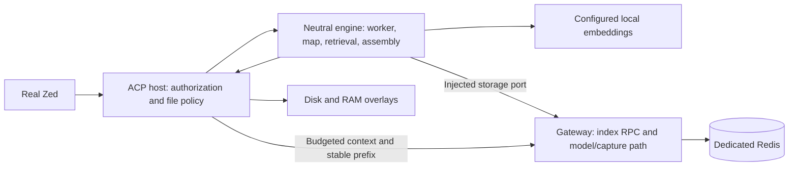

# Plan 12.10: Memory index, tools and first useful context (M1)

**File:** `docs/superpowers/plans/2026-11-03-plan-12-10-memory-index-and-context-implementation.md`  
**Issue:** #469 · **Implementer:** Claude · **Reviewer:** Codex, read-only CLI  
**Source inspected at main:** `d70fce26b8f585d75a9668982d6aa1c6a720a35d`, detached worktree `optimus-cost-agent-wt-claude-m1plan`.

## Operator summary

Give a cheaper configured model current task evidence. Finish with better context and tools seen in real Zed; Augment Code is the benchmark, not a parity claim. Deliver M1 in four checkpoints with early landings, opt-in; automatic memory, continuity, GraphRAG and `/why` follow later.



D1–D7 need operator decisions; tuning is agent-selected.

| Decision | Recommendation and alternatives |
|---|---|
| D1 — delivery | **One plan/landings, 13d:** #465 CP1 (~day 2), hybrid CP3 (~day 10), qualification CP4 (~day 13). Delays leave closure open, not early landings. Alternatives: final-only PR **13d**, delays #465; independently close M1a/context **8d** + M1b/qualification **8d**, repeats gates (16d). If split, #469 owns M1a; #235 holds M1b pending its issue. |
| D2 — attach | **Authenticated compatibility identity and request binding.** Same configuration across workspaces reuses. Per-launch ports simplify isolation but change ordinary configuration/lose reuse. Reject silent free-port selection: `OPTIMUS_GATEWAY_URL` is approved environment. |
| D3 — storage access | **Gateway-owned proxy**, subject to latency/throughput qualification. Direct unauthenticated loopback access avoids proxy cost but permits any local process to read/alter the index and bypass admission/scoping. Host-held ACL credentials violate the two-credential rule. Record the adapter-placement departure from spec §2 in the new ADR. |
| D4 — setup | **Opt-in at CP3 and closure.** Explicit artifact/ACL administration; ACP host starts the dedicated container from hash-only ACL configuration. No new agent CLI target, startup TTY or hidden download. Incomplete setup shows status and preserves today's context. |
| D5 — corpus | **This repo plus pinned Apache Hadoop with measured ≥1M eligible parsed Java LOC.** IntelliJ Community is a larger stress alternative. Operator chooses revisions, roots/test inclusion and resource/time envelope after the sample forecast; downloads/runs need separate release. |
| D6 — targets | **Pilot, then approved numeric targets before held-out evaluation/qualification; K2 bounds before its run.** Single-instance topology remains provisional; qualify separation in-plan if needed. |
| D7 — calls/cost | **Zero paid calls** for #465, setup, indexing, tool/protocol plumbing and P5-a. Separately release **≤24 physical model attempts / USD 2** for Zed comparison, including routing/retries, and **2 attempts / USD 0.25** for caching. Check configured prices/output caps before release; reduce work or obtain a revised release if bounds cannot hold. |

## Goal and authority

Deliver all v12 §7 M1/evaluation scope: hybrid index/generations/coverage, large benchmark/second K2; four tools; repo-map/model-aware hybrid context/caching/manifest/grounding; resumable worker. Resolve P1–P3 and P5-a; #465 first.

Authority: discovery v12 `33670c6b84aceccd629437c14f03609ba4293d70cde95b242dd93a2b0ad4fb14` (SHA-256), §§5.3–5.4a/5.6/7/12 lookup+branch/16.3–4/16.17 OQ-5/16.22 K2; `docs/superpowers/specs/2026-10-22-plan12-memory-design_v4.md`, SHA-256 `708e0e7831f6d4c56b5f6442cd37c4e02eecffd2659db04f3e6a6b1c54506ff9`, §§1–3/5 M1 limits/8 K2+K6/8.1.

Read ADR-001/005/025/031–035/index; feasibility README/qualification/probe-config/handoffs, evaluation/tools, durable-capture reports and archived 12.5–12.9. Private discovery/incident are provenance, never dependencies. ADRs take next free number per PR (036 today; recheck), record exact dated operator statements/options and separate mechanism/release authority.

### Explicit Exceptions

| Excluded work | Owning issue/roadmap entry and boundary |
|---|---|
| Accepted-memory Gate, notices, continuity/brief, import/export, backups/encryption, P5-b/c/d | #235 M3; M1's rebuildable index introduces no memory Gate. |
| `/why`, reranking, ambiguity/budget refinements | #242/#243/#245; #235 M2 for the remainder. Baseline fusion, model-aware fitting and manifest remain M1. |
| Dependency intelligence/intended-new symbols; L2; GraphRAG/graph-store/community benchmark; learning | #258 and #235 M5a; #235 M5b, M7 and M6 respectively. Structural indexing/early grounding and M1 scale remain in scope. |
| Broad telemetry; remote search routes | #303; #361/#362. Consume existing interfaces, do not implement their wider scope. |
| Comparative campaigns/generic harness expansion | #463. M1 supplies localization/retrieval gold, ablations and bounded Zed comparison. |
| Nonblocking sibling Redis/Phoenix attach residuals | #469 until operator-approved independent issues are filed before closure. Do not hold #465 open for them; absorb any actual M1 blocker. |

## Design choices

### #465: compatible attachment and visible refusal

The incident sent 26 unintended requests, USD 0.01436675. Replace `ensure_local_gateway` reachability with bounded authenticated `POST /v1/local/identity`: existing key, nonce-bound integrity/domain-separated fingerprints. Identity comes from actual verified serving config, not caller expectations; no secrets/environment snapshots.

Compatibility fields and reasons:

- Normalized upstream URL/provider/adapter: destination and request semantics.
- Upstream/shared-key fingerprints: billing principal/authentication; comparison must be stable across sessions, not a whole launch-manifest digest.
- Effective registry/routing, Auto and caching: admitted models/providers/controls.
- Test composition/Stage C envelope: prevents replacing a released stub/test path.
- Accounting enablement/configuration/root: capture destination and interpretation.
- Other explicit effective egress/tool-policy controls only when behavior differs.
- Exclude workspace/branch/security-snapshot/session/nonce/expiry: these authorize the host, not shared upstream behavior. Preserve existing test-profile owned-Gateway restrictions.

Compatible prior sessions and two workspaces reuse. Old/non-Gateway listeners, wrong keys, malformed/late/incompatible replies refuse with a stable reason, zero provider calls and no borrowed-process termination. Bind every potentially billable request to expected identity; reject mismatch before dispatch to close port-replacement races. Cover all model routes and strict/check-config/preflight/no-auto-start branches.

Diagnostic-only ACP refusal supports initialize/session creation, then first prompt displays reason/remedy in Agent Panel and `end_turn`; no model/preflight/discovery/execution. Zed can hide `refusal` behind a content-policy banner; stderr is insufficient. Prove visible refusal/two entries and compatible two-workspace reuse.

Sweep Gateway callers and Redis/Phoenix borrowing. Legacy Redis has the same service/data identity class, not the upstream billing gap; its default-port Docker-name check is not authentication. Fix blockers, assign independent residuals, and keep product-index lifecycle out of #465's standalone CP1 PR.

### Boundaries, Redis and production setup

`context_engine` owns neutral index/retrieval/map/worker/assembly; no Optimus/Gateway/security/evidence/model-policy imports. Host injects authorized reads/enumeration/overlay, namespace/storage/embedding, estimator/caps, cancellation/clock/telemetry. Extend existing context/engine/ACP attachment/automatic-workspace path, retaining protected history/admitted digest/fitting receipts/approval reuse. Absent/disabled engine preserves today's behavior; optional imports are lazy.

`POST /v1/context/index` implements bounded query/catalogue/batch/generation/coverage/cursor/lease/cleanup; Gateway owns Redis adapter/secret. No arbitrary commands/filesystem access. Agent-selected limits: 256 records, 1 MiB batch/reply, 5s deadline, two serving workers/bounded queues. Validate schema/vectors and paginate without blocking model/capture.

**Scopes are host-asserted:** Gateway authenticates the shared API key, enforces schema/limits/asserted scope/generation and seals cursors; it cannot identify the workspace. Trusted host binds registry/worktree/branch and FilePolicy/authorization; model cannot select scope. Malicious same-key hosts can assert another namespace, even in single-workspace use. Stronger authentication needs separate capabilities. Test host binding, changed-scope cursor denial and fresh-request residual.

Use a dedicated product instance/endpoint/container/volume/ACL, isolated from legacy Redis, tests and P3; logical DB separation is insufficient. P3 observed `redis:8` as 8.10.1 with Search/JSON/TimeSeries/ACL. Qualify a pullable digest/modules, not the mutable tag or P3's local image ID. Start with AOF `everysec`, periodic RDB, `noeviction`, logical/physical/disk budgets/reserve. Rebuildable data needs consistent generation/cursor recovery, not zero-loss durability: replay unconfirmed/lost batches; never label missing data complete. No SQLite/Postgres index hot path.

Extend `optimus-trust` one-time TTY administration: approve/download artifact source/revision/licence/digest/cache; provision least-privilege Redis password in Gateway's approved store. Restricted ACL file holds its hash, config nonsecret identities/reference. ACP runtime keeps only Gateway URL/API key, no Redis/provider secrets in env/argv/files/logs. Test separation/native keyring denial/absence.

**ACP host `local_infra.py` starts/restarts the dedicated container**, reusing current lifecycle helpers with approved image/port/volume/hash-only ACL file. No secret or already-running Gateway is needed; borrower launches can ensure it too. Concurrent ensure is idempotent for the released named resource; refuse unexpected container/listener/configuration, never adopt/replace. No-auto-start only verifies. Gateway resolves the password and checks authentication/modules/persistence/resource identity before serving; borrowers check health without a model call. Task 2 binds index configuration into Gateway compatibility.

Ordinary ACP IDE launch, after setup/opt-in/resource approval, ensures Redis/compatible Gateway and resumes worker; no startup TTY/download. Missing setup shows setup-required/today's context. Build shows coverage counts/lag/pause/error and uses the first indexed file. Redis outage pauses indexing with incomplete disk/literal fallback; healthy Gateway model service continues.

Owning host exit may stop a borrowed Gateway: borrowers pause RPCs, reconcile cursor/leases and show unavailable; no automatic takeover/new port. Redis/volume survive for later authorized compatible restart. Test this, not an invented shared daemon.

Pilot proxy query p95/assembly-budget share and bulk throughput at actual chunk count/dimensions under foreground load versus native storage on released disposable Redis. Unauthenticated direct access is benchmark-only. Freeze limits; optimize batching/pipelining/bounds then requalify. Failure blocks acceptance; credential/access-policy changes need approved successor.

### Index, worker, retrieval and tools

B1 permits identifiers, signatures, deterministic structural descriptions, relative paths/hashes, allowed documentation prose, vectors and pointers. No source bodies/docstrings/raw tool results in new persistent index/cache/journals/manifests. Documentation code uses Option A pointers/terms/vectors, no bodies. Literal search reads disk; results/selected-buffer overlays and their vectors stay RAM-only. Retain inversion-risk disclosure and existing governed diagnostic-capture exclusions/redaction.

Index/map construction uses Gateway storage RPCs/local embedding inference, **no generative/LLM/provider calls or generative computation**. Parse Python/Java/admitted docs; unsupported languages get listing/literal coverage, not parsed LOC. Lexical/dense plus observed structure/import/recency; no inferred edges/GraphRAG. FLAT first; HNSW needs measurement.

Key generations by registered project/common-Git-dir identity, worktree/branch/revision/dirty state and policy/parser/embedding/schema versions; clones stay separate. Publish coherent membership/coverage atomically. Invalidate changes/new callers; pin query generation, verify selected disk hashes and retry reconciliation at most twice before incomplete status. Wrong/stale branches never become current evidence.

Worker persists payload-free progress/fenced leases/idempotent batches; cancel/exit/outage pause/resume. Initial config: one orchestration thread, ≤2 native embedding threads, bounded batches/background priority/cooperative foreground yielding, not ACP-wide priority reduction. Bound backend pools; machine cold-build admission/workspace fencing prevent saturation. Open/named/changed files first, then catalogue.

Measure foreground/cancel responsiveness versus idle. If forecast exceeds machine bounds, reduce load or obtain a smaller qualifying corpus/subset release; retain failure and ≥1M parsed-Java criterion.

Seed bounded repo-map; RRF lexical/dense/structure/recency/eligible-memory then utility/stable ties. Memory channel is empty absent an authorized source, no M1 store. Initial RRF 60/configured weights freeze before evaluation; score is not confidence.

Order protected state → applicable user constraints → required evidence → optional context; expand map → signatures/descriptions → verified bodies. Budget the full rendered request with configured estimator/context limit, reserve output once; required overflow is incomplete preparation. Report searched/omitted/unsupported/stale/truncated scope; negative claims cover only inspected scope.

Manifest records source/route/config, selections/hashes/symbols, generation/coverage, ranks/reasons, budget/omissions/grounding, no historical packs. Verify files/symbols; expose unresolved/ambiguous references. Intended-new/version grounding stays #258; `/why` M2.

SEARCH/OUTLINE/SYMBOLS/LIST use existing canonical dispatch in Plan/Chat and Agent with actual ACP tool-call/result updates, no new MCP server. Apply authorization/`PreToolGuard`/FILE_READ/`FilePolicy.decide(..., purpose=automatic|index|anchor)`, time/byte/result/cancel/duplicate/no-progress/Agent-loop bounds. Capture name/parameters/summary/latency/policy/auth/session/run/call IDs; tool content never becomes policy.

Chat's agent-selected cap is **4 read-only rounds then one tools-disabled final answer**. Give model limit/coverage observation and user visible incomplete scope; no fifth round or mutation/directive execution. Update feature-enabled advisory/hostile-directive/mutation-denial/attribution cases in `tests/unit/agent/test_plan121_chat_runner.py`; disabled mode keeps its one-call contract.

P5-a: advertised `fs.readTextFile` gates `fs/read_text_file`; require exact known dirty hash and saved-buffer control. Prove selected-buffer RAM overlay consistent across tools/assembly/grounding; version/hash invalidates preparation/RAM vectors, nothing persists, no global unsaved search. Unsupported/inconclusive/unreleased ships explicit disk-only fallback in `zed-ui.json`; client probe alone proves no production integration.

### Embeddings, provider caching and packages

Embedding artifact/backend/identity/dimensions/input limits are configuration (ADR-025), with any default/provenance/licence only there. Offline local load; absent dense visibly falls back, no download/new credential. Hybrid acceptance requires qualified dense; P2 selects no model.

Cache layout stabilizes instructions/tool schema/map/unchanged prefixes, puts volatile IDs/timestamps/task text later, preserves protected-state fitting. Optional route `prompt_cache: none|implicit|top_level` drives Gateway behavior without per-model code. Absent/none is today's wire behavior; top-level mode emits approved root `cache_control` after `flatten_messages_to_input_text`/final single-user rendering, separate from `provider_controls`. Preserve endpoint pinning/fallback/parameter controls and exact behavior for noncacheable routes.

The cheapest qualified route requires explicit control; implicit alone is insufficient. Qualify the configured endpoint; block-only routes stay uncached absent separate implementation. Recheck [OpenRouter caching](https://openrouter.ai/docs/guides/best-practices/prompt-caching) and [provider selection](https://openrouter.ai/docs/guides/routing/provider-selection) before release. Preserve old registry/route/payload digests when absent; opt-in cache config enters identities. Change serialization/binding together, not historical fixtures. Zero-paid checks prove layout/wire/pinning; released cold/warm pair proves actual provider behavior, not guaranteed hits.

M1 leaves capture schema unchanged: `prompt-cache.json` records `cache_write_tokens: null`/`not_captured`, cached usage and both reported costs. Writes can cost more; no category-complete savings or price-derived tokens. All model calls/retries/final synthesis use existing durable capture.

Proposed optional memory packages: tree-sitter 0.26.0, Python grammar 0.25.0, Java grammar 0.23.5 (MIT); rustworkx 0.18.1/fastembed 0.9.1 (Apache-2.0); measurement-only psutil 7.2.2 (BSD-3-Clause). Add only actually used packages; existing redis-py, no RedisVL/community stack. P1 proves isolated Windows 3.14, not combined production/Linux. Requalify wheels/transitive licences/digests including stemmer qualification, preserve `Pillow>=12.3,<13` despite P1's newer isolated major. `pyproject.toml` is Plan 11.7 custody input: retain historical fixture hashes and prove current resolution separately.

## Prerequisites

Task 0 resolves all unknowns before dependent work.

| Requirement | Satisfied today? | Owner | If unsatisfied: genuinely hard, or merely unauthorized? |
|---|---|---|---|
| Number/issue, D1–D7, exact-hash approval | no | Operator; Claude files | merely unauthorized — obtain in Task 0 before Task 1. |
| File policy/registry, assembly, durable capture | yes | Existing owners | Source foundations exist; M1 composition is below. |
| Attach protection/M1 production setup/runtime | no | Claude #465/#469 | genuinely absent — implement Tasks 1–4. |
| Combined packages, Windows 3.14/alternate OS | unknown | Operator machine-state; Claude | genuinely hard — inventory Task 0, qualify Task 2. |
| Docker/image/modules/ports, ACL/native keyring/TTY | unknown | Operator machine-state; Claude | genuinely hard — inventory Task 0, release/prove setup Task 2. |
| Licensed local artifact/offline backend | unknown | Operator; Claude qualifies | genuinely hard — establish availability Task 0, provision Task 2. |
| Eligible corpus/revision and resource/time envelope | unknown | Operator; Claude measures | genuinely hard — candidates/access Task 0; sample forecast Task 3 before large release. |
| Zed/acpx versions, trusted projects/two entries/GUI | unknown | Operator types; Claude launches | genuinely hard — inventory/schedule Task 0; release before proof. |
| Cache route/pinning/prefix/prices | unknown | Operator; Claude | genuinely hard — docs/config/bounds Task 0; wire Task 4 before paid Task 5. |
| Live/download/keyring/paid/publication releases | no | Operator | merely unauthorized — each resource/session/budget/GitHub/push/PR/merge separately. |

## Files and inventories

New names are planned; keep engine modules flat or update its scanner.

| Surface | Files and mandatory inventory joins |
|---|---|
| Host/engine | `src/optimus/acp/{__main__,local_infra,bootstrap,spec,context_attachment,launch_approval_cli}.py`; existing context/agent/workspace paths; neutral index/retrieval/map/worker in `src/context_engine/`, host adapter in `src/optimus/context/`. Establishing-import additions only join `tools/probe_p11_zed_session_load.py` closure/source pins. |
| Gateway/config | New `src/optimus_gateway/{local_identity,memory_index}.py`; server/transports/upstream, model-policy registry/binding/defaults, `src/optimus_security/launch_manifest.py` and trusted config. Update every route/auth/dispatch inventory, dependency lock/custody checks. |
| Tests/evidence/sinks | Existing focused suites; planned `tests/unit/context/test_memory_workspace.py`, `tests/unit/optimus_gateway/test_memory_index.py`, `tests/integration/context/test_memory_index.py`; `tools/plan12_memory/`, separate M1 gold/reports. New sinks join `docs/superpowers/reviews/2026-07-15-plan-9-96-logging-surface-audit.json` (`ensure_ascii=True`). |
| Scanner/process/docs | New walkers need `test_tracked_file_scanners` reasons; Git listings join `_INDEX_LISTINGS` in `test_tracked_repository_files.py`. Child sites join `tests/unit/tools/run_context_child_sites.json`, applicable `_REVIEWED_CHEAP_LAUNCHERS`/classification and `tests/profiles.toml` parallel serial list. `sys.platform` tests get `platform`; markers join run-context/profile lists. Update ADR/index, docs index and ADR-022 pointer; checkpoint log stays gitignored. |

## Tasks and verification

Use TDD, all design cases, real boundaries/class sweeps/revert checks, frozen environment and live releases. New paths are task outputs.

### Task 0 — authority and attainable evidence

- [ ] Read AGENTS/CONTRIBUTING, checkpoint log and authorities; verify HEAD/status/worktree registry. Ask the required worktree/branch question before implementation; use latest-main contributor branches. Save plan, obtain number/issue, D1–D7, exact-hash approval and filing/label authority before Task 1.
- [ ] Establish every unknown prerequisite: environment/WSL, Docker/modules/ports/keyring, offline artifact, eligible corpus/access, Zed/acpx/trust and cache route/prices. Record availability versus authority in `manifest.json`; no dependent evidence until satisfied. Use `Get-FileHash -Algorithm SHA256`, `git status --short`, `git rev-parse HEAD`, `git worktree list --porcelain` and read-only inventories.
- [ ] Prepare ADR/docs/ADR-022 filing and labels `priority:high`, `handler:claude`, `difficulty:high`, `estimate:13d` under approved writes.

### Task 1 — #465 standalone landing (CP1)

- [ ] Implement identity/request binding and diagnostic-only visible refusal; cover every compatibility field/exclusion, startup/model branch and owned/borrowed lifecycle described above. Test old/non-Gateway/malformed/wrong-key/timeout listeners, port replacement, same-session reuse and **two workspaces/same configuration**. Use native HTTP/Gateway/ACP composition; revert guard to prove failure. Sweep sibling attaches; disposition residuals.
- [ ] Release dedicated port and each real Zed session. With **two configured entries** and controlled zero-paid upstreams, operator types prompts in the failing launch order: mismatched configuration refuses visibly before upstream use; compatible configuration reuses across two workspaces. Capture reason/success screenshots, ACP/debug/listener identities and zero-provider-call evidence. Protocol checks use real acpx.
- [ ] Run focused/new identity checks plus `uv run --no-sync pytest --no-cov tests/unit/acp/test_local_infra.py tests/unit/acp/test_local_infra_model_registry.py tests/unit/acp/test_main_wiring.py tests/unit/acp/test_bootstrap.py tests/unit/optimus_gateway/test_server.py tests/unit/optimus_gateway/test_upstream_client.py -q` and Ruff. CP1 gates **separate #465 PR**, Linux PR CI and operator merge; close #465/remove `status:`. No index lifecycle in this PR; residuals do not hold it open.

### Task 2 — packages and ordinary setup

- [ ] Implement setup/lifecycle/storage design and every stated lifecycle/credential/offline-load/refusal case, including borrower/Gateway-not-up/concurrent launches; verify model/capture responsiveness. Qualify combined Windows 3.14/Linux packages/licences/digests/Pillow without changing custody fixtures.
- [ ] Real filesystem/keyring/Redis tests prove route/auth/framing/ACL/admission/atomic-state, engine/absence and host-scope/cursor contracts, including the same-key residual.
- [ ] Run `uv run --no-sync pytest --no-cov tests/unit/context_engine/test_boundaries.py tests/unit/context/test_memory_workspace.py tests/unit/optimus_gateway/test_memory_index.py tests/unit/tools/test_run_plan117_custody_feasibility.py tests/unit/tools/test_verify_plan117_custody_feasibility.py -q`; then `uv run --no-sync pytest --no-cov -m requires_plan12_index_redis tests/integration/context/test_memory_index.py -q`. Register the new dedicated-resource marker; no fake/shared Redis substitute.

### Task 3 — index/worker and pilot (CP2)

- [ ] Implement index/map/worker/adapters; real FS/Redis test first-file publication, edit/delete/rename/policy changes, branch/worktree/clone/new-caller/dirty isolation, competing writers, cancel/kill/restart/partial generations. Revert generation/membership/hash guards with positive controls.
- [ ] Scan real keys, AOF/RDB, journals/cache/manifests before/after rewrite/restart for distinctive source/raw-result/doc-code/overlay canaries, including escaped encodings; allowed prose/structural records are controls.
- [ ] Count **eligible parsed LOC per language**, files/chunks and exclusions at exact roots/revision. IntelliJ is stress scale: JetBrains reported 3.6M compilable Java LOC already in 2016 ([measurement](https://intellij-support.jetbrains.com/hc/en-us/community/posts/205415750-How-many-lines-of-code-in-IDEA-ultimate)). Smaller Java alternative Hadoop has a published 1,753.94 K source-LOC measurement ([study, Table 1](https://www.hengli.org/pdf/Zhang2022TestLog.pdf)); neither historical count proves current M1-policy eligibility. Unsupported Kotlin/other LOC cannot meet parsed-Java coverage.
- [ ] P2's **short synthetic texts** ran ~89–100 items/s; real code is slower. Hypothetical 35–60k chunks gives only an optimistic embedding-only 6–12-minute illustration, excluding parse/storage/yielding, **not an IntelliJ forecast**. Sample representative real chunks with production thread/adapters first; replace this with actual chunk-count/end-to-end wall-time/resource forecast before seeking the large-run release.
- [ ] Add/run `uv run --no-sync python -m tools.plan12_memory.m1_scale --phase pilot --config reports/plan12-memory-m1/run-config.json`. Measure proxy/native query p95 and bulk throughput, assembly share, cold/incremental/reconciliation time, lag/fan-out/concurrency/CPU/threads/RAM/disk/recovery; real acpx turns/cancellation during cold build versus idle. Freeze operator-approved numeric performance/K2 targets. CP2 reviews Tasks 2–3 and D3/D5/D6 feasibility.

### Task 4 — useful context/tools (CP3)

- [ ] Wire context/grounding/manifest/four tools in both modes; verify all assembly/policy/loop/absence cases above with overflow/hostile/stale controls.
- [ ] Wire/test every cache mode/hash/binding/pinning/flattened-wire/override/unsupported case above; revert layout/cache propagation/Chat bound to prove discrimination.
- [ ] Run `uv run --no-sync pytest --no-cov` over new tool/workspace/overlay/cache cases and `tests/unit/agent/test_plan121_chat_runner.py`, `tests/unit/context_engine/test_boundaries.py`, `tests/unit/optimus_gateway/test_model_policy.py`, `tests/unit/optimus_gateway/test_upstream_client.py`; preserve root conftest/selection.
- [ ] Released real Zed uses **ordinary production setup**, no test provisioner: operator types, Claude launches/captures. Show setup-required, first prompt while cold build is partial/usable, and all four actual tool cards. Prove P5-a exact dirty/saved controls plus production overlay, or record disk-only fallback. Zero-model plumbing is not quality evidence.
- [ ] CP3 gates **opt-in PR**, Linux CI/operator merge; #469 stays open for Task 5. Continue from latest main.

### Task 5 — qualification and visible benefit (CP4)

- [ ] Preserve original **88 cases**, independent grader axes and 12 chronological seeds (4/4/4). Separate M1 gold: Claude drafts, Codex verifies cutoff/source labels, operator seals held-out before tuning; no future leakage or retrieval-selected gold. Run `uv run --no-sync python -m tools.plan12_memory.evaluate --validate-only tests/fixtures/plan12_memory` and the separate M1 directory; add/run `tools/plan12_memory/m1_evaluate.py` for context-off/lexical/dense/hybrid fixed-route/budget ablations. Report recall@5, required evidence, irrelevant tokens, coverage and wrong-branch/stale failures independently against frozen targets.
- [ ] Run `uv run --no-sync python -m tools.plan12_memory.m1_scale --phase qualify --config reports/plan12-memory-m1/run-config.json` on this repo and approved ≥1M eligible parsed Java LOC. Second K2 uses production adapters/real records and predeclared count/dimensions/concurrency, RAM/disk/reserve, append-ack/projection p95, restart/purge/physical-erasure bounds. Exercise canary append/projection under burst/slow persistence/AOF rewrite/crash/restart/noeviction. Retain failures; qualify separated event/projection instances if necessary or obtain successor. This does not prove M3 UX/encryption.
- [ ] After merged #465, release paired **real Zed** Chat localization/Agent planning on the cheaper qualified configured route; operator types fixed tasks. Match revision/workspaces/route/tools/inputs context-off/on; capture selected evidence, grounded answers, tools, partial-build/responsiveness states, screenshots, ACP/debug and durable usage. Require visible improvement in ≥1 task and no critical regression in either; fix/requalify within released budget otherwise.
- [ ] `zed-ui.json` records P5-a status/version/capabilities/hashes/production-or-fallback, first-file coverage and exit/resume. acpx proves protocol, not UI.
- [ ] Release/run pinned cache pair with sufficient prefix; record hit/usage/latency/**both** costs/capture IDs/unknown writes. Missing hit/release is not a pass.
- [ ] Run inventories below and **one final-head Windows full suite/coverage from PowerShell**, validate active/native context/products/Ruff. Later code invalidates acceptance; operator disposition before repeating. CP4 reviews evidence/freshness; final PR CI is Linux.

```powershell
uv run --no-sync pytest --no-cov tests/unit/tools/test_verify_plan996_logging_surfaces.py tests/unit/guardrails/test_tracked_file_scanners.py tests/unit/tools/test_tracked_repository_files.py tests/unit/tools/test_run_context_child_sites.py tests/unit/tools/test_test_profiles.py tests/unit/tools/test_probe_p11_zed_session_load.py tests/unit/docs/test_docs_index.py tests/unit/docs/test_plan_directory_hygiene.py tests/unit/docs/test_open_work_pool_hygiene.py -q
uv run --no-sync python tools/check_product_coverage.py --run-full-suite --groups tools/product-coverage-groups.json --report-json tmp/coverage/product-coverage-report.json --coverage-json tmp/coverage/coverage.json
uv run --no-sync python -m tools.testing.coverage_products validate --coverage-json tmp/coverage/coverage.json --gate-report tmp/coverage/product-coverage-report.json
uv run --no-sync ruff check .
```

## Checkpoints and execution rules

| Checkpoint | Review/landing |
|---|---|
| CP1 | Task 1: identity/refusal/two-entry Zed; standalone #465 PR/CI/operator merge. |
| CP2 | Tasks 2–3: setup/packages/real storage/worker/B1, forecast and frozen targets. |
| CP3 | Task 4: context/tools/Chat/cache wire/partial UI/P5-a; opt-in PR/CI/operator merge. |
| CP4 | Task 5: retrieval/scale/K2/Zed benefit/cache, final Windows coverage/Ruff/Linux CI/freshness. |

Use AGENTS.md's CLI/model/effort and verbatim review-posting rules. Claude owns chat/checkpoint log. Codex acceptance counts as the operator's **review verdict**, not execution authority. **Fable is optional at Claude's judgment. No additional per-task reviews or checkpoint full suites apply.**

Focused tests/local commits between checkpoints; skip only hook pytest, retain all other hooks/Ruff. GitHub writes except authorized review posts, commit/push/PR/merge need operator OK; update from main before push, no feature-parent branches. Platform-shaped changes need real alternate-OS evidence (WSL2 where available), distinct from Linux CI.

Each Docker operation/container/Zed session/download/keyring operation needs its release; each paid envelope is named and includes retries. Before #465 lands, zero-paid Zed needs a dedicated port and first-prompt actual-listener/upstream gate. After landing retain dedicated proof ports and identity check.

## Definition of Done and evidence discipline

Follow AGENTS.md **Parallel tests and evidence attribution**. JSON uses `hex:<digest>` and `ensure_ascii=True`. Repository-visible reports in `reports/plan12-memory-m1/` bind targets/releases/logs; private/raw provenance follows artifact policy. No source-body/historical-pack store.

| Required claim | Named evidence with real dependencies |
|---|---|
| Safe attach and visible reason | `gateway-attach.json`: native Gateway HTTP, two-entry/two-workspace Zed/screenshots/ACP/debug, zero paid/provider use, #465 PR/merge/CI. |
| Ordinary setup/two-credential/optional behavior | `setup.json`, `packages.json`: Docker/Redis, isolated native keyring, offline load, Windows/Linux combined packages, absent-feature controls. |
| Coherent resumable policy/B1 index | `index-worker.json`, `persistence.json`: real FS/Redis/AOF/RDB canaries, host-asserted scope/cursors, branch/new-caller/crash/resume. |
| Qualified scale/proxy/topology | `scale.json`, `k2.json`: eligible LOC/language/chunks, sample forecast, ≥1M parsed Java corpus, production adapters/predeclared bounds and foreground responsiveness. |
| Useful hybrid context/tools | `retrieval.json`, `zed-ui.json`: sealed gold/ablations, operator-typed Zed/screenshots/logs, first-file coverage, four tools/Chat cap/grounding/P5-a. Zero critical authority/B1/wrong-branch/stale-evidence failures. |
| Honest provider caching | `prompt-cache.json`: wire tests plus real released pinned pair, reported usage/both costs and unknown writes. |
| Delivery gates valid | `qualification.json`, `execution-context.json`: focused/class/revert/inventories, exact final Windows active full suite, ≥80% aggregate production coverage/required product floors/no safety regression, Ruff, checkpoint verdicts and landing/final Linux CI SHAs. |

## Closure

Under approved writes, close #469/remove `status:` after terminal delivery and named residual custody; preserve #465's independent closure. File sibling residual issues before plan closure, no placeholder owner. First plan PR adds docs index/ADR-022 issue pointer; later landings keep them current.

Before closing commit and again before merge, Codex audits all affected current-state claims: README/roadmap/issues/register/docs and decision indexes, not only touched entries. Archive terminal plan byte-for-byte, repair mutable references/index in the same change; frozen files receive only permitted mechanical path repairs. Preserve predecessor/ADR/approval bytes; cleanup separately released.

**Assessment:** proposed `difficulty:high` — credential reuse/generation coherence/client-resource boundaries. `estimate:13d` — 2d attach + 4d setup/index/pilot + 4d context/tools + 3d qualification/closure, excluding approval waits; re-estimate per checkpoint.  
**Unqualified risks:** package combination, real-corpus K2, Zed buffers and provider caching require their stated proofs; failed/unreleased required evidence keeps closure open.