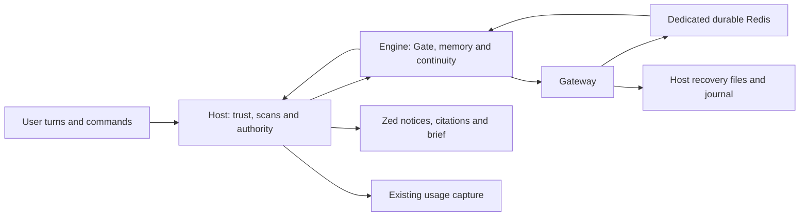

# Plan 12.11: Memory and continuity (M3)

## Operator summary

Deliver automatic, checked memory that a person sees remembered, cited and forgotten in real Zed, with cross-session continuity and a welcome-back brief. Knowledge never expires through inactivity. There is no review queue.

Split M3 into two plans. Include plaintext recovery export and restore here; leave backups, cloud, encryption, rotation, recovery channel, import and pilot to the later plan. Closing this part closes neither M3 nor #235. Do not add a replacement loop, replay store, model picker, Postgres mirror or learning service.



| Decision | Recommendation and alternative |
|---|---|
| D1: Split | **Allow 16 working days here and 12 later**, excluding waits. All M3 needs approximately 28 days and is too large for four useful checkpoints. |
| D2: Redis | **Use a separate instance behind Gateway.** Sharing index Redis needs capacity isolation it does not enforce. Memory cannot be rebuilt from files. |
| D3: Extraction | **Run concurrently with or after the answer.** Prefilter turns without candidates and freeze latency, calls per 100 turns and cost forecasts. |
| D4: Display | **Use qualified host cards or appended host text.** Show the brief after seven days and through `/welcome`. Pre-prompt display is optional; neither surface is confidential. |
| D5: Recovery | **Add export and restore now for three extra days.** This moves M21 and export erasure here and better meets the cornerstone bar. The 13-day alternative has no copy and loses everything on volume loss. Declined sync consent still disables export and shows that risk. |
| D6: Model switch | **Do not force new route qualification for closure.** With one eligible shipped route, use controlled bindings. If no second real route qualifies, actual-model proof stays UNRUN with the later issue as owner. Operator acceptance permits this part to close, not an M3-wide claim. Alternatively block closure on qualification of unknown duration. Run an available qualified route under separate release. |
| D7: Releases | **Release operations separately.** Hash approval grants no service, credential, Zed, paid, publication or merge authority. |
| D8: Recovery boundary | **Use one confirmed location per project and refuse healthy non-empty restore targets.** Export active payloads only, clean withdrawn copies, verify Git exclusion and disclose shell and sync limits. |

These agent-selected mechanisms govern; changed scope or gates need a successor before Task 1. Propose `priority:high`, `handler:claude`, `difficulty:high` and `estimate:15d`; state **16 working days** in the issue body. Difficulty reflects trust, durability and restore. The estimate allocates three days to setup, four to store and Gate, five to integration and recovery, and four to qualification. Re-estimate at checkpoints.

## Goal and authority

**Issue:** #TBD under #235; operator confirms the number. **File:** `docs/superpowers/plans/2026-11-16-plan-12-11-memory-and-continuity-implementation_v2.md`.

**Source inspected at main 5b28b2b:** branch `agent/claude/plan12-11-m3-plan`, HEAD `5b28b2b19b0a665484d04614044bd87abe179eef`, no reported changes; 12.10 is last numbered plan found.

Authority: discovery v12 SHA-256 `33670c6b84aceccd629437c14f03609ba4293d70cde95b242dd93a2b0ad4fb14`, section 7 sole slice table; [design v4](../specs/2026-10-22-plan12-memory-design_v4.md), rechecked `708e0e7831f6d4c56b5f6442cd37c4e02eecffd2659db04f3e6a6b1c54506ff9`, sections 2-6, memory accounting 7, K1, K2, K5, K6, 8.1 and 9; ADR-001, 005, 012, 025, 031-033 and 036-041 with [index](../../decisions/README.md); archived 12.10 v3/v1, 12.7 v4 and current memory reports/code.

Claude implements and owns chat; Codex reviews read-only. Save outside the repo until exact-hash and decision approval before Task 1. Follow Superpowers and AGENTS. ADR-042 is free here; recheck at filing and record topology, commit, recovery, alternatives and authority. Frozen predecessors remain unchanged; private provenance is never a dependency.

**Successor provenance (2026-11-17):** The operator approved the predecessor's SHA-256 `77a7aec144b7b85ad379ff59bdb95912411b7753e6b3338628aa09e2f995824d` and D1-D8 on 2026-11-16: “Approve hash” ([approval record](https://github.com/vibhanshu-agarwal/optimus-cost-agent/issues/490#issuecomment-6921405051)). Codex [CP1 review 1](https://github.com/vibhanshu-agarwal/optimus-cost-agent/issues/490#issuecomment-6929082919) recommended `appendfsync always`, retaining same-connection WAITAOF and the unchanged CLIENT ID check. Under the operator's standing rule of 2026-10-03, reaffirmed 2026-10-28, a Codex recommendation carries the operator's approval. This is mechanism approval; D7's separate releases remain unchanged.

V2 becomes authoritative when committed with its Live implementation plan registry row updated to this file. The predecessor stays as the approved original, immutable; archive it byte for byte when v2 becomes authoritative. Original intake, source and prerequisite statements above and below remain planning-time context; #490 binds the original #TBD and #491 owns the later M3 part. This successor changes persistence only and clarifies the Task 1 recovery shapes and Task 4 Q3/Q4 acceptance; scope, decisions, checkpoints, estimates, releases and budgets remain unchanged.

## Scope and Explicit Exceptions

In scope: automatic and compaction-time Gate; lifecycle/conflicts; durable events, projection, acknowledgement and retry; withdrawal/purge; commands, notices and citations; checked assembly; checkpoints, lookup, handoff and brief; scheduled/on-demand Agent Memory Repo export, journal and restore; real-store and real-Zed proof. Anything not excluded remains in scope.

| Explicit Exception | Owner and obligation |
|---|---|
| Backups, cloud, daily snapshots, 30-day rotation | **Later M3 plan under #235, Claude.** Off by default; other-drive warnings, cloud consent and erasure boundaries. Here: same-drive recovery only. |
| Encryption, rotation, channel, encrypted restore and encryption-key retirement | **Later M3 issue.** Design 6.1-6.2 and encrypted 6.3, P1, P5-d, M22-M24 and native K5-R1/R2. |
| Import, import K1/round-trip controls and consented 20-30-item pilot | **Later M3 issue.** M13, M18-c, OC-2 isolation, private-source custody and optional ceiling. Export stays here. |
| Strength decay, consolidation and Postgres archive | **#235 M6.** Original M20 decay assertions; no-expiry/no-promotion checks stay here. |
| Model-callable `RECALL` | **#235 M2.** Automatic assembly and `/memory` suffice here; existing four model tools unchanged. |
| Actual second-model evidence without a qualified route | **Later M3 issue under D6.** Controlled-binding implementation/tests stay here. |
| `/why`, ambiguity and ranking/budget refinements | **#235 M2; #242, #243, #245.** Baseline ranking/fitting stays here. |
| Graph and decision linking; dependency intelligence | **#235 M7; #258 and M5a.** Invalidation IDs only here. |
| Broad telemetry, savings and general benchmark campaign | **#303, #248, #463**, respectively. |
| Conversation/live-approval replay | **P11-FEAT-ZED-RESUME**, existing session-load lane. |

File remainder custody under #235 before Task 1; no second pool or later number.

### Later-plan security contract

Excluded security, copy and import obligations move whole; Task 0 files their full design-v4 and M3 acceptance checklist in the later issue.
The recovery channel requires proven mediation of every enabled automatic, file, native, MCP and shell path on Windows and Linux; otherwise the channel, encryption and rotation stay visibly unavailable.
`cryptography` is not added here; later P1 requalifies its licence, Windows CPython 3.14 wheel and Linux support while preserving historical custody fixtures.

## Design choices

### Package, credential and setup boundaries

Neutral engine owns contracts, Gate, folding, applicability, ranking and continuation; no host, Gateway, security, evidence or model-policy imports. Inject typed ports, not keys or Redis commands. Host owns canonical inputs/lineage, trust, registry, FilePolicy/scans, user actions/notices, files/journal, authority and final sanitization. Gateway owns Redis credentials/connections and authenticated recovery data.

Engine absence preserves today's floor; outages degrade independently, never stop ordinary work or create authority. Lost/corrupt registry requires recovery.

Use container `optimus-memory-store-redis`, volume `optimus-memory-store-data`, loopback `6394` and M1 image `redis@sha256:298e5b3bc566bade82f46ad5511777a4a07a294097ce16ada2f6a42be5239df5`. Proposed limits: maxmemory 512 MiB, container 1024 MiB, noeviction, AOF `appendfsync always` and periodic RDB. Verify version, WAITAOF, persistence and resource at open/reconnect. No SQLite, shared test Redis or mirror.

Add `optimus-trust memory-setup --store` without changing index setup. Bind config, hash-only ACL and resource to approval, manifest and Gateway identity; absent config preserves identities. Reuse ADR-037 topology/concurrency checks; never adopt unidentified resources.

Only new keystore secret: **Gateway's generated Redis ACL password**, service `optimus-gateway-memory-store`. Tests use isolated password entries, never encryption keys. Host keeps URL/key only. Qualify Windows Credential Manager and Linux Secret Service; CI without Secret Service proves unavailable.

Same-key hosts can assert another scope; test this residual and cursor binding. Dedicated setup uses neither shared `ensure_local_redis` nor index Redis. **Task 4 checks merged #487's run-ID reuse/refusal, including no-auto-start; do not redo #480.** Authenticate dedicated identity beyond TCP. #488/Phoenix is unnecessary; #486's record-replace retry is merged. Validate Windows records.

### Durable commit and capacity

One stream is authoritative. Events bind immutable project, item, version and event IDs, expected version, idempotency, origin, status, scope, anchors, lineage and bitemporal validity. Projection, version, dedupe, notice and checkpoint indexes rebuild.

One monotonic fenced lease reconstructs lookup at verified head before admission. Check expected version/idempotency there, not in serving projection. `WATCH` and `MULTI` validate lease, fence and head with **one event append**; lease bookkeeping is separate. Lost lease or moved head prevents publication; no multi-key rollback claim.

Hold the **same physical connection** through append/EXEC and separate `WAITAOF 1 0 <timeout>`; compare local count >=1. Serve only confirmed matching projected versions. AOF-off, unsupported/malformed replies or fsync failure disable admission, never weaken durability. The unchanged `CLIENT ID` check remains part of the per-write proof; `appendfsync always` does not replace it. If watermark publication cannot establish availability, report projection pending.

Timeout is unconfirmed. Retry same key/digest reconciles existing event and verifies persistence on its connection; no second logical mutation. Different payload conflicts; no hidden retry loop.

No accepted-record, checkpoint or deletion TTL/eviction. Proposed ceiling: 384 MiB logical plus 128 MiB reserved for deletion/control. Refuse new saves visibly, preserve knowledge and report history/off-archive growth; measure RSS, COW and disk separately.

Freeze K2: 100k events, 10k live items, four clients; ack p95 <=1.5 s, projection-after-ack p95 <=250 ms, restart <=60 s, logical purge <=1 s after confirmed tombstone, rewrite/snapshot <=120 s, RAM <=1 GiB, disk <=4 GiB. Include slow persistence and separate index rebuild; preserve misses. Zero acknowledged loss covers tested crashes with volume intact, not hardware or volume loss.

Preserve the released-test-store evidence: 50 consecutive confirmed saves under `appendfsync everysec` took p50 1.003 s, max 1.006 s (run `20261116T201743-42348-455d0c`); WAITAOF waited for the next periodic fsync, so one serialized writer per Gateway confirmed about one save a second. Under `appendfsync always`, 50 consecutive confirmed saves took p50 8.7 ms, p95 11.7 ms, max 15.6 ms (run `20261116T204113-43152-751697`). These sequential measurements do not establish K2 acceptance. Its thresholds remain unchanged; K2 must still measure contention, slow storage and watermark loss/reconstruction under `appendfsync always`.

### Gate, extraction and accounting

Gate alone writes; no model mutation. Every candidate, command, edit and switch-on passes the existing tool-output injection scanner, secret, B1 and source-overlap checks and origin, speech-act, span, scope, revision and conflict validation. Blocked payload never persists.

User extraction sees sanitized raw user blocks and host spans only. Assertions, preferences and decisions support origin; questions, hypotheticals and quotations do not. Retractions identify withdrawal/supersession; ambiguity goes off. Agent extraction sees completed work and host evidence with transitive lineage: optional episode, procedure or lesson only. External, document or tool directives, gaps and user conflicts go off, including followed README instructions. Repetition, tests, compaction, pinning, type and citations never raise trust; only user origin constrains.

Off records contain pointer, origin, scanned title/reason, no payload; active cap 200 and 512 KiB per project, recoverable unserved archive overflow and growth alert. No inactivity deletion. Switch-on repeats deterministic exact-source extraction/scans without raising the optional ceiling. Absent/RAM-lost source refuses; never mine diagnostics. Untrusted workspaces are read-only. User updates supersede with history, stale versions never overwrite. Compaction uses covered raw spans before release, never summary_text; digests/watermarks dedupe, gaps stay off/unavailable.

Extract concurrently or after answer dispatch: current user text is already in its prompt. Bounded workers own settlement; stale results recheck head/conflicts. Agent extraction follows completed evidence. Deterministic prefilter skips empty turns, commands, acknowledgements, status-only turns, pure questions without assertions, extracted spans and agent results without new evidence. Known hostile/quoted content can yield off metadata without inference. Ambiguous assertions proceed; test paraphrases/retractions against omission.

Allow one user request `memory.extract_user` and one agent request `memory.extract_agent`. Compaction `memory.compaction` shares the user slot; no third call. Commands, switch-on, checkpoints, brief and recovery use zero inference; ambiguous switch-on refuses. Use configured summarization role and `stage=summarization` through existing GatewaySummarizerCall, capturing/CaptureIntent, TurnSettlement and durable capture, with purpose in receipts. No new debit or automatic extraction retry.

Cap each request at 8,192 estimated input tokens including framing and 512 output. Registry USD 0.50/M input and 2.50/M output gives **USD 0.001664** for a 2,048/256-token planning call, **USD 0.0003328 per turn** at 20 calls/100 turns (USD 0.03328/100), and **USD 0.010752** for two capped calls. Zero-paid workload forecast, not measured charges/universal bound; reprice approved registry before release.

Freeze targets.json: sealed 100-turn mix, expected 12 user and eight agent calls, <=20 calls/100 turns; added first-response p95 <=100 ms versus off, settlement p95 <=3 s, inference latency separate. Record workload/token assumptions; production frequency unknown. Match route/inputs and include failures; no retrospective target/case changes.

Failed, cancelled, malformed or uncertain extraction admits no unsupported item and shows incompleteness. Settle late, discarded and failed attempts; unknown cost is not zero. Close capture after workers settle or record an incomplete lifecycle. Preserve CF-2 and alerts-only policy.

### Serving and prompt caching

Linked worktrees share project identity; clones/forks do not. Applicability, trust and authority stay separate. Check current event/projection version, status and FilePurpose.ANCHOR hashes. Changed, missing or denied support becomes needs-reverify: omit or label an optional unverified hint.

Rank anchor, scope and type with stable ID/version ties; protect user constraints and initially allow three optional memories with omissions. Typed memory hits bypass file-shaped Hit/readers; memory works without index.

Order protected state, constraints, required evidence, optional material; truncate brief first and report required overflow. Mutable memory, constraints, brief and handoff stay **after ADR-039 breakpoint**, outside both indexed builders. Preserve ADR-041; changed memory, brief or non-ASCII must preserve prefix bytes/boundary and full payload binding.

Serve ID, version, origin, status, applicability and evidence. Validate `[memory:<id>@<version>]` against current served versions. Invented, obsolete or missing required citations fail qualification; a supplied-memory footer cannot repair support. No paid repair loop.

### Commands, notices and continuity

Host commands run before inference/classification, never from model/tool text:

- `/remember <statement>` submits a checked user candidate with confirmed, pending, refused or unconfirmed outcome.
- `/forget <id>` and `/memory forget <id>` withdraw while retaining internal history.
- `/forget <id> --purge` requests confirmed deletion.
- `/memory` and `/memory view <id>` show paginated history, state, source, capacity, notices and recovery limits.
- `/memory edit <id> <statement>` uses expected version and scans, never origin promotion.
- `/memory switch-on <id>` runs deterministic exact-source checks or refuses.
- `/welcome` displays the historical brief.
- `/memory export` and `/memory restore <generation>` use the fixed recovery location, no arbitrary path/import.

Malformed syntax/attachments get help, not paid inference. Advertise commands with /savings via available_commands_update after session/new flush, independently of savings setup. Preserve slot, cancellation and delivery ownership.

Purge uses **ACP session/request_permission**: host-generated request/tool-call identity, project, item, version and boundary and one-shot Purge/cancel. Server pending state accepts only its matching client RPC response, never always approval. Recheck version; change, reconnect, cancel or expiry needs fresh confirmation. Model text, tools, fake commands and card IDs cannot create or answer it. Test forgery, replay, wrong session, stale version, unsupported client and cancel: zero purge writes. Bind restore mapping and sync consent similarly.

Host `MemoryNotice(event_id,item_id,version,action,durable_state,projection_state)` derives from outcomes. Only fsync-confirmed Remembered/Updated; delay and uncertainty explicit. Qualify model-free ACP tool-call/update cards with reserved memory/<event_id>; separate model IDs and escape bounded labels, controls, bidi and Markdown. Prefix stripping alone is insufficient. Resend same ID/state on reconnect; durable backlog preserves notice obligations without changing commits. Purge scrubs obsolete text. P5-c fallback: appended host text; P5-b: first response plus /welcome; neither proves P5-d privacy.

Checkpoint every ordinary settlement. Bind project, session, sequence, branch, worktree, baseline, provenance and outcome. Include objective, amendments, plan hash and references for completion, verification, pending decisions and remaining work. Scan fields; source text becomes pointers/incompleteness. Separate from SummaryCheckpoint and session ledger. Lookup prefers latest eligible same branch/worktree; killed turns retain last settled checkpoint. Status questions never replace objective. Handoff preserves live host state across bindings, not authority; fresh sessions receive history only.

After >=7 days show the brief at first response, never below threshold; /welcome always works. Check gap before resetting last-session time. Target 1-2K tokens: dated work, pinned/applicable facts, invalidations, relevant changes “N of M commits”; missing, shallow or rewritten baseline explicit. No 30/120-day expiry.

### Workspace recovery copies

One confirmed export location per project: `.optimus/memory-recovery/` in the chosen trusted worktree. Persist canonical destination privately; linked hosts share it and writer lock, not one copy each. Missing destination means unavailable, no automatic replacement. Confirm relocation and inventory prior locations until cleaned.

Export dirty projects every 15 minutes while host runs, at clean shutdown best effort and via /memory export; catch up next launch. Agent Memory Repo generations carry active payloads, registry, payload-free lifecycle, version and exclusion metadata and authenticated manifest. Recheck format first. One writer, staged/fsynced atomic publication; retain Windows rename limits.

**Runtime protection:** `src/optimus/guardrails/runtime_tree.py` already denies model READ, WRITE and automatic context for .optimus, lexically and by resolved target. Reuse it. Test export paths through file guards and FilePolicy, Windows casing, a real junction and a real Linux symlink; verify no bytes opened and ordinary-path positive controls. Keep explicit runtime command-token denials.

**TEST/shell residual:** this rule is not an execution sandbox; authorized code may read indirectly. Export active payloads only; off, withdrawn, purged, conflicted and superseded states carry no old text or titles. Withdrawal retires every managed generation containing the payload and publishes replacement exclusion state; Redis history remains. Until cleanup succeeds, /memory shows “withdrawn; plaintext recovery cleanup pending.” Test indirect canary access by an authorized synthetic test, then its absence from all managed generations after withdrawal. No confidentiality, forensic or external-copy promise; shell authorization and untrusted-output rules still apply.

**Git residual:** before first payload, create export-local `.gitignore` containing `*` if absent; never overwrite the user's file. Check effective git check-ignore exclusion and git ls-files for tracked destination content before publication. Ineffective, tracked or unverifiable exclusion refuses export before payload write and shows remedy; non-Git folders need no Git check. Test unignored workspace, incompatible existing rules, tracked content, force-add detection and normal ignored publication. This cannot prevent forced addition, subsequent ignore edits, copying or pushing old commits; disclose at setup and /memory, with no history rewrite or root-ignore change. Intentional host writes do not grant model WRITE.

Known sync roots need bound warning/consent before first write; refusal writes nothing. Show last success, dirty age, failure, cleanup and loss window. Same-drive plaintext is not backup; sync history, recycle bins and external copies lack guaranteed erasure.

### Restore and deletion continuity

Gateway signs manifest with domain-separated HMAC derived from its generated ACL password, no new host secret. Bind hashes, project, registry and store identities, generation and deletion sequence/checksum. Setup preserves password. Recover same-machine volume loss only with surviving keystore, config and journal; missing root/continuity means unavailable/unknown.

**No live merge:** restore only an empty target project or recovery-required project held out of serving without a healthy committed head; other projects may stay live. No flag bypasses healthy non-empty state. Refuse `RESTORE_TARGET_NOT_EMPTY` before altering live events/idempotency. No winner selection for live version conflicts.

Stage and authenticate chosen generation; apply freshest verified withdrawals/tombstones, validate anchors and confirm registry mapping. ProjectRegistry.restore repairs missing registry only, never overwrites existing or merges ambiguous/many-to-one mappings. Fence/compare target again before publish; concurrent write or moved head aborts. Interrupted staging stays unserved and resumable/discardable.

If linked-worktree copies or supplied generations differ, show authenticated project, head and deletion frontier and require selection; no merge or timestamp winner. Current deletion journal applies regardless of age. Unknown continuity stays unserved; metadata grants no trust or approvals.

Fsync payload-free deletion intent before dispatch, then its authenticated journal outcome. Unfinished/uncertain journal blocks restore publication. Test crash between exclusion/journal confirmation followed by volume loss; old export alone cannot prove freshness.

Withdrawal excludes the item, invalidates dependants and cleans exported payloads, retaining internal history. Purge confirms tombstone before destruction, journals it, removes event, projection and vector payloads and affected checkpoints, summaries, notices and all managed export generations, completes AOF rewrite/fresh RDB and regenerates clean export. Reconcile multipart/orphan files and interrupted publication; failures preserve exclusion.

Inventory Redis, files, RAM and delivered context. Separate exclusion from `pending`, `completed-within-declared-boundary`, `completed-attested` and `unbounded/unavailable`. Here prove managed live/export boundaries, never crypto-erasure/external attestation. Known synced plaintext prevents overall “fully erased”; Q27 remains excluded.

## Prerequisites

| Requirement | Satisfied today? | Owner | If unsatisfied: genuinely hard, or merely unauthorized? |
|---|---|---|---|
| Exact hash, number, D1-D8 | no | Operator | merely unauthorized - Approve before Task 1. |
| Isolated checkout and M0a, M0b, M1 interfaces | yes | Claude | Task 0 rechecks source and worktree choice. |
| Production memory/recovery paths | no | Claude | genuinely absent - Tasks 1-4 deliver them. |
| Later issue and filing | no | Operator/Claude | merely unauthorized - Establish custody before Task 1. |
| Machine readiness | unknown | Operator owns machine; Claude inventories | genuinely hard - Task 0 verifies Python, uv, frozen environments, Docker capacity, image, AOF, WAITAOF, native keyring, Zed, acpx, GUI, WSL and valid run recording before dependent work. |
| #487 merge | yes | Owner/operator | Task 4 verifies the merged identity check. |
| Second real route | unknown | Operator/Claude | genuinely hard - Task 0 checks availability; D6 assigns absent real-model evidence later. |
| Recovery readiness | unknown | Operator/Claude | genuinely hard - Task 0 verifies format, destination, Git exclusion, sync consent, integrity and deletion state before dependent work. |
| Operation/publication releases | no | Operator | merely unauthorized - Release each named operation separately. |

## Files and inventories

| Boundary | Files and obligations |
|---|---|
| Engine/host | New `src/context_engine/{memory_contracts,memory_gate,memory_projection,continuity}.py` and typed retrieval/context_pack branch. New `src/optimus/context/{authored_memory,memory_extraction,memory_recovery}.py`; integrate assembly, session, maintenance and registry. |
| Storage/ACP | New `src/optimus_gateway/memory_store.py`, `src/optimus_security/{memory_store_contract,memory_store_config}.py`, packaged `src/optimus/context/memory_store_defaults.json`, `src/optimus/acp/{memory_commands,memory_notices}.py`. Integrate setup, launch, manifest, identity, Gateway/spec, local_infra and prompts; reuse runtime_tree guards. |
| Real boundaries | New `tests/integration/memory/{conftest,test_store,test_lifecycle,test_continuity,test_recovery,test_native_keyring}.py`, `tools/plan12_memory/m3_evaluate.py`, `reports/plan12-memory-m3/`. Keep original oracles. |
| Inventories | Closure entrants join ESTABLISHING_EXECUTION_GIT_PATHS in `tools/probe_p11_zed_session_load.py`. Sinks join `docs/superpowers/reviews/2026-07-15-plan-9-96-logging-surface-audit.json`; JSON uses ensure_ascii=True. Join Gateway route, auth, framing, dispatch, identity and redaction inventories. |
| Walkers/children | Reasons: `tests/unit/guardrails/test_tracked_file_scanners.py`. Git listings: _INDEX_LISTINGS in `tests/unit/tools/test_tracked_repository_files.py`. Child sites: `tests/unit/tools/run_context_child_sites.json`; cheap launchers: _REVIEWED_CHEAP_LAUNCHERS in `tests/unit/tools/test_test_profiles.py`. Applicable core nodes join `tests/profiles.toml` [parallel].serial; process tiers stay outside core parallelism. |
| Configuration/docs | Register/exclude requires_plan12_memory_redis in pyproject, run-context and profile guards; reuse/update isolated requires_os_keyring_write. Platform readers get platform tag. Preserve historical pyproject fixture/pins. ADR, indexes, ADR-022 pointer and gitignored checkpoint log follow custody rules. |

## Tasks and verification

Use TDD, real-boundary checks, class sweeps and revert controls. Preserve default selection/conftest, frozen environments and one coverage writer. Commands grant no live release.

### Task 0 - attainable work and custody

- [ ] Verify source, status, worktree/branch choice, inputs, numbering, every unknown and price arithmetic; record availability separately from authority.
- [ ] With approved writes file this issue, plan/indexes and later issue. Its body carries the **full** excluded M3 acceptance checklist, not just a link: design 6.1-6.3, K5-R1/R2, M22-M24, native backends, P1, complete channel mediation, erasure attestations, backups/cloud and OC-2 pilot. Add D6 custody; no personal content.
- [ ] Freeze targets.json, workload, rubric, manifests, releases and exact hash before Task 1. Verify with `Get-FileHash -Algorithm SHA256`, `git status --porcelain=v1 --untracked-files=all`, `git rev-parse HEAD` and `git worktree list --porcelain`.

### Task 1 - contracts, setup and capabilities (CP1)

- [ ] Define typed candidate, event, commit, notice, served-memory and checkpoint contracts, injected ports, MemoryGate.admit, folding and lookup. Reject invalid origin/status and unknown fields.
- [ ] Implement setup and authenticated `POST /v1/context/memory` for capabilities, admission, read/list, withdrawal, purge/status, checkpoints and recovery. No raw command, key or arbitrary path. Bound requests to 256 KiB, replies to 1 MiB and writer queue; erasure cannot monopolize reads. Clarification: define and test closed recovery request/reply shapes (`export`, `restore`, `restore_status`) in Task 1; return `MEMORY_OPERATION_UNAVAILABLE` until Task 4 implements recovery.
- [ ] Test auth-before-body, framing/deadlines, identity replacement, cursor binding and same-key residual, no-config compatibility and real isolated password custody/deletion.
- [ ] Release Z0: synthetic zero-paid real-Zed P5-b/c proof, versions, screenshots and logs and fallback; no P5-d secret or privacy claim.

Run `uv run --no-sync pytest --no-cov tests/unit/context_engine tests/unit/context tests/unit/acp/test_memory_wiring.py tests/unit/optimus_gateway -q` and Ruff; native cases separately with `-m requires_os_keyring_write`. Produce setup, credential-boundary and client-capabilities JSON.

### Task 2 - durable store and deletion

- [ ] Implement all commit and capacity controls. Test real Redis for competing writers, expired fence and moved head, identical and conflicting retries, disconnections around append, fsync timeout, AOF-off, OOM and killed projection recovery.
- [ ] Implement journal, withdrawal and resumable purge. Interrupt each tombstone, journal, payload-removal, rewrite and snapshot boundary; inspect real keys and multipart AOF/RDB using encoded canaries and allowed-record controls.
- [ ] Qualify frozen K2 with independent expected identities, slow persistence, COW and separate index load. Record `durability.json`, `capacity-k2.json` and `erasure.json`.

Run `uv run --no-sync pytest --no-cov -m requires_plan12_memory_redis tests/integration/memory/test_store.py tests/integration/memory/test_lifecycle.py -q`.

### Task 3 - automatic admission and capture (CP2 with Task 2)

- [ ] Implement extraction, prefilter and workers; test every Gate case above, including summary-attribution forgery and short-paste residual. Positive controls prove genuine user admission and optional agent lessons.
- [ ] Integrate existing Gateway capture and settlement. Test known, unknown, late, discarded and failed attempts; purpose, cancellation and worker-close ordering; frozen latency and call targets. Controlled upstream proves plumbing, not extraction quality. Record `admission-k1.json`, `accounting.json` and `extraction-overhead.json`.

Run Task 1's command, `uv run --no-sync pytest --no-cov tests/unit/usage -q` and Task 2's real lifecycle selection.

### Task 4 - continuity, recovery and Zed (CP3)

- [ ] Verify merged #487 behavior. Implement commands, bound permissions, notices and reconnect. Test all command/notice design cases and both prefix builders, including non-ASCII changes. Q4 acceptance test: bounded, paginated `/memory view` history preserves earlier versions through withdrawal and respects purge; latest-event `read` remains sufficient for the current store primitive.
- [ ] Implement serving, checkpoints, lookup, brief and handoff; test real Git worktrees, clones and branches, fresh and killed processes, rewritten baseline, 7-, 30- and 120-day clocks and distinct controlled bindings.
- [ ] Implement recovery and every stated residual test: runtime aliases, indirect TEST, active-only exports and withdrawal cleanup, Git exclusion/tracked refusal, one destination/divergent generations, consent, integrity/deletion frontier, mapping, non-empty refusal with unchanged live events and idempotency, concurrent admission and crash/volume loss. Q3 acceptance test: durable host knowledge detects that an existing project previously held memory after its store is emptied, shows recovery-required and prevents replacing its recovery copy with an empty export.
- [ ] Released zero-paid Zed: operator types; Claude launches and captures commands, remembered, cited and forgotten memory, brief and recovery status. Independent real acpx proves protocol separately.

Produce continuity, prompt-layout, citations, recovery, copy-inventory and zed-ui JSON reports. Run Task 1's command, `uv run --no-sync pytest --no-cov tests/unit/acp tests/unit/agent tests/unit/guardrails -q` and `uv run --no-sync pytest --no-cov -m requires_plan12_memory_redis tests/integration/memory/test_continuity.py tests/integration/memory/test_recovery.py -q`.

### Task 5 - qualification and final gate (CP4)

- [ ] Drive observed production transitions through `tools/plan12_memory/m3_evaluate.py` and the existing grader; never manufacture traces from expected events. Run case matrix, Windows and real WSL/Linux checks, class sweeps and reversions.
- [ ] Run released paid Zed comparisons and return proof; actual second-route proof follows D6. Audit current documents and inventories, then run one final-head Windows full suite with coverage from PowerShell and Linux PR CI.
- [ ] Bind failures, limits, source identities and actual CI SHAs in `verification.json` and `qualification.json`. Publication/merge need separate authority.

```bash
uv run --no-sync python -m tools.plan12_memory.evaluate --validate-only tests/fixtures/plan12_memory
uv run --no-sync python -m tools.plan12_memory.m3_evaluate --config reports/plan12-memory-m3/run-config.json --output tmp/plan12-memory-m3
uv run --no-sync pytest --no-cov tests/unit/tools/test_verify_plan996_logging_surfaces.py tests/unit/tools/test_run_context_child_sites.py tests/unit/tools/test_test_profiles.py tests/unit/tools/test_tracked_repository_files.py tests/unit/guardrails/test_tracked_file_scanners.py tests/unit/docs -q
uv run --no-sync python -m ruff check .
```

```powershell
uv run --no-sync python tools/check_product_coverage.py --run-full-suite --groups tools/product-coverage-groups.json --report-json tmp/coverage/product-coverage-report.json --coverage-json tmp/coverage/coverage.json
uv run --no-sync python -m tools.testing.coverage_products validate --coverage-json tmp/coverage/coverage.json --gate-report tmp/coverage/product-coverage-report.json
```

## Evaluation and releases

Run real-store M01-M12, M14-M17, M19, M18-a, M18-b, M18-d and all M21, including mapping collisions, unknown frontier and later withdrawal/purge. M20 gets separate no-expiry and no-promotion assertions; its decay verdict stays UNRUN under M6. M13, M18-c and M22-M24 stay later. Fixture validation is not runtime proof.

Cross-session uses a fresh host and ACP session without conversation RAM and with the real store. Binding-switch preserves objective, scope, verification, mode and decisions; actual-model proof needs distinct resolved eligible identities (D6).

Pair on/off save, switch-on, forget, conflict and return with fixed tasks, route and rubric. Report retrieval, correctness, lifecycle, latency and fully loaded cost separately. Require zero authority, secret or isolation failures; no broad superiority/savings claim. Revert checks must catch missing notices, citations or fsync, stale fences, wrong projects and premature purge or restore completion.

Count every physical attempt, including extraction, retry and fallback. Bind config, prices and token forecast, gate the first prompt, and never transfer allowance.

| Session/release | Expected/max attempts | Maximum USD |
|---|---:|---:|
| Z0 and each named controlled-upstream Zed session | 0/0 | 0 |
| M3-ZED-OFF | 5/8 | 0.50 |
| M3-ZED-ON | 15/20 | 1.50 |
| M3-ZED-RETURN | 3/4 | 0.50 |
| M3-ZED-SWITCH, only qualified and released | 6/8 | 0.50 |
| M3-ROUTE-QUAL, only separately commissioned | 2/6 | 0.50 |

Zero-paid sessions use their own Gateway port, verified identity and no paid egress: plumbing, UI and Redis proof only, not extraction quality/cache hits. Unknown cost suspends qualification, not ordinary work.

## Checkpoints and Definition of Done

CP1: Task 1; CP2: Tasks 2-3; CP3: Task 4; CP4: Task 5. AGENTS requires stronger owner-side review first, then consolidated read-only Codex review with explicit CLI model/effort. No per-task reviews. Standing operator rule **2026-10-24**: one final Windows full suite/coverage, then Linux PR CI. Skip only `optimus-pytest-coverage` on commits; other hooks and Ruff pass. Failures/later code invalidate acceptance; obtain disposition before repeating. Codex acceptance is review verdict only. Claude posts reviews verbatim and maintains the gitignored checkpoint log.

| Done claim | Named JSON evidence and real dependency |
|---|---|
| Scope, setup and admission | manifest, setup, credential-boundary, admission-k1, accounting: approved custody, real Gateway/Redis and native backend where claimed. |
| Durability/recovery | durability, capacity-k2, erasure, recovery, copy-inventory: real AOF, RDB, filesystem and journal, crash/restore, aliases, Git, withdrawal cleanup and non-empty refusal. |
| Serving/continuity | citations, prompt-layout, continuity: current anchors, real Git, processes and store; actual route or D6 UNRUN custody. |
| Visible product/overhead | zed-ui, client-capabilities, extraction-overhead, paid-attempts: operator-typed real Zed, screenshots, ACP and debug logs, versions and paid receipts. |
| Valid delivery | revert-checks, verification, qualification: discriminating negatives, valid Windows coverage, product floors and no safety regression, Ruff, inventories and platform proof and Linux CI SHA. |

Files are `.json` under `reports/plan12-memory-m3/`; apply AGENTS attribution, validity, archival and freshness. Default full excludes live markers. Tracked content is synthetic only; JSON digests use `hex:<lowercase-digest>`. No private dependencies. Authorized closure removes the status label, closes this part, archives plan unchanged and updates docs index; **later M3 issue stays open**.

Authoring ran no implementation, tests or live/paid operations.
Risk: plaintext same-drive recovery does not cover disk loss, declined consent, indirect shell reads or external synced copies.
