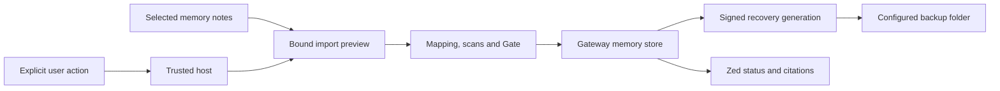

# Plan 12.12: Memory backups and import (M3, second part)

## Operator summary

Back up memory and import existing notes as optional context. Knowledge never expires through inactivity.

**Recommend a further split, with Claude’s concurrence:** plaintext backups, Agent Memory Repo import and the consented pilot here; encryption/channel/rotation/encrypted restore and native qualification in a later, unnumbered plan under **#491**. Operator approval of the split and exact hash remains required. This delivery closes independently, not M3.

**Number confirmed:** operator in Claude’s chat, 2026-11-20: “Yes, 12.12” (relayed in Claude review 2, round 109).

No new service, mirror, model picker, automatic user admission, review queue or accounting system. Models remain configuration under ADR-025.



| Operator decision | Recommendation and alternative |
|---|---|
| D1 — Split | Approve the split. Unmeasured estimates excluding waits: **9 working days here**, **15–19 later**, plus mediation engineering assessed separately. Combined scope could use four checkpoints at **22–26 days** plus mediation uncertainty; selecting it requires a complete replacement plan. |
| D2 — Plaintext cloud backup | Prefer a verified separate local drive; allow plaintext cloud only with target-bound warning/consent and visibly unavailable encryption. Alternatively disable cloud until encryption is delivered. |
| D3 — Pilot | Recommend the **20–30-item pilot now** with confirmed sources/mapping/private custody. Alternatively decline/defer: **#491 / later plan, Claude; operator owns consent/source access** retains the full pilot, and this delivery closes on the rest. |
| D4 — Second-model proof (12.11 D6) | Use a second already eligible route if available. Do not commission new route qualification here. Otherwise retain actual second-model proof UNRUN under #491’s later plan. |

Propose `priority:high`, `handler:claude`, `difficulty:high`, `estimate:13d`, subject to Claude/Codex agreement and operator-authorized label edits.

- **Difficulty:** high because restore, file identity, deletion continuity and import authority cross trust boundaries.
- **Estimate:** nine working days under the lean workflow, rounded up to the permitted `13d` label; re-estimate at checkpoints.

## Goal and authority

Implement configured backups and optional-context import while preserving Plan 12.11’s authority, commit, deletion and recovery contracts.

File: `docs/superpowers/plans/2026-11-20-plan-12-12-memory-backups-and-import-implementation.md`.

Claude implements and owns chat; Codex authors and reviews read-only. Operator hash approval and D1–D4 precede Task 1. Standing authority: each container, Zed session, keyring write/delete outside an isolated test service, cloud-folder write and paid operation needs its own release; GitHub writes other than review posts, plus push, PR and merge, need applicable operator authorization. Configuration consent is not release.

### Source and governing inputs

**Source inspected at main fcc72ce.** Worktree HEAD and `origin/main`: `fcc72ce8e77b262226c1909ff8f7784e7ce4ab09`, branch `agent/claude/m3-part2-plan`, clean. Recheck source/overlap at pickup.

At the inspected baseline, Plan 12.11 was the last allocated 12.x plan; its checkpoints merged through PRs #493/#496/#500/#504. #490’s administrative closure is separate, not a dependency.

Governing inputs:

- Discovery v12, SHA-256 `33670c6b84aceccd629437c14f03609ba4293d70cde95b242dd93a2b0ad4fb14`: M3/evaluation, backups/import/pilot, §16.17/16.22; external provenance only.
- `docs/superpowers/specs/2026-10-22-plan12-memory-design_v4.md`, verified SHA-256 `708e0e7831f6d4c56b5f6442cd37c4e02eecffd2659db04f3e6a6b1c54506ff9`: §6–6.3, K1/K5 and §9.
- Plan 12.11 v5, `docs/superpowers/plans/2026-11-16-plan-12-11-memory-and-continuity-implementation_v5.md`, verified SHA-256 `db61651d4301077a218260a7539ab5576ad04df53f7c54de3b8dfb73c47e9c06`; its Explicit Exceptions and `reports/plan12-memory-m3/`.
- #491’s full checklist, checked against `issue-491-body.md`; ADR-025/031–033/042/044/045 and decision index; evaluation reports, frozen `tests/fixtures/plan12_memory/`, `tools/plan12_memory/`; AGENTS, CONTRIBUTING, HLD/LLD/Test Strategy and evidence policy.

ADR-044 still says Proposed but option A was operator-accepted at CP3 (#490/index): explicit user actions, automatic user mutations off, optional agent lessons unchanged. Preserve ADR-042/045’s delivered mechanisms and acceptance qualifications; no frozen ADR edits.

No new ADR: import authority follows ADR-044/design; signed-generation reuse follows ADR-045. Escalate material policy changes.

#514’s served-read records landed in CP4 (`b8b16c0`) and were used in its rerun. Preserve that capability/tests; do not absorb its administrative closure.

Private paths are provenance, never test/release dependencies. Commands below are future gates, not new execution results.

## Scope and Explicit Exceptions

Anything not expressly excluded remains in scope.

| In scope | #491 / Claude obligation |
|---|---|
| Plaintext backups | Off by default, daily, 30-day maximum retention; separate-drive/cloud validation/consent, failure domain and last success/failure. |
| Recovery/deletion continuity | Signed generations, staging, empty-target refusal, controlled mapping and freshest established deletions. |
| Import | Bounded Agent Memory Repo parsing, K1, optional ceiling, deduplication, restrictive states/provenance/project isolation; M13/M18-c. |
| Pilot, if D3 selects execution | #491 / Claude; operator owns consent/source access: 20–30 items, temporal comparison with MEMORY.md and private-source custody. |
| Visible product/second-model proof | Real-Zed status, unavailable encryption/rotation and eligible second-model proof. |

| Explicit Exception | Named custody |
|---|---|
| Encryption/catalog/channel/mediation | **#491, later unnumbered plan / Claude; operator owns machine state.** Entire §6/6.1.1, P1/P5-d and Windows/Linux native qualification. |
| Rotation, encrypted restore and crypto-erasure | **#491, later plan / Claude.** Entire §6.1–6.3, four erasure states, immutable batching, native K5-R1/R2 and real-store M22–M24. |
| Host/keyring co-loss recovery | **#491, later security plan / Claude.** Current seals need the ACL-derived key; plaintext import recovers optional context, not authenticated authority. |
| D3-deferred pilot | **#491, later plan / Claude; operator owns consent/source access.** Entire OC-2 pilot/comparison remains owed. |
| New route qualification/unavailable second-model proof | **#491, later plan / Claude**, under D4/12.11 D6. Keep UNRUN; bindings are not actual-model proof. |
| Other memory slices | **#235 M2/M6/M7**, with existing #242/#243/#245 custody: broader retrieval, decay, consolidation and archive. |
| Unrelated follow-ups | Existing **#303, #248, #463, #512 and #514** owners: broad telemetry, savings, benchmark, Agent-mode classification and administrative logging closure. |

Q27 diagnostics, delivered prompts, external copies, cloud history and forensic media erasure remain outside this feature’s declared erasure boundary under the governing design. Report the limits; do not claim deletion.

## Design choices

New mechanisms and limits below are agent-selected proposals, not operator quotations.

### Backup format, scheduling and targets

Reuse `memory_recovery.py`/Gateway authentication: unchanged `optimus-agent-memory-repo/2` bytes (`MEMORY.md`, `entries.jsonl`, `manifest.json`, seal/mapping/deletion frontier), not another serialization or live Redis-directory copy.

Keep target/schedule/status outside signed bytes. Include a verified payload-free deletion-state snapshot; it cannot prove that no later deletion occurred. Export no ACL password/plaintext signing key.

Host-owned scheduling/locks: default off; check every 60 seconds, snapshot after 24 hours since success, one catch-up after downtime. Linked hosts share one publisher/state; closed hosts show paused scheduling. Failure preserves last good copy/time; no permanent retry, at most three transient attempts.

Exclusive staging → flush/fsync → verify → atomic publish, with Windows durability qualifications. Prune managed generations older than 30 days only after verified replacement; preserve foreign/unknown directories and the last usable copy.

Revalidate target identity before writes/deletes; refuse unsafe ancestry, symlink/reparse redirection, workspace/runtime/config overlap, tracked content or changed mounts. Record volume/device/physical-disk evidence: letters/mountpoints alone prove no independence. Same-drive targets show K5 warnings/no drive-loss credit; unknown stays unknown.

Reuse `sync_root()`, including resolved aliases, plus explicit user declaration for undetected sync folders. Detection is best effort. Consent binds target identity and plaintext disclosure; relocation invalidates it. An unreleased cloud write stays due/held with a reason.

Model-free `/memory backup` commands configure, show status, back up now or disable through existing bound actions/confirmation. Show target/domain, plaintext, last success, overdue/paused/held/failure and cleanup. No raw path crosses Gateway.

### Restore, copies and deletion

Use existing authenticated staging, empty-target refusal, fenced publication and controlled registry mapping. Missing verification credentials or unknown deletion continuity refuse serving; do not weaken authentication to recover an otherwise readable file.

Inventory current/prior targets, staging/generations and cleanup even after disabling/moving. Withdrawal/purge excludes retrieval immediately; publish clean backup before retiring affected older copies. Thirty days is a ceiling; offline/unwritable cleanup stays pending.

Report store, recovery, backup and external boundaries separately; local cleanup proves no cloud-history/recycle-bin or overall erasure.

Encryption and rotation remain visibly unavailable here: **“Encryption unavailable: the recovery-secret channel and key rotation are not qualified. These copies are plaintext.”** An encrypted request refuses without writing plaintext, and no rotation acknowledgement is simulated. #491 retains the complete security implementation and qualification obligations for a later plan’s own design/review; this plan makes no advance mechanism choices for it.

### Import and source custody

Parse [Agent Memory Repo](https://cognition.com/agent-memory-repo) entry point, bullets, metadata and root-relative links as data: no execution, fetch, clone/push or embedded authority.

Host commands:

- `/memory import <absolute-root>` prepares a preview.
- `/memory import apply <preview-id>` invokes one-shot confirmation bound to its exact digest.
- `/memory import status` reports confirmed, skipped, off, refused, uncertain and remaining items.

Source consent does not expand model access. Identity-check selected Markdown reachable from `MEMORY.md`; apply secret/injection/B1 controls. Reject traversal, outside-root links, aliases, unsafe ancestry, binary/unsupported encoding and malformed entries; list unsupported files/links as coverage gaps.

Initial bounds: 1 MiB/file, 16 MiB total, 1,000 entries and the existing 2,000-character statement limit. Refuse over-limit statements whole; never truncate qualifications. Detect cycles by resolved identity.

Preview binds file hashes/locators, exact statements, mapping, dispositions and trust. Validate the whole manifest before commits; changed source at apply needs new preview/confirmation.

Use ordinary Gate/fence/expected-state/durable commits per item, not atomic batches. Stable project/source/locator/content identities ensure idempotent resume; report confirmed/uncertain progress without duplication, retargeting or overwrite.

Imports are optional `legacy-import`. Metadata grants no user authorship, approval or protected constraint; represent such claims as optional facts or refuse. No user overwrite; lineage/scan failures refuse or remain off without statement payload.

Map projects explicitly: linked worktrees share registration, clones/forks do not; unmapped/ambiguous/other-project entries stay out. Deduplicate mechanically, preserving restrictive state/provenance without trust promotion.

### Round trip and executable oracles

Authenticated restore preserves lifecycle/provenance after deletion reconciliation/mapping. Import downgrades user claims to optional; off/withdrawn/purged/superseded stay inactive and payload-free stays payload-free. Keep established agent provenance; missing origin stays unavailable, never recovered from diagnostics.

Freeze M13-a/b/c and M18-c. For M13-c’s historical switch-off/storage representation, Claude/Codex agree mappings to version-bound commands/payload-free off records: original and actual operation/state, invariant and differences. Escalate only changed product meaning.

Retain original/mapped results. PASS covers only the named invariant; missing provenance/payload/steps/observations remain unavailable. Add current import/restore cases without repinning history.

## Prerequisites

Resolve every unknown in Task 0 before dependent work.

| Prerequisite | Satisfied today? | Owner | If unsatisfied: genuinely hard, or merely unauthorized? |
|---|---|---|---|
| Delivered store, Gate, signed recovery and journal | yes | Claude | Inspected baseline; recheck drift at pickup. |
| Effective ADR-044 user-action policy and served-read records | yes | Claude | Preserve D9/D10 and #514 regressions. |
| Exact hash, split and D1–D4 selections | no | Operator | merely unauthorized — decisions/approval pending. |
| Main base, own environment and overlap | unknown | Claude/operator | genuinely hard — establish at pickup. |
| Dedicated disposable AOF-backed Redis and fault-injection resources | no | Operator/Claude | merely unauthorized — provision only the named released resources. |
| Target availability/domain/filesystem | unknown | Operator/Claude | genuinely hard — establish before storage claims. |
| Cloud target selection, identity and consent | unknown | Operator | merely unauthorized — establish D2 and selected target in Task 0. |
| Pilot consent/manifest/custody | unknown | Operator/Claude | merely unauthorized — choose execute/defer before private reads. |
| Windows/Linux environments and acpx/Zed versions | unknown | Claude/operator | genuinely hard — inventory binaries/native capabilities in Task 0. |
| Second eligible route | unknown | Claude/operator | genuinely hard — inspect configuration; apply D4. |
| Qualified secret channel, wrapped-key lifecycle and P1 | no | #491 later plan | genuinely absent — not delivered; dependent capabilities stay unavailable. |

## Files and inventories

Read existing files before editing. New paths below are proposed targets.

| Area | Files |
|---|---|
| Backups | New `src/optimus/context/memory_backups.py`; extend `memory_recovery.py`, `memory_session.py` and lifecycle wiring in `src/optimus/acp/spec.py`. Reuse generation/locking/publication mechanics. |
| Import | New `src/optimus/context/memory_import.py`; extend `src/optimus/acp/memory_commands.py`, `src/context_engine/memory_gate.py`, `memory_contracts.py`, `src/optimus/context/authored_memory.py` and `memory_serving.py` only where needed. |
| Gateway boundary | Preserve `src/optimus_gateway/memory_store.py`, `memory_journal.py`, `memory_files.py`, `src/optimus_security/memory_store_config.py` and `memory_store_contract.py`; extend closed operations only if required. |
| Tests | New `tests/unit/context/test_memory_backups.py`, `test_memory_import.py`, `tests/integration/memory/test_backups.py`, `test_import.py`; extend existing recovery, command, Gate, serving and served-record tests. |
| Evaluation/docs | Extend `tools/plan12_memory/m3_evaluate.py` and its tests; new `reports/plan12-memory-m3-part2/`, including `run-config.json`; affected user/runbook documentation and mutable indexes. |

Join applicable inventories in the same change:

- Establishing-import closure in `tools/probe_p11_zed_session_load.py` only for modules actually entering it.
- Logging sinks in `docs/superpowers/reviews/2026-07-15-plan-9-96-logging-surface-audit.json`; JSON serialization uses `ensure_ascii=True`.
- Gateway route/operation/authentication inventories and closed-shape tests for extensions.
- Bounded walker reasons in `tests/unit/guardrails/test_tracked_file_scanners.py`; repository scans use `tracked_repository_files`.
- New child launches: `tests/unit/tools/run_context_child_sites.json`, `_REVIEWED_CHEAP_LAUNCHERS` in `test_test_profiles.py`, and `tests/profiles.toml` parallel serial list.
- `platform` tag for tests reading `sys.platform`; any new live marker joins default exclusions and run-context lists.
- New Git-index listings join `_INDEX_LISTINGS` in `tests/unit/tools/test_tracked_repository_files.py`.

Adapt `tests/integration/memory/conftest.py` to this plan’s new resource identities and fail closed without authorization; do not reuse historical releases. Prefer its existing dedicated marker.

No cryptography dependency change occurs here. Preserve the historical `tests/fixtures/evidence/plan117-origin-a-pyproject-v2.toml`, its digest constants and custody tests; current configuration drift never authorizes repinning historical bytes.

## Tasks

Each task: failing discriminating test → minimum change → focused pass → class sweep/reversions. Checkboxes require passed verification; no per-task review.

### Task 0 — authority and acceptance registration

- [ ] Record approved bytes, D1–D4 and full scope allocation on #491; preserve every original checklist row and later-plan owner. Obtain Claude/Codex agreement on review-level oracle mappings.
- [ ] Read Current State in `docs/superpowers/reviews/plan-12-12-review-checkpoints.md`, then verify tree/source/digests. Claude maintains this gitignored log.
- [ ] Resolve unknowns, main drift and overlap before dependent mutation; branch only from main.
- [ ] Freeze synthetic cases, workload, expected losses/refusals, source-to-oracle mapping and security UNRUN allocation.
- [ ] Bind D3’s manifest/mapping/custody/comparison before private reads, or record full deferred custody on #491.
- [ ] File one issue-pointer registry row and update `docs/README.md`; no second work register/new ADR.

Verify source/custody using `git status --porcelain=v1 --untracked-files=all`, `git rev-parse HEAD`, `git worktree list --porcelain` and `Get-FileHash -Algorithm SHA256`; run focused docs checks after authorized filing.

### Task 1 — backups, restore and copy status

- [ ] Test default-off/no writes, daily/catch-up timing, two-host contention, paused/overdue visibility and unchanged last-success after failure; implement scheduling/configuration/status.
- [ ] Exercise real target identity and permissions: separate/same/unknown failure domain, known/declared sync roots, absent consent/release, alias/reparse/mount swaps and foreign directories. Refused encrypted requests write nothing.
- [ ] Prove signed-generation byte reuse, corruption/missing-key refusal, controlled mapping and empty-target staging/restore.
- [ ] Test volume loss with backups on/off, later deletions, lost/shortened journal, publication/restore interruption, concurrent withdrawal/purge and offline-target cleanup. Unknown deletion continuity never becomes served.
- [ ] Test failed publication/retention; measure backup/import contention against affected frozen K2 acknowledgement/projection/capacity targets and retain misses.
- [ ] Revert identity, consent, seal, deletion-frontier, publication and cleanup controls individually; named discriminating tests must fail.

```bash
uv run --no-sync pytest --no-cov tests/unit/context/test_memory_backups.py tests/unit/context/test_memory_recovery.py tests/unit/acp/test_memory_commands.py -q
uv run --no-sync pytest --no-cov -m requires_plan12_memory_redis tests/integration/memory/test_backups.py tests/integration/memory/test_recovery.py -q
uv run --no-sync python -m ruff check .
```

Produce `backups.json`, `restore.json`, `copy-inventory.json` and `erasure-boundaries.json`.

### Task 2 — import and authority preservation

- [ ] Test valid entry points, links/cycles, metadata, unsupported files/encodings, limits, traversal/aliases, controls/bidi, command injection, secrets and source overlap before implementing parsing.
- [ ] Implement bound preview/apply/status. Model/tool/quoted/attachment text, stale source/preview, wrong session/project, replay and cancellation authorize no mutation.
- [ ] Test forged authority/types, user conflicts, stale anchors, lineage gaps and mixed/unknown projects: optional/off only, no off statement.
- [ ] Prove dedupe/crash/resume, durable commits/notices and served-read records through production import, not direct Redis fixtures.
- [ ] Test export/import versus restore, later withdrawal/purge, restrictive state and known/missing origin.
- [ ] Drive M13-a/b/c and M18-c through actual operations under the agreed translation table; retain original/mapped verdicts and missing coverage.
- [ ] Revert origin ceiling, mapping, source binding, restrictive-state, idempotency, scan and notice controls individually; require failing tests.

```bash
uv run --no-sync pytest --no-cov tests/unit/context/test_memory_import.py tests/unit/context_engine/test_memory_gate.py tests/unit/acp/test_memory_commands.py tests/unit/context/test_memory_serving.py tests/unit/acp/test_memory_served_record.py -q
uv run --no-sync pytest --no-cov -m requires_plan12_memory_redis tests/integration/memory/test_import.py tests/integration/memory/test_user_authority.py -q
uv run --no-sync python -m tools.plan12_memory.evaluate --validate-only tests/fixtures/plan12_memory
uv run --no-sync python -m tools.plan12_memory.m3_evaluate --config reports/plan12-memory-m3-part2/run-config.json --output tmp/plan12-memory-m3-part2
uv run --no-sync python -m ruff check .
```

Produce `import-k1.json`, `round-trip.json`, `evaluation.json` and `revert-checks.json`. Unsupported evaluator operations are missing coverage, never manufactured traces.

### Task 3 — pilot, real clients and platforms

- [ ] Under D3 execution, import the approved 20–30 OC-2 items from selected Claude/Codex mixed-project sources; public-format samples remain data. Record counts/revisions/mapping/dispositions, no personal text.
- [ ] Verify mapped Optimus items in a linked worktree, and unrelated/unknown-project negatives in a separate registration. Compare recall with MEMORY.md using frozen temporal questions/cutoffs; report retrieval, correctness, lifecycle, latency and fully loaded cost separately.
- [ ] Under D3 deferral, record `pilot.json` NOT RUN/disposition/later custody; retain synthetic qualification, and leave pilot-execution checkboxes unchecked.
- [ ] Observe backup status/failure/overdue, plaintext/encryption-unavailable state, cleanup boundaries and import preview/confirmation/result/refusal live in real Zed; retain synthetic screenshots and ACP/debug logs.
- [ ] Qualify protocol with independent real `acpx`; run focused Windows and real Linux/WSL path/permission checks in separate environments, preserving capability limits.
- [ ] Apply D4: actual second-model proof using distinct eligible resolved identities, or explicit UNRUN with #491 later-plan custody. Controlled bindings prove plumbing only.

Produce `pilot.json`, `zed-ui.json`, `platforms.json`, `continuity.json` and `paid-attempts.json` if applicable.

### Task 4 — final gates and disposition

- [ ] Audit current-state claims across README, roadmap, transitional registry, linked issues, decision/docs indexes, commands, runbooks and reports, including claims not already edited.
- [ ] Complete class sweeps/inventory checks below. Preserve no-config behavior, D9/D10 authority, commit/confirmation, recovery-required state and safety-critical coverage.
- [ ] Launch the one planned Windows full suite with coverage from PowerShell on the final clean code head; validate that same dataset. Preserve failure or later-fix invalidation and obtain disposition before repeating a broad gate.
- [ ] Complete CP3 review and operator disposition, then authorized publication and actual-SHA Linux PR CI. Disclose focused fixes and the exact delta from the full-suite-tested head.
- [ ] Archive required evidence before cleanup; record this delivery’s completion separately from #491/M3 closure.

```bash
uv run --no-sync pytest --no-cov tests/unit/tools/test_verify_plan996_logging_surfaces.py tests/unit/tools/test_probe_p11_zed_session_load.py tests/unit/tools/test_run_context_child_sites.py tests/unit/tools/test_test_profiles.py tests/unit/tools/test_tracked_repository_files.py tests/unit/guardrails/test_tracked_file_scanners.py tests/unit/tools/test_run_plan117_custody_feasibility.py tests/unit/tools/test_verify_plan117_custody_feasibility.py tests/unit/tools/test_plan117_custody_contract.py tests/unit/docs -q
uv run --no-sync python -m ruff check .
```

```powershell
uv run --no-sync python tools/check_product_coverage.py --run-full-suite --groups tools/product-coverage-groups.json --report-json tmp/coverage/product-coverage-report.json --coverage-json tmp/coverage/coverage.json
uv run --no-sync python -m tools.testing.coverage_products validate --coverage-json tmp/coverage/coverage.json --gate-report tmp/coverage/product-coverage-report.json
```

Apply configured product floors, project aggregate requirements and no safety-critical regression; distinguish informational coverage.

## Evaluation and releases

Execute backup/restore K5, import K1, M13/M18-c. M22–M24, native K5-R1/R2 and encrypted erasure stay UNRUN under #491’s later plan; fixtures/UI do not qualify them.

Use dedicated AOF Redis, real filesystems/ACLs/clients; fakes are unit evidence. Zero-paid Zed has its own verified Gateway port/config/store, no paid egress and a first-prompt gate. Commands/parsing use zero inference.

Proposed paid ceilings below are not releases:

| Named operation | Maximum physical attempts | Maximum USD |
|---|---:|---:|
| Each zero-paid Zed/acpx/backup/import session | 0 | 0 |
| Optional pilot answer comparison | 12 | 0.50 |
| Optional actual two-route proof (12.11 D6) | 8 | 0.50 |
| New route qualification | 0 here | 0 |

Bind paid workload/config/prices and worst-case planning/extraction/retry/fallback counts. Stop before exceeding either cap; no allowance transfer. Count failures/overhead; unknown cost suspends qualification, reservation is not settlement.

## Checkpoints

Three coarse checkpoints, with no per-task or intervening Codex reviews:

1. **CP1 — Tasks 0–1:** adopted scope, backups/restore and copy/deletion boundaries.
2. **CP2 — Task 2:** import authority, round trip, real-store evaluation and reversions.
3. **CP3 — Tasks 3–4:** pilot or recorded deferral, clients/platforms, final Windows coverage and delivery disposition.

AGENTS requires Fable first, then consolidated read-only Codex. Claude resolves findings, posts reviews verbatim to #491 and maintains the gitignored log. Reviewer invocation:

```bash
codex exec -m gpt-6.1-sol -c 'model_reasoning_effort="high"' -s read-only
```

Report named-model failure without substitution.

Use focused coverage-free/checkpoint profiles between gates, one final Windows full suite then Linux PR CI. Skip only authorized `optimus-pytest-coverage`; all other applicable hooks/Ruff remain required.

## Definition of Done and evidence discipline

Reports live under `reports/plan12-memory-m3-part2/`; historical M3 reports remain attributed to their original sources.

| Done claim | Named evidence and boundary |
|---|---|
| Scope and authority | `manifest.json`, `decisions.json`: approved hash/choices, source, complete #491 allocation, agreed mappings and release identities. |
| Backup/recovery | `backups.json`, `restore.json`: real targets, scheduling/retention, contention, volume loss, seal/key refusal, mapping and empty-store publication. |
| Deletion continuity | `copy-inventory.json`, `erasure-boundaries.json`: real store/files, later tombstones, interrupted/offline cleanup and explicit external limits. |
| Import authority/isolation | `import-k1.json`, `round-trip.json`, `evaluation.json`: production operations, M13/M18-c original/mapped results, restrictive states and negative controls. |
| Pilot disposition | `pilot.json`: either consented 20–30-item comparison/private-custody summary or explicit D3 deferral with full later ownership. Synthetic controls never claim a private pilot. |
| Visible/platform behavior | `zed-ui.json`, `platforms.json`, `continuity.json`: real Zed/acpx, Windows/Linux observations and actual second-model result (12.11 D6) or UNRUN. |
| Valid delivery | `revert-checks.json`, `verification.json`, `qualification.json`: discriminating reversions, inventories, exact-head Windows coverage/validity/Ruff/hooks and Linux CI SHA. |

Bind each run to checkout/branch, pre/post HEAD/status, command, platform/environment, source/config/dependency/resource/release identities, run ID, stdout/stderr, exit/skips/context. Dirty evidence binds diff/hashes and stays provisional. JSON digests: `hex:<lowercase-digest>`; Git: `git:<sha>`.

One coverage writer per worktree; Windows/Linux use separate frozen environments. Preserve repository selection/root conftest; inspect active/passive mode, native/guard validity and completeness separately from pytest success. Archive/hash evidence before cleanup.

Retain failures, invalid/incomplete attempts, skips, UNKNOWN/UNRUN; no retry-to-green, old-head relabelling, absence-as-proof or expected-derived traces. COMPLETE is not acceptance. Approved private custody holds raw sources; tracked sanitized summaries establish claims without personal content/path dependencies.

## Closure

After CP3, disposition and authorized delivery, mark this plan completed, archive approved bytes under the flat archive rules, repair mutable references and update `docs/README.md`. Only mechanically proven relocation substitutions may alter frozen plan bytes.

Under D1, **#491 stays open** with security, unavailable second-model proof (12.11 D6) and any deferred pilot owned. Retain its `status:` label; number the later plan only when scheduled.

Close **#491/remove `status:` only after its whole checklist is satisfied or explicitly dispositioned into named issue custody**; then archive its final plan. M3 requires those dispositions. **#235 remains open**; #490/#514 retain their existing closure owners.

Excluded here: security implementation/live proof and any explicitly deferred pilot. Risk: interim copies are plaintext; host/keyring co-loss and external cloud history remain outside this delivery’s authenticated-recovery and erasure claims.