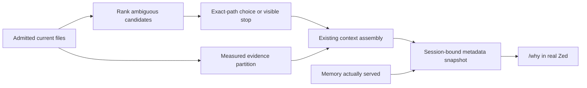

# Plan 12.13: Context explanation and ranked ambiguity (memory M2a)

## Operator summary

Deliver `/why`, ranked ambiguous-reference suggestions (#242), and a measured observation/current-read partition (#245), with **zero paid calls**.

The operator chose M2 before M3 encryption on 2026-11-22 and confirmed “Yes, 12.13 and 12.14” on 2026-11-23. Plan 12.14 owns remaining M2 refinements and paid experiments. Models remain configuration under ADR-025.

Non-goals: global reranking, model-aware budget refinements, required-file summarization, paid answer-quality experiments, encryption and the Q21 retrieval subagent.



| Open decision | Recommendation |
|---|---|
| D1 — Filing | Authorize **the Plan 12.13 issue (to be filed)**: `kind:plan`, under #235, `handler:claude`, with #242/#245 as children. Allocate #243 and M2b to Plan 12.14; #235 retains custody until its issue exists. |
| D2 — `/why` lifetime | Explain this ACP session’s last terminal, non-command context-preparation attempt. Keep its snapshot in RAM; report unavailable after restart/resume without it. Never infer “last turn” from diagnostic timestamps. |
| D3 — Target authority | Rank suggestions; require an exact workspace-relative path whenever multiple eligible targets remain. Ranking never authorizes a target. |
| D4 — Partition | Calibrate a replacement fixed byte partition from the alternatives below. Preserve the 16 KiB combined ceiling and route fitting. Stop at CP1 if none qualifies. |

Propose `priority:high`, `handler:claude`, `difficulty:medium`, `estimate:8d`, subject to Claude/Codex agreement and authorized label edits.

- **Difficulty:** medium: bounded attribution, target-selection and byte-limit changes reuse existing data/boundaries; no new storage service, route, dependency or paid path.
- **Estimate:** eight working days excluding approval waits; preliminary range 7–9 days. Re-estimate at checkpoints.

## Goal and authority

**Version:** complete v3 successor to reviewed v2, `hex:ff056ad8fb39f737a967b12309da99fef0887e34ede3153feeb50961aea47586`; compression only. Reviewed v1: `hex:8d1f9081975c4e6f7853ed9babf0b8e662465ff6ac64712273c6416d42958205`.

**File:** `docs/superpowers/plans/2026-11-23-plan-12-13-context-why-and-ambiguity-implementation_v3.md`.

Claude implements/owns chat; Codex authors/reviews read-only. Operator approval of this exact SHA-256 and D1–D4 precedes Task 1; Task 0 mutations also require applicable authority.

**Conditional filing authority:** operator, Claude chat, 2026-11-23: “Once the plans are drafted and reviewed and approved, please have them pushed to main via a doc-only PR”. After hash approval, Claude may commit/push this documentation, open its docs-only PR and merge when green. This does not authorize issue filing, implementation or its PR/merge.

Each container, Zed session and keyring write outside an isolated test service needs its own release. Other GitHub writes except review posts, implementation commits, push, PR and merge require applicable operator authorization. Historical releases do not carry forward.

**Source inspected at main 8e56b3c.** Supplied worktree clean, branch `agent/claude/p1213-plan`; HEAD/inspected `origin/main`: `8e56b3c9591441ab2a63a0a3024eeab2d5f26322` (PR #543). Recheck drift before implementation.

Governing inputs:

- Discovery v12 §7/Q21, external provenance, SHA-256 `33670c6b84aceccd629437c14f03609ba4293d70cde95b242dd93a2b0ad4fb14`: M2 depends only on M1 and may precede M3.
- `docs/superpowers/specs/2026-10-22-plan12-memory-design_v4.md`, SHA-256 `708e0e7831f6d4c56b5f6442cd37c4e02eecffd2659db04f3e6a6b1c54506ff9`; current HLD/LLD/Test Strategy and controlling amendments.
- Archived Plans 12.10 v3, 12.11 v5 and 12.12; ADR-025/031/038–041/044, decision index, `docs/context-window-optimization-strategy.md`; acceptance in [#242](https://github.com/vibhanshu-agarwal/optimus-cost-agent/issues/242), [#243](https://github.com/vibhanshu-agarwal/optimus-cost-agent/issues/243), [#245](https://github.com/vibhanshu-agarwal/optimus-cost-agent/issues/245).

AGENTS, CONTRIBUTING and evidence policy apply. External sources are provenance, never operating dependencies. Commands below are future gates, not authoring-time results.

## Scope and Explicit Exceptions

Anything not expressly excluded remains in scope.

| In scope | Owner |
|---|---|
| `/why`, truthful attribution, partial/missing states, sanitization and real-Zed display | Claude / the Plan 12.13 issue (to be filed) |
| Shared ranked ambiguity, fail-closed choice and wrong-target regret | Claude / #242 |
| Measured fixed partition; complete evidence or explicit refusal; preserved ambiguity | Claude / #245 |
| Cases, evaluation, real boundaries, inventories, docs and delivery evidence | Claude / the Plan 12.13 issue (to be filed) |

| Explicit Exception | Custody |
|---|---|
| Global RRF/utility refinements, ablations and model/learned reranking | #235 M2 / Plan 12.14, Claude; preserve M1 fusion here. |
| Model-aware budgets, required-file summarization, remaining budget refinements | #243/#235 M2 / Plan 12.14, Claude; preserve M1 final fitting. |
| Paid answer synthesis, citation-quality and baseline-versus-context experiments | #235 M2 / Plan 12.14, Claude; coordinate campaigns with #463. |
| New paid cache-economics measurements | #235 M2 / Plan 12.14, Claude. |
| Retrieval subagent and semantic-answer serving | #235 / deferred Q21; operator schedules reconsideration after demonstrated benefit. |
| Encryption, secret channel, rotation and encrypted restore | #491 / later M3 security delivery, Claude. |
| Other memory slices/unrelated defects | Existing #235 slice/issues and owners; new independent defects need approved issue custody. |

M2a owns pure-assembler determinism and byte-partition budgeted assembly, with deterministic citation/grounding regressions. Plan 12.14 owns model-aware refinement and M2’s answer-synthesis, citation-quality and baseline-versus-context experiments. M2a claims neither measured answer quality nor savings.

## Design choices

### `/why`

Use the command catalogue/local-answer path before admission/classification/model calls. No new ACP method, model tool or Gateway route; work with index/extraction disabled.

Existing `Selected` records contain no bodies. `MemoryTurn.manifest` holds selections, route/configuration, coverage, budget and grounding. `MemorySession.write_manifest()` persists per-run JSON under `manifest_root/<scope-prefix>/`, newest 200 per scope. Files survive restart, but no reader or persisted session-to-last-turn link exists; blocked/incomplete preparation can bypass writing.

Reuse `AcpPromptTurn.served_memory`, `memory_serving.ServedSet` and `debug_trace.log_memory_served()`. Preserve debug exclusions: no statements, titles, paths or branches.

Capture one immutable metadata snapshot per terminal preparation attempt, bound to session/run/turn, scope and outcome. Use actual assembly/serving/dispatch facts; never rerun retrieval or reread memory.

| Display | Fields |
|---|---|
| Identity/delivery | Turn/run/outcome; prepared versus dispatched; request/round distinctions |
| Choices | Paths/symbol identifiers, disclosure, ordinal/channel ranks, selection/omission reasons; considered candidates only |
| Fit | Token budget/use, observation/read serialized limits/use, required-evidence failures |
| Grounding/scope | Grounding, unresolved/ambiguous references, generation/revision/coverage, channel failures, unsaved-buffer metadata |
| Memory | Served `id@version`, read outcome/completeness, omission counts, established watermarks |

Missing fields say unavailable; preparation does not prove dispatch, failed reads do not mean no memory, and historical metadata does not establish current validity.

Render no bodies, signatures/descriptions, prompts, memory statements or hidden reasoning. Apply workspace-aware conversation sanitization, current disclosure denials and Markdown/control escaping; do not substitute current content for historical facts. Preserve stricter logging contracts; new JSON uses `ensure_ascii=True`.

The latest terminal attempt replaces its predecessor even when blocked/failed/cancelled. Commands do not replace it. Rejection before preparation leaves the previous snapshot explicitly identified; retain active-turn/cancellation rules.

No snapshot: “No context explanation is available for this session yet.” After restart/resume, state that diagnostic manifests cannot establish this session’s last turn; never select the newest workspace file. Disk-write failure does not defeat the RAM explanation.

Use bounded local delivery/deterministic paging; freeze bounds before implementation and never silently truncate entries. `/why` causes zero classification, maintenance, extraction, embedding or provider calls; its display is not automatically future prompt content.

### #242

Ordinary workspace assembly and `MemoryTurn.assemble()` share this policy:

1. FilePolicy/scope control eligibility. Preserve secret/ignore denials, exact-path resolution and deterministic fallback; data never gains instruction authority.
2. Use only current verified structural hints. Missing/stale hints contribute nothing and never remove eligible candidates.
3. Sort by descending task-term relevance, verified dependency proximity to independently resolved task paths, verified-current metadata availability, then workspace-relative path.
4. Reuse term splitting/import-neighbour metadata; exclude the ambiguous basename from relevance. Dependency proximity is bounded static adjacency, not complete build resolution. No global utility function, RRF retuning or wall-clock truth heuristic.

Freeze features/ties in `ranking-policy.json`.

**Threshold:** automatic resolution requires one admitted current target under existing exact-path/unique-name rules. Multiple eligible targets stay ambiguous regardless of score/gap. Show ranked paths/reasons, request an exact workspace-relative path and revalidate before read/edit. No new confirmation dialogue.

Measure top-one accuracy, reciprocal rank, actual wrong-target selections and oracle regret using frozen acceptable-target sets. Agent-selected losses: correct `0`, wrong `1`, unresolved on a decidable case `0.25`; visible abstention on an inherently undecidable case `0`. Report denominators/undecidable cases separately; ranking is not confidence.

Require zero wrong-target selections, visible fail-closed behavior, no candidate loss and held-out suggestion improvement over path-only order. Without benefit, no #242 completion claim.

### #245

Compare **2/14, 4/12, 6/10 and 8/8 KiB** observation/current-read partitions against 4/12. Preserve the combined 16 KiB ceiling and route fitting. Count UTF-8 serialization including headers, paths, hashes and framing; distinguish bytes/tokens.

Selection on train/development:

1. Reject weakened source-hash, completeness, ambiguity or route-fit checks.
2. Require no loss on frozen baseline-success schedules.
3. Maximize completed schedules; ties prefer fewer budget stops, then proximity to 4/12.
4. Require at least one held-out completion improvement and no held-out baseline-success regression.

Represent observation-heavy, read-heavy and mixed schedules. Truncation/dropped required evidence cannot count as completion; preserve typed refusal or guarded reread.

CP1 records numeric limits before production changes. If no non-baseline partition qualifies, retain 4/12 and stop for operator disposition. Exclusion of #245 needs an approved complete successor; never force a change or claim delivery.

Update packer, observation sizing/validation, read scheduling/recovery, disclosure and fixtures together. Preserve hashes/ranges, complete required evidence or explicit incompleteness, and visible ambiguity. Model-aware partitioning/summarization stays with 12.14.

### Composition/caching

Preserve ADR-039/041’s breakpoint after the map, cache mode and wire shape; `/why` stays local.

Limits occur in `indexed_planner_prefix()`: changing the fixed partition changes prefix bytes/request digest and may require a cold write, but does not itself change registry composition hashes.

Record before/after prompt versions, prefix/request digests and ordinary/Auto/test-profile hashes. Update affected current prompt fixtures/version pins; prove unchanged registry inputs retain hashes. Re-pin current establishing-import/source identities and renew source-bound launch approvals where required; never re-pin historical custody fixtures. Registry/configuration changes require hash approval. Paid cache measurements stay with 12.14.

## Prerequisites

Resolve unknowns in Task 0 before dependent work. Capability evidence never renews releases.

| Prerequisite | Satisfied today? | Owner | If unsatisfied: genuinely hard, or merely unauthorized? |
|---|---|---|---|
| M1 pack/manifest, ambiguity stop, partition, served-memory records | yes | Claude | Inspected baseline; preserve #514/citation regressions. |
| Exact v3 hash/D1–D4 | no | Operator | merely unauthorized — approval pending. |
| Issue, relationships, assessed labels | no | Operator/Claude | merely unauthorized — D1/GitHub writes pending. |
| Checkout/base/overlap/environment refresh | unknown | Claude | merely unauthorized — routine approved Task 0 checks; no established hard blocker. |
| Complete `/why` snapshot/command | no | Claude | genuinely absent — buildable with existing boundaries. |
| Frozen M2a cases/oracles | no | Claude/Codex | genuinely absent — Task 0 authorship/freezing, CP1 review. |
| This run’s dedicated index/store and configured embedding artifact | unknown | Operator/Claude | merely unauthorized — verify availability and obtain resource releases. |
| Windows, WSL Ubuntu-24.04, acpx, real Zed capability | yes | Claude/operator | Plan 12.12 CP3 exercised them on 2026-11-21; acpx 0.12.0. Recheck versions; release new operations. |
| Isolated Gateway/zero-paid first-prompt procedure | yes | Claude/operator | Established in Plan 12.12 `zed-ui.json`; instantiate under fresh release. |
| Keyboard/screenshots | unknown | Operator | merely unauthorized — arrange each Zed session. |
| Paid capability | yes | Claude | Unneeded; attempts/USD zero. |

Capability evidence: `reports/plan12-memory-m3-part2/platforms.json` and `zed-ui.json`. Prior resources were cleaned up; names/ports are not reusable releases.

## Files and inventories

Read before editing; new paths are proposed.

| Area | Files |
|---|---|
| Explanation | New `src/optimus/context/context_why.py`; extend `memory_session.py`, `assembly.py`, `src/optimus/acp/spec.py`, `memory_commands.py`; reuse serving/debug contracts. |
| Ranking | `src/optimus/agent/workspace_context.py`, `memory_session.py`; verified retrieval/repo-map metadata. |
| Partition | `src/optimus/agent/planning_loop.py`, `prompts.py`, discovered consumers/fixtures. |
| Tests | New `tests/unit/context/test_context_why.py`; existing workspace/planning/prompt, retrieval/pack, memory-turn/wiring/command/served-record suites; extend `tests/integration/context/test_memory_session.py`, `tests/integration/agent/test_multi_turn_planning_flow.py`. |
| Evaluation | Thin `tools/plan12_memory/m2a_evaluate.py`, reusing contracts/real-route setup; `tests/unit/tools/test_plan12_memory_m2a.py`; `reports/plan12-memory-m2a/`. |
| Docs | Commands, docs/decision indexes, issue-only registry pointer and one new ADR at next free number. |

Record changes or reviewed non-applicability for:

- Establishing-import closure in `tools/probe_p11_zed_session_load.py`, only entering modules.
- Logging files/sinks in `docs/superpowers/reviews/2026-07-15-plan-9-96-logging-surface-audit.json`.
- Changed Gateway route/op/auth inventories; none planned.
- Walker reasons in `tests/unit/guardrails/test_tracked_file_scanners.py`; repository scans reuse `tracked_repository_files`.
- Child sites in `tests/unit/tools/run_context_child_sites.json`, applicable `_REVIEWED_CHEAP_LAUNCHERS` in `test_test_profiles.py`, `[parallel].serial` in `tests/profiles.toml`.
- `platform` tag for tests reading `sys.platform`; new markers in default exclusions/run-context lists, preferring existing markers.
- `_INDEX_LISTINGS` in `test_tracked_repository_files.py` for tracked-file listings.
- `/why` catalogue/descriptions/usage/parser and ACP advertisement/wiring.

The new ADR preserves operator words/source references, labels agent choices and records mechanisms, alternatives and authority boundaries. Review within checkpoints; frozen ADRs stay unchanged.

## Tasks

Failing discriminating tests → minimum implementation → focused pass → class sweep/reversions. Checkboxes require passed verification; no per-task reviews.

### Task 0 — authority and frozen cases

- [ ] Record approved bytes, D1–D4, worktree/branch choice, releases/agreed labels; verify status/HEAD/registry, drift, overlap and own frozen environment.
- [ ] Read/update gitignored `docs/superpowers/reviews/plan-12-13-review-checkpoints.md`; Claude owns it, never stages it.
- [ ] Resolve unknowns/reconcile specs and decisions; stop on authority conflicts.
- [ ] Complete authorized docs-only filing and D1-authorized issue/registry allocation; retain 12.14 custody.
- [ ] Claude authors/freezes `cases.json`, `ranking-policy.json`, `evaluation-contract.json`, `case-provenance.json` before feature implementation; Codex reviews at CP1, as in Plan 12.12.
- [ ] Freeze at least **24 ambiguity cases, 24 synthetic split schedules, 12 explanation cases**, family-separated into train/development/held-out. Include acceptable targets, serialized demand, stops, privacy sentinels, page bounds and release configuration.
- [ ] Ground schedules in M1 corpus/chunk/budget/coverage records (`assembly.json`, qualification/run records) and existing multi-turn fixtures/serializers: eight observation-heavy, eight read-heavy, eight mixed, with exact/one-over boundaries.
- [ ] Record source, observed quantities and synthetic/scaled choices per schedule. M1 lacks complete observation/read traces: these are not natural-demand replays. Missing dimensions use loop fixtures/explicit boundaries; representativeness covers demand shapes, not production frequency.
- [ ] Record adopted decisions and inventory applicability.

Verify: `git status --porcelain=v1 --untracked-files=all`, `git rev-parse HEAD`, `git worktree list --porcelain`, `Get-FileHash -Algorithm SHA256`, and focused docs checks after filing.

### Task 1 — baseline/calibration

- [ ] Test evaluator/loader before feature changes; measure path-order baseline and four partitions on train/development with actual serializers.
- [ ] Reuse M1 localization gold only for regression diagnostics; it lacks sufficient target-regret/loop-demand oracles.
- [ ] Run released real-index/Gateway/filesystem checks where claimed; freeze limits/features at CP1, preserving held-out custody.
- [ ] Retain losses/unknowns; stop at CP1 if no replacement qualifies.

```bash
uv run --no-sync pytest --no-cov tests/unit/tools/test_plan12_memory_m2a.py -q
uv run --no-sync python -m tools.plan12_memory.m2a_evaluate --config reports/plan12-memory-m2a/run-config.json --phase calibration --output reports/plan12-memory-m2a/calibration.json
```

### Task 2 — `/why` and ambiguity

- [ ] Capture indexed/fallback, blocked/incomplete, failed/cancelled attempts, dispatch distinctions and multiple rounds.
- [ ] Implement advertisement/parsing/rendering, paging/privacy, session isolation and restart behavior.
- [ ] Preserve prompt-handler await placement: preparatory await before authoritative session lookup/checks, no new refusal branch/intervening invalidating await. Test cancellation, close, session changes and report/turn ownership.
- [ ] Implement shared ranking/exact-path retry retaining candidates; no score-based authorization.
- [ ] Verify zero calls, disabled-index/extractor behavior and no body/statement leakage.

```bash
uv run --no-sync pytest --no-cov tests/unit/context/test_context_why.py tests/unit/context/test_memory_tools_and_turns.py tests/unit/acp/test_memory_wiring.py tests/unit/acp/test_memory_commands.py tests/unit/acp/test_memory_served_record.py tests/unit/agent/test_workspace_context.py -q
```

### Task 3 — partition/qualification

- [ ] Apply CP1’s partition to all consumers/disclosures/fixtures.
- [ ] Test UTF-8/header overhead, equality/one-over, multiple observations/reads, required ranged rereads, stale hashes, missing/unreadable files and ambiguity.
- [ ] Prove complete required evidence or explicit refusal and unchanged final fitting; no truncation-based pass.
- [ ] Consume held-out qualification once; preserve failures without tuning against them.
- [ ] Check repeated/reordered-input determinism and cache/composition identities.

```bash
uv run --no-sync pytest --no-cov tests/unit/agent/test_planning_loop.py tests/unit/agent/test_planning_loop_runner.py tests/unit/agent/test_planning_loop_recovery.py tests/unit/agent/test_prompts.py tests/unit/context_engine/test_retrieval_and_pack.py tests/unit/optimus_gateway/test_prompt_cache.py tests/integration/agent/test_multi_turn_planning_flow.py -q
uv run --no-sync python -m tools.plan12_memory.m2a_evaluate --config reports/plan12-memory-m2a/run-config.json --phase qualification --output reports/plan12-memory-m2a/qualification.json
```

### Task 4 — boundaries/UI/reversions

- [ ] Exercise real index Redis/Gateway/filesystem under fresh releases; adapt identities/guards in `tests/integration/context/conftest.py`. Served-memory boundary claims require a separately released real store; fakes prove unit behavior only.
- [ ] Use independent real acpx **only for `/why` advertisement and ambiguity → exact-path retry** against real ACP. Retain machine-readable exchanges to verify advertisement/retry independently of Zed rendering; no full client campaign.
- [ ] Observe `/why`, ranked ambiguity/retry, no-snapshot and restart live in real Zed; retain screenshots and correlated ACP/debug logs covering choices/omissions, budgets and served IDs.
- [ ] On Windows and real WSL Ubuntu run only **P1**, sanitizer workspace-path rendering with spaces/non-ASCII and sensitive-token redaction; **P2**, ambiguity suggestions/exact-path retry using native/input separators, preserving relative targets/denials. No WSL arithmetic, generic serialization or broad filesystem campaign.
- [ ] Revert snapshot publication, privacy filtering, session binding, fail-closed selection, freshness/completeness checks, UTF-8/header accounting and chosen partition in disposable checkouts. Relevant oracles must detect each defect; restore production bytes.

```bash
uv run --no-sync pytest --no-cov -m requires_plan12_index_redis tests/integration/context/test_memory_session.py -q
```

Freeze collected acpx/P1/P2 commands/node IDs before execution. Collection, skips or passive runs are not live acceptance.

### Task 5 — final gates/delivery

- [ ] Sweep affected agent/context/ACP, sanitizer/logging, cache/inventory classes; preserve no-config fallback and safety-critical coverage.
- [ ] Audit current-state claims, including untouched ones made stale: README, roadmap, registry, issues, commands, indexes/reports.
- [ ] Freeze final clean code head; launch **exactly one planned Windows full suite with coverage from PowerShell**, then validate that dataset.
- [ ] Complete CP3/operator disposition; obtain implementation publication/merge authority and inspect actual-tested-SHA Linux PR CI.
- [ ] Retain evidence before cleanup and complete authorized closure.

```bash
uv run --no-sync pytest --no-cov tests/unit/tools/test_verify_plan996_logging_surfaces.py tests/unit/tools/test_probe_p11_zed_session_load.py tests/unit/tools/test_run_context_child_sites.py tests/unit/tools/test_test_profiles.py tests/unit/tools/test_tracked_repository_files.py tests/unit/guardrails/test_tracked_file_scanners.py tests/unit/docs -q
uv run --no-sync python -m ruff check .
```

```powershell
uv run --no-sync python tools/check_product_coverage.py --run-full-suite --groups tools/product-coverage-groups.json --report-json tmp/coverage/product-coverage-report.json --coverage-json tmp/coverage/coverage.json
uv run --no-sync python -m tools.testing.coverage_products validate --coverage-json tmp/coverage/coverage.json --gate-report tmp/coverage/product-coverage-report.json
```

Apply configured product floors, ≥80% aggregate Python production coverage and no safety-critical regression. CP1/CP2 checks are focused/coverage-free. Preserve final-run failure; later executable changes invalidate final-head acceptance and require disposition before a replacement broad gate.

## Evaluation and releases

**Paid physical attempts: maximum 0; provider cost: maximum USD 0.**

Reuse Plan 12.12’s procedure under fresh releases. Each Zed session has its own approved Gateway port/configuration; gate its first prompt on attach identity, controlled local upstream, no paid egress and no paid classification/maintenance/extraction/fallback.

Scripted local responses establish real ACP/Gateway/UI plumbing, not answer quality. Retrieval claims need real dedicated index Redis/configured local embedding artifact; controlled artifacts do not establish embedding quality.

Bind releases to resources, ports, image/artifact/config digests, lifetime/cleanup. No hidden downloads, starts, keyring writes or port substitutions. Missing UI/dependency evidence holds the claim.

Only P1/P2 require local alternate-OS checks; newly platform-shaped failures trigger repository reproduction rules. Linux PR CI is not Windows parity.

## Checkpoints

Per the operator’s 2026-11-23 ruling, **Codex CLI alone** reviews three coarse checkpoints; no intervening/per-task reviews:

1. **CP1:** Tasks 0–1 — frozen cases/provenance, decisions, prerequisites, calibration/partition.
2. **CP2:** Tasks 2–3 — explanation, ranking, partition, qualification/regressions.
3. **CP3:** Tasks 4–5 — boundaries/Zed, bounded clients/platforms, reversions, freshness audit, final coverage.

```bash
codex exec -m gpt-6.1-sol -c 'model_reasoning_effort="high"' -s read-only
```

Specify model/effort on every call/resume; report failure without substitution. Claude posts reviews verbatim with model/effort/session attribution, maintains the checkpoint log and resolves findings. Reviews recommend; operator approves in Claude’s chat. Disclose tested head/exact fix deltas; earlier evidence never tests later bytes.

## Definition of Done

All artifacts reside under `reports/plan12-memory-m2a/`; sanitized repository-visible evidence supports every claim.

| Claim | Evidence |
|---|---|
| Authority/prerequisites, frozen cases/provenance, selected partition | `authority.json`, `prerequisites.json`, `cases.json`, `case-provenance.json`, `ranking-policy.json`, `evaluation-contract.json`, `calibration.json` |
| Bound `/why`, states/privacy, zero calls, session/restart behavior | `why.json` |
| Ranking improvement, targets/regret, fail-closed behavior | `ambiguity.json` |
| Completion gains, preserved completeness/ambiguity | `split.json` |
| Determinism, prompt/cache/composition identities | `determinism.json`, `cache-identity.json` |
| Real index/store/filesystem, bounded independent client | `boundaries.json`, `acpx.json` |
| Live Zed/screenshots/ACP/debug logs | `zed-ui.json` |
| P1/P2, reversions/inventories | `platforms.json`, `revert-checks.json`, `inventory.json` |
| Final source/Ruff/coverage/actual-SHA Linux PR CI | `final-gates.json`, retained run/coverage records |
| Qualification, freshness, custody/closure | `qualification.json`, `closure.json` |

Missing real UI/dependency evidence prevents completion. Paid answer/citation/benchmark experiments remain UNRUN under Plan 12.14.

## Evidence discipline

Follow AGENTS’ parallel-test/evidence rules, CONTRIBUTING, Plan 11.28’s design/current live-registry row and `docs/governance/evidence-and-local-artifact-policy.md`.

Bind runs to command, source/checkout, environment/configuration, output/exit and retained context. Preserve failures, skips, consumed held-out sets, UNKNOWN/UNRUN and invalid/incomplete records. Keep measured checkouts unchanged, one coverage writer per worktree and separate native/WSL environments; archive before pruning.

New JSON uses `hex:<digest>`, `git:<sha>`, `ensure_ascii=True`, no secrets/bodies. Historical evidence stays unchanged; COMPLETE alone is not acceptance.

## Closure

After CP3, operator disposition and authorized implementation delivery:

- [ ] Record terminal disposition on the Plan 12.13 issue (to be filed); archive this plan under flat-archive/frozen-byte rules, repair mutable references/update `docs/README.md`.
- [ ] Close the issue and remove its `status:` label.
- [ ] Close #242/#245 only with acceptance evidence; otherwise retain exact remainders/named issue custody under approved scope disposition. Failed calibration is not delivery.
- [ ] Keep **#235 and M2 open for Plan 12.14**, retaining every M2b exception; #243 stays open.
- [ ] Repeat freshness audit before merge; distinguish PR-head, merge and CI identities.

Excluded: paid experiments, global reranking, model-aware refinements and encryption. Risk: `/why` lacks cross-restart snapshots; synthetic schedules prove bounded demand-shape behavior, not production frequency or universal ranking correctness.