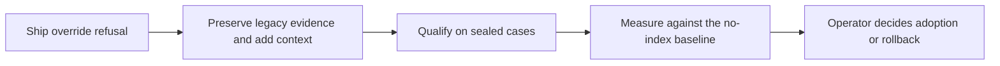

# Plan 12.15: Model-aware context budgets, second attempt (#243)

**Version:** v4, replacing unapproved v3

## Operator-facing summary

Keep the evidence the current context pack already carries. Let one configured entry add context when its price and capacity allow it. First ship the safeguard that rejects operator-supplied budget fields. Then prove that the larger pack preserves evidence on fresh cases and measure its answers, citations and costs against the existing no-index baseline. The operator uses those results to decide whether to adopt the budget or restore the legacy defaults.

Ranking changes, automatic outlines, reranking and broad evaluation campaigns are outside this release.



| Decision | Record or recommendation |
|---|---|
| Plan number | The operator confirmed the number in Claude's chat on 2026-11-27 with “Yes, 12.15 is fine”. |
| Filing | Create a new `kind:plan` issue under #235 and move #243 under it. Obtain approval of the exact plan SHA-256 and its decisions before filing by docs-only PR. |
| Override refusal | Make the safeguard permanent. Deliver it on its own PR after CP1. Start candidate implementation from refreshed `main` after the safeguard lands. |
| Budget and target | Preserve the legacy selection and add context within the route ceiling. Start with an estimated input target of USD 0.012288 for the configured entry. Keep D4's outline dormant. |
| Auto | Apply the same rule whenever the configured entry prepares the request, including in Auto. On escalation, check the prepared request against the destination's capacity. |
| Candidate and shipping hashes | Approve the complete inventory of registry compositions before approving candidate hashes for live use. Adopt the exact qualified defaults and pins after deterministic qualification, reconciled base Q and an operator decision. |
| Base paid Q | Release QB1 and QB2 together once, for six sends and at most 12 physical attempts. Set the dollar cap to 12 times the per-attempt bound recomputed at release, with a maximum of USD 0.75. |
| Optional paid QB3 and QB4 | Leave these `UNRUN` by default. G2 proves the capacity difference at zero provider cost. If the operator wants the two F answers, obtain a separate release for two sends and at most four physical attempts. Set the cap to four times the recomputed per-attempt bound, with a maximum of USD 0.25. |
| Closure | Accept the one-entry delivery and assign the remaining route and outline work to #235, or restore the legacy defaults and keep #243 and M2 open. Apply the closure rules below. |

Propose `priority:high` and `handler:claude` on the work-bearing issues. Propose `difficulty:high` because packing, release identity and accounting must agree. Propose `estimate:8d` for six to eight working days, rounded up and excluding approval waits. Claude and Codex agree the labels and re-estimate at checkpoints. The operator authorizes label writes.

## Goal and authority

**File:** `docs/superpowers/plans/2026-11-27-plan-12-15-model-aware-budgets-implementation.md`

The operator chose this successor in Claude's chat on 2026-11-27 with “Let us go with the successor plan in that case”. #243 requires that “Budget changes are model-aware, cost-attributed, injection-safe, measured against the null baseline, and never silently omit required evidence.” [Issue #243](https://github.com/vibhanshu-agarwal/optimus-cost-agent/issues/243)

Source inspected at `d83dc38`, the Plan 12.14 archive merge. The `agent/claude/p1215-plan` checkout was clean at that commit, and `origin/main` had advanced. #548 closed incomplete. PR #664 delivered the dormant machinery, PR #666 archived the plan, and paid Q and R were `UNRUN`. Read `closure.json`, `qualification.json` and `evaluation-contract.json` v19 under `reports/plan12-memory-m2b/`. [Archived Plan 12.14](archive/2026-11-23-plan-12-14-ranking-and-budgets-implementation.md)

Claude (Opus) owns the operator chat and implements. Codex authors and reviews read-only. Fable 5.2 reviews the draft first, then Claude. Claude holds the draft outside the repository until approval. Merge the green docs-only filing PR before Task 1 under the 2026-11-23 filing decision. Preserve the approved bytes. A substantive revision requires an approved, complete versioned successor.

Technical review, registry approval and operational release are separate decisions. Release each container, Zed session, keyring write outside an isolated test service and paid run individually. The operator approves GitHub writes other than review posts and separately authorizes implementation pushes, PRs and merges.

## Scope and Explicit Exceptions

Deliver the override safeguard and qualify one configured entry through narrow Q and real-boundary checks. Adopt or roll back the candidate. Preserve retrieval, history, ambiguity, partition and admission behavior.

| Explicit exception | Owner and custody |
|---|---|
| D2 ranking selection and calibration, paid R, reranker training and serving, and new retrieval, learning or caching | #548 retains the delivered D2 baseline. #235 owns new work and paid R, including its Gated reranker work. |
| Vendor and native campaigns, population claims, and B2 and B3 report integration | #463 owns these. This plan produces the narrow Q record. |
| D4 activation, automatic outlines and qualification of more entries | #243 retains these obligations until the operator assigns them to #235. Preserve D4's pure code and historical tests. |
| M2a redesign, actual second-model continuity, M3 security and Phase 1 working-agent sign-off | #545 with #242 and #245 owns M2a. #491 owns continuity and security. Plan 9.6 owns live sign-off. Controlled escalation tests in this plan establish fit behavior. |

## Design choices

**Budget.** Plan 12.14 targeted 13,107 estimated tokens at the cache-write price. The legacy allowance was 16,384. QF04-a named no required file, yet its gold required R3 and the smaller pack lost it. On the fresh set, F covered 19 of 44 requirements and U covered 20. All four historical replays passed. F carried 142,705 irrelevant tokens and 79 poison tokens, compared with U's 181,099 and 867. The operator directed “Roll back D3” and “Keep it dormant”. The shipped effective hash returned to `4d2f637e…6338`, and the packaged defaults carry no `context_budget`.

Use the legacy floor on every task. A floor limited to tasks that name no files would leave unnamed evidence vulnerable even when a task names another file. Calculate usable input from the smaller of the minimum configured endpoint window and the policy ceiling, less the implementer output reserve. Set `L = min(floor(0.25 × usable_input), 16,384)` and `C = min(floor(0.25 × usable_input), 32,768)`. Set `T = floor(1,000,000 × input_target_usd / effective_input_price)`. Include the possible cache-write premium, omit any cache-read discount and use `T = C` at zero price. USD 0.012288 is 1.5 times the prior target. At the prior write price it forecasts 19,660 tokens, a modest increase below the maximum ceiling. Verify that forecast on the chosen configuration.

**Packing.** Let `R` estimate the complete serialized required section. When the complete required set fits within `C`, use `max(L, chosen_budget(C, T, R))`. At `R ≤ L`, first run the exact legacy selection with its signature allocation and body remainder. Seed both sections with those selections. Continue the greedy pass over the remaining candidates in fused order. Give signatures 25% and bodies 75% of the extra allowance. Charge the rendered headers and separators, and check whole-pack fit before each addition. Preserve the required section and every legacy signature and body block byte-for-byte and in relative order. Qualify rendered blocks because a manifest row can summarize both disclosures. Use one assembly and one set of verified reads. If the legacy selection alone exceeds `C`, report a capacity stop.

At `L < R ≤ C`, use the existing whole-file path and fill the remaining optional room. Preserve missing, denied, unreadable and ambiguous-file outcomes. At `R > C`, Chat refuses before sending an answer request, and Agent retains the policy-checked ranged-read path. Detach the production runner's outline target so summary wording, pasted text and prior turns cannot activate D4.

**Fit and explanation.** Bind the budget at preparation before retrieval. On escalation, keep that preparation and apply the destination's estimator and fit limit. If the expanded pack fails the local pre-dispatch check, try the legacy selection from the same preparation once before refusing. This check sends no extra provider request. Use the explicit capacity outcome if the legacy selection cannot fit the required section whole. Preserve cancellation and maintenance limits. Record the pack actually used in lineage and the body-free `/why` view. Keep `optimus.context-manifest.v2` and its existing readers. Use `m2c-v1` for the new policy.

**Override and cost.** Reject a per-entry `context_budget` key in the parsed operator layer before merge, including null or an equal value. Use the parsed bytes that supply the input digest on ordinary and Auto host and Gateway paths. Preserve trusted packaged overlays and offline fixtures. A valid override can inherit the packaged field under the existing effective-hash approval rule. The target buys estimated pack room. Record pack growth, full-input growth and the estimated tokens and billed cost separately. Attribute irrelevant and poison content to each arm. Qualification gates unauthorized disclosure and checks untrusted-data framing.

## Prerequisites

| Prerequisite | Satisfied today? | Owner | If unsatisfied: genuinely hard, or merely unauthorized? |
|---|---|---|---|
| M2a and M2b custody, production index, packer, registry, `/why` and Gateway accounting | yes | Claude | The predecessor records and production paths exist. |
| Current `main`, lane overlap, governing documents, frozen tooling, Redis, pinned embedder, Zed, dedicated ports, route tariff and topology, and reviewers | unknown | Claude and reviewers, with the operator owning machine state | genuinely hard until Task 0 verifies these inputs. Plan 12.14 used real Redis, Zed and an isolated zero-paid Gateway on 2026-11-26, with final gates on 2026-11-27. |
| New fresh set and verified gold | no | Claude and Codex | genuinely absent. Build and seal the set in Task 0. |
| Plan approval, filing, hash approvals, service and UI releases, external keyring authority and paid Q | no | Operator and Claude | merely unauthorized. Obtain the applicable decision before each activity. |

## Files and inventories

Core files are `src/context_engine/{context_pack,pack_utility}.py`, `src/optimus/context/{context_budget,shipped_policy,memory_session,assembly,context_why}.py`, `src/optimus/agent/{runner,planning_loop}.py`, `src/optimus_model_policy/{registry,binding}.py` and `src/optimus_gateway/__main__.py`. Reuse `tools/plan12_memory/{m2b_evaluate,m2b_launch,m2b_paid,m2b_score}.py` with explicit M2c contract handling. Preserve the M2b records and release seals.

Record changes or existing coverage for the closure list in `tools/probe_p11_zed_session_load.py`, the Plan 9.96 logging manifest, Gateway route inventories and `test_tracked_file_scanners` reasons. Check `run_context_child_sites.json`, `_REVIEWED_CHEAP_LAUNCHERS`, serial placement and `platform` tags in `tests/profiles.toml`, run-context markers and default `addopts`, and `_INDEX_LISTINGS`. Check the ACP catalogue in `src/optimus/acp/spec.py` and use `tests/unit/context_engine` for prompt changes.

## Tasks

Read before editing. For each code change, run a discriminating failing test, implement the change, rerun the test and sweep the affected classes. Keep normal hooks and focused test cycles. Check off steps only after their verification passes.

### Task 0. Verify prerequisites and seal the cases

- [ ] Confirm worktree and branch choices, latest `main`, lane overlap and clean state. Confirm no governing document conflicts with this plan and record the result in `manifest.json`. Record prerequisite results and authority there, and resolve any conflict with the operator.
- [ ] Give each worktree its own `.venv` with `uv sync --frozen --all-extras`. Confirm which environment mypy-audit uses. Verify the embedder digest, Redis capacity, ports, Zed and its required interaction, PowerShell, route topology, tariff source and reviewer availability.
- [ ] Use the pool and fixture builders in M2b `cases.json` to create a fresh set separated by family, with at least 40 localization requirements. Exclude spent and paid families. Codex verifies the gold against the cutoff trees. Record the case, requirement, cutoff, blob and fixture identities. Record the same-view positive controls, wrong-branch control and poison probes. Approve the sample and record its SHA-256 before Task 2. Retain the reproducible inputs and seal in the repository. Open the set once under Task 3.
- [ ] Record the existing QB1 through QB4 prompts, cutoff trees, sizes, assertions and refusal rubric. Seal QB3 and QB4. Carry QB1 and QB2 forward to the Task 2 growth check before freezing Q. File the approved plan, update the docs index and add one issue-only live registry pointer.

Verify with `git status --porcelain=v1 --untracked-files=all`, `git rev-parse HEAD`, `git worktree list --porcelain`, `Get-FileHash -Algorithm SHA256` and `uv run --no-sync pytest --no-cov tests/unit/docs -q`.

### Task 1. Refuse operator budget fields and deliver the safeguard

- [ ] Add the refusal at the shared registry composition boundary. Test ordinary and Auto approvals and Gateway startup with null, equal and positive values. Prove refusal before approval mutation, startup or dispatch. When the operator field is absent, verify parity for valid overrides, packaged overlays, fixtures and hashes.
- [ ] Deliver the safeguard independently after CP1, with normal hooks, Ruff and Linux PR CI. Record the merge and actual-merge CI identities. Refresh `main` before Task 2.

```bash
uv run --no-sync pytest --no-cov tests/unit/model_policy tests/unit/acp/test_launch_gate_model_registry.py tests/unit/acp/test_auto_launch_composition.py tests/unit/optimus_gateway/test_main_model_registry.py -q
uv run --no-sync python -m ruff check .
```

### Task 2. Implement and stage the candidate

- [ ] Test byte parity for legacy blocks and show that an unseeded larger greedy pass can evict a later legacy block. Test the 25% signature and 75% body split for extra room, rendered headers and separators, zero and write-priced input, small windows, exact limits and one token over, whole required sections, denied and stale hits, unsaved buffers and untrusted-data framing.
- [ ] Immediately after changing packing, check deterministically at zero provider cost that F adds substantive context over U on both QB1 and QB2. Before freezing Q, replace any case that misses with a sealed ordinary-fit case chosen solely for that gain. Record the results, choices and seals. Use QB cases only for evaluation and leave the fresh qualification set untouched.
- [ ] Test ordinary and Auto preparation, escalation to a smaller fit limit, and the single legacy fit retry before refusal. Prove zero extra sends and correct disclosure. Cover cancellation, history, stored-plan binding, index outage and engine absence. Verify the cache breakpoint and stable prefix under a budget-only change. Exercise direct and spoofed summary wording, over-ceiling refusal and Agent's exact ranged read.
- [ ] Set `context_budget.input_target_usd` on the ordinary production preparation entry in `defaults.yaml` and prove the configuration binding. Inventory the shipped, attached, qualification, evaluation and Auto compositions across `experimental.py`, `test_profiles.py`, the overlays and launch tests. Record effective hashes, display and approval literal digests, and dependent pins in `policy-checks.json`. Identify the pins that move, including pins that previously shared a hash. Test refusal of stale approvals and correct binding of fresh approvals. Keep the candidate off `main` pending adoption.

```bash
uv run --no-sync pytest --no-cov tests/unit/context_engine tests/unit/context tests/unit/agent tests/unit/acp tests/unit/model_policy tests/unit/optimus_gateway -q
```

### Task 3. Bind qualification and the paid preflight

- [ ] Reuse `--phase qualification`. Replay the four historical sets and the spent M2b fresh set separately. Gate frozen cases and requirements by identity. Require F to retain every item U admitted on each case. Both fresh arms must admit every same-view positive control, and F must retain U's control evidence. A zero tie fails. Require zero wrong-branch hits and a positive own-branch hit. Require zero stale, denied or wrong-scope disclosures. Keep injected text inside the existing untrusted-data framing. Record irrelevant and poison bytes and estimated tokens by arm.
- [ ] Harden `verify_qualification` to bind the schema, sealed cases digest, exact tested commit and tree, candidate registry hash and input target. Recompute every gate from complete rows. Refuse stale, malformed, substituted or partial reports before paid provisioning or dispatch. Bind G2 to the same source, candidate and case contract.
- [ ] Replace M2b's `--phase budget` and `outline_available` paid preflight with qualification and the production G2 checks in Task 4. Preserve the historical M2b phase and outputs. Read the M2c send, attempt and dollar limits from sealed configuration and validate them against the schedule, current tariff, Gateway topology and release. Bind each release to the clean head, contract digest, review comments, accepted qualification and G2, exact registry and tariff, ports, bounds, one-use ID, fresh output and private sink. Reuse the one-send allowance, pre-dispatch byte checks, settlement and #463's narrow producer schema. Agree any schema revision before Q and refuse old releases.
- [ ] Freeze the commands, selectors, scripts, rubric and output paths in `evaluation-contract.json`. Open the fresh set only after historical gates pass and the opening has been durably recorded against the seal. Keep the set marked consumed even if the run stops. Test non-zero evaluator exit, launcher refusal, attempt and dollar limits, one-use release, and score and claim identity.

```bash
uv run --no-sync pytest --no-cov tests/unit/tools/test_plan12_memory_m2b.py tests/unit/tools/test_plan12_memory_m2b_launch.py tests/unit/tools/test_plan12_memory_m2b_paid.py tests/unit/tools/test_plan12_memory_m2b_production_bytes.py -q
```

### Task 4. Run zero-paid qualification and real-boundary checks

- [ ] Run the production index worker, dedicated Redis, pinned embedder and `FilePolicy` on the cutoff trees. Record the released index fixture and real test nodes. Pair U and F on one retrieval per case. Use `drop_retrying` for index-store drop timeouts. Keep QF04-a's historical loss distinct from its successor replay. A failed gate exits non-zero and blocks Q. Retain partial output, record a disposition before any pre-opening rerun and hold the candidate fixed after sealing it.
- [ ] Run G2 through the real runner and HTTP Gateway with a loopback-only upstream. Gate the cold and unavailable map disclosures. Require the published generation and primed map for Q. Require substantive context additions for F on both ordinary cases. On both overflow cases, require F to send the whole file and U and N to refuse. Require a visible over-ceiling refusal with no outline. Verify full request bytes, stable prefix, route binding, input cap and eight expected sends across the four cases.
- [ ] Verify `/why` in real Zed and keep `zed-ui.json`. Cover no snapshot, legacy and expanded allowance, overflow, an exact follow-up and restart. Open `%LOCALAPPDATA%\Programs\Zed\bin\Zed.exe -n <folder>`. Use one window because a restored window can start a second agent that owns the Gateway. Start new threads with **+**. Before the first prompt, verify the agent, dedicated Gateway port and config root, and loopback-only upstreams.
- [ ] Use Windows for local verification and Linux for PR CI. Exercise both operating systems locally if path or newline handling changes. Reproduce platform-shaped failures on the alternate operating system.
- [ ] In disposable checkouts, reverse the legacy anchor, override refusal, qualification identity and control gates. Require the intended assertions to fail, including independent zero-tie and wrong-branch assertions. Restore the measured bytes.

```bash
uv run --no-sync pytest --no-cov -m requires_plan12_index_redis tests/integration/context/test_memory_session.py -q
uv run --no-sync python -m tools.plan12_memory.m2b_evaluate --phase qualification --config reports/plan12-memory-m2c/qualification-config.json --output reports/plan12-memory-m2c/qualification.json
uv run --no-sync python -m tools.plan12_memory.m2b_launch --phase gate --config reports/plan12-memory-m2c/gate-config.json --output reports/plan12-memory-m2c/gate-g2.json
```

### Task 5. Measure Q and decide adoption

- [ ] After CP2 and the separate Q release, run the sealed base schedule once. Reconcile and score it. Audit material claims against the exact answers, delivered requests and cited ranges. Hold unsupported or disputed claims for an audit tied to that evidence. Present all results to the operator, including negative results.
- [ ] On adoption, keep the exact qualified defaults and reviewed pins. If qualification fails, required Q is refused or incomplete, or the operator declines adoption, remove the field and restore the prior packaged effective hashes and launch expectations. Keep the permanent refusal. Verify legacy equivalence with the Task 1 and Task 2 suites and the registry inventory. Record unused candidate approvals.

```bash
uv run --no-sync python -m tools.plan12_memory.m2b_launch --phase paid --config reports/plan12-memory-m2c/q-config.json --release <release.json> --output reports/plan12-memory-m2c/paid-attempts.json
```

### Task 6. Verify and deliver the final head

- [ ] Sweep affected classes and run the checks below. Run one planned active Windows full suite with coverage from PowerShell on the clean final code head. Verify run validity, product coverage floors, at least 80% aggregate production coverage and safety-critical coverage. A load-sensitive replacement requires a Codex ruling and operator disposition. Audit current-state docs and issues before the closing commit and again before merge. Record the accepted decision and its source.
- [ ] After CP3, verify Linux PR CI on its tested SHA. Recheck drift and evidence binding before merge, and record actual-merge CI separately. Every PR body uses `Refs #N` and omits closing verbs before issue numbers. Validate exactly one `Master-plan impact:` line with `tools/verify_masterplan_impact.py`.

```powershell
uv run --no-sync pytest --no-cov tests/unit/docs -q
uv run --no-sync python tools/verify_plan996_logging_surfaces.py --manifest docs/superpowers/reviews/2026-07-15-plan-9-96-logging-surface-audit.json
uv run --no-sync python -m ruff check .
uv run --no-sync python tools/check_product_coverage.py --run-full-suite --groups tools/product-coverage-groups.json --report-json tmp/coverage/product-coverage-report.json --coverage-json tmp/coverage/coverage.json
uv run --no-sync python -m tools.testing.coverage_products validate --coverage-json tmp/coverage/coverage.json --gate-report tmp/coverage/product-coverage-report.json
```

## Evaluation and releases

N uses production Chat without the context engine, with its existing 16 KiB workspace-context behavior and no index map. U uses the delivered indexed legacy pack. B aliases U. F uses the same indexed production path with the candidate budget. Use fresh Chat turns with tools withdrawn and no history or recall. Match cutoff, task, route, reasoning and output controls. G2 must reproduce the schedule before release.

| Case | G2 order | Expected paid sends |
|---|---|---:|
| QB1, ordinary fit | N, U, F | 3 in base Q |
| QB2, ordinary fit | F, U, N | 3 in base Q |
| QB3, whole required section exceeds `L` and fits `C` | U, F, N | 1 in optional Q, F only |
| QB4, whole required section exceeds `L` and fits `C` | N, F, U | 1 in optional Q, F only |

Expect F to retain U's successful answers and citations and match or improve on N. Report per-case measurements against the frozen fact and citation rubric. Audit screening passes against answer and source bytes. Stop or hold for identity, accounting or safety failures and unresolved or unsupported material claims. Keep the overflow cases separate from cost and quality comparisons on cases where all arms send. The operator decides adoption after deterministic qualification and completed, reconciled base Q.

Cap full estimated input at 65,536 tokens and output at 2,048. At release, verify that the exact route allows at most two physical attempts per send. Recompute the worst reachable per-attempt input and output cost, including cache writes. The prior bound was USD 0.04608, which gives USD 0.55296 for 12 attempts and USD 0.18432 for four. Refuse launch if the recomputed total exceeds the approved maximum or if the price or attempt bound cannot be verified.

Reserve before each logical send. Attribute and settle Gateway attempts one-to-one, including failures. Retain failed or uncertain rows and booked or `UNKNOWN` charges. An unexpected dispatch or refusal fails schedule identity. Stop without a host retry, repair, paid grader or replacement. Report billed input, output and total cost separately from token counts repriced at the sealed uncached tariff. Include cache observations, attempt fields, cost per success where defined, and absolute cost deltas for QB1 and QB2.

Without the base release, paid answers, citations, billed and repriced costs, cache observations and the paid null comparison stay `UNRUN`. Without its own release, optional Q stays `UNRUN`.

## Checkpoints

| Checkpoint | Review package |
|---|---|
| CP1 follows the Task 0 and Task 1 checks. | Show prerequisites, the fresh seal, refusal tests and baseline parity. Finish review before the safeguard PR is authorized. |
| CP2 follows Tasks 2 through 4. | Show the candidate, registry inventory, qualification, G2, live Zed and reversal checks. Finish technical review before the separate Q release. |
| CP3 follows the Task 5 and Task 6 final-head checks. | Show Q or its recorded `UNRUN` status, the support audit, the adoption or rollback disposition, Windows coverage and the current-state audit. Linux PR CI follows authorized publication and precedes merge. |

Use focused local checks without coverage at CP1 and CP2. At each checkpoint, Fable 5.2 reviews first, followed by one consolidated Codex review. Specify model and effort on every invocation and resume. Report a named-model failure to the operator for direction.

```bash
codex exec -m gpt-6.2-sol -c 'model_reasoning_effort="high"' -s read-only
```

Claude posts the plan and checkpoint reviews verbatim on the Plan 12.15 issue once it exists, with model, effort and session attribution. Claude maintains the ignored `docs/superpowers/reviews/plan-12-15-review-checkpoints.md` and records the tested heads and any later fix deltas.

## Definition of Done

Keep the records under `reports/plan12-memory-m2c/`. Hold any claim whose evidence is missing or invalid. The safeguard can ship independently of budget acceptance.

| Claim | Named evidence |
|---|---|
| Authority, prerequisites, sealed gold, permanent refusal and registry binding | `manifest.json`, `cases.json`, `evaluation-contract.json`, `policy-checks.json` and the safeguard PR and merge identities |
| Preserved evidence, real index controls, production bytes, fit and capacity boundaries, and live explanation | `qualification.json`, `gate-g2.json`, `zed-ui.json` and the focused fit result in `policy-checks.json` |
| Null comparison, answer and citation support, and reconciled cost | `paid-attempts.json`, `q-score.json` and `support-audit.json` |
| Reversal checks, inventories, Ruff, Windows coverage and Linux CI | `final-gates.json` with tested, PR and actual-merge identities |
| Adoption or rollback, with remaining work assigned | `closure.json` and the authorized issue dispositions |

## Evidence discipline

Use `hex:<digest>` and `git:<sha>` in JSON. Bind each run to its checkout, branch, commit, tree, command, operating system, environment, start and end status, run ID, outputs and exit status. Use separate environments when running on both operating systems and one coverage writer per worktree. Verify default selection, run mode, guard and native capability, and record completeness. Preserve failures, skips, `UNKNOWN`, `UNRUN` and platform qualifications. Retain sanitized records and hashes in Git and keep private raw evidence under the artifact policy. Archive and hash the required evidence before authorized cleanup.

## Closure

| Outcome | Required disposition |
|---|---|
| Adoption | Record the qualified entry, tested composition, Q and operator decision. Close #243 on acceptance and explicit assignment of the remaining route and outline work to #235. Close M2 only after the operator confirms all its obligations have a recorded disposition. Preserve #463 and #491 custody. |
| Failure, refused release or incomplete delivery | Apply the Task 5 rollback. Keep #243 and M2 open with the failed gate or `UNRUN` claim, owner and next gate. Close the plan incomplete only after the operator accepts that disposition. A further attempt requires a new approved candidate and fresh seal. |

- [ ] After terminal disposition, archive the plan byte-for-byte, remove its live registry pointer, repair mutable links and update `docs/README.md`. With explicit authority, close the plan issue and remove its `status:` label.