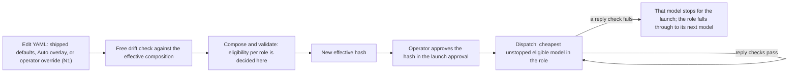

# Plan 12.4 — Auto mode: classify each turn into a tier (v10)

- **Status: delivered and closed, 2026-10-27.** Auto mode (H as the judge) and models as configuration shipped in PR #428 (main `bf440cb`), after Checkpoint B's live slices passed; the design documents followed in PR #430 (HLD v2.22, LLD v2.45; main `1ecee74`). Round 2 kept H (Checkpoint R2; the operator's acceptance CR2). #426 closed as not needed. This file is the plan's closing record; #395 closes when it merges.

- **Goal:** an opt-in Auto mode. Each turn is classified easy, medium or complex, then sent to the cheapest eligible model in that tier. **The tiers are fixed. Models are configuration:** adding, removing or re-pricing a model that the existing adapters and wire controls support is a YAML change and a hash approval, never a plan or a code change. In the registry the operator's tiers are the roles `easy`, `medium` and `complex` (`registry.py:95-102`); the field named `tier` is a price band and does not drive selection.
- **Authority:**
  - **The operator, 2026-10-25, verbatim:** "What I wanted was the tiers to remain the same and we choose from among each tier on a given set of attributes. Every time we add a model why do we need a new plan? This is one thing that is a given that will change frequently".
  - **The operator, 2026-10-25, the v7 instruction:** "Draft Plan 12.4 v7: fixed tiers, models as configuration, per-model admission evidence, a conservative default estimator, no per-model task tests; Gemini and Luna as first inputs only. Get Codex's review, then bring it back."
  - **The operator, 2026-09-30 (ADR-004), verbatim:** "Model selection will change throughout the life of the project and should be configurable, so tests are not needed just to check tasks". The one exception they kept is ADR-006's summary quality check.
  - **The operator, 2026-10-23, verbatim:** "for Auto we need to research Jev vs DSPy first". ADR-007 stays Proposed and frozen until the pilot's acceptance record.
  - **The operator, 2026-10-26:** decision N3 (#400 option b1), quoted under Decisions.
  - **The operator, 2026-10-26:** decision N4, and the Checkpoint A decisions: H accepted as Auto's judge (ADR-028), the `auto` hash, manifest option (ii), and round 2 with R1(a), R2(a) and R3. All are quoted under Decisions.
  - **The operator, 2026-10-27:** Checkpoint B's live slices and the merge (CB1), the design-document successor (CB2), round 2's arms and inputs (R4, N6, N7), and round 2's disposition (CR2). All are quoted under Decisions.
- **Supersedes** v9 (`fb1a06a5…`), now unchanged in the plans archive (`archive/2026-10-23-plan-12-4-auto-mode_v9.md`); v9 superseded v8 (`72cab9f0…`), v8 superseded v7 (`9682ab64…`), and v7 superseded v6 (`433bb8eb…`). This file is the complete successor and the plan's closing record. The plan file wins over chat.
- **Workflow:** Claude (Opus 5.5) implements; Codex reviews through the CLI at Checkpoints A, R2 and B. Targeted tests per change; one full suite at the end; Linux CI failures are fixed in the PR.
- **Estimate:** **10–14 active days**, excluding approval, service and paid-run waits (Codex's figure, kept until N1 and the migration scope are settled). Removing the paid qualification saves little; the override authorization and the admission migration add cross-cutting work.
- **Round 2 (Task 6):** about 2–3 more active days, in parallel with Tasks 4–5, excluding labelling and approval waits.
- **Research:** the Jev-versus-DSPy report, posted verbatim on #395. **Reviews:** Codex's reviews of every draft, posted verbatim on #395.

## What v10 changes from v9

v10 records what happened after v9 was filed and closes the plan. Nothing in Designs 1–5 changes, except the four
round-2 deviations below, each approved by the operator before the paid calls.

| v9 | v10 | Why |
|---|---|---|
| Checkpoint B: the full suite, the PR, Linux CI, Codex's full-diff review, the documentation audit and one live acpx slice per routable tier | **Done.** Codex round 68 found four issues in the full diff, fixed in `3420eb2` and accepted. The Windows full suite with coverage passed at `3420eb2` (10,107 passed, 50 skipped, 101 deselected; every required coverage gate). PR #428's first Linux run failed three tests (a test wrote an override into the runner's real home folder); fixed in `236a3c4`. Main (PR #429) was merged into the branch as `df7dc3c`, and this plan's judge record became ADR-028 (main's ADR-027 had merged first). The live slices passed 3 of 3 at `df7dc3c` for USD 0.005858 (#395 comment 6437429914). PR #428 merged as `bf440cb`; the design-document successor merged as PR #430 (`1ecee74`) | CB1, CB2 |
| Round 2's arms include L and HL, with an `evaluation` change for Luna Decisions and its hash approval | **R4 (option (c)): L and HL dropped.** Luna Decisions' endpoint states no data-use policy and is not on the zero-retention list, and 60 of the 150 test items are redacted excerpts of the operator's archived prompts. The `evaluation` profile (`d8d0b90e…`) was unchanged, the Luna probe was skipped, and the harness's existing no-Luna path ran (it gates every Luna step on `arms.json`) | The operator's choice (S15); Codex round 66's options |
| The turn sizes are measured from the operator's own Gateway usage | **N6:** from the operator's Claude Code transcripts, usage counts only: 2,180 typed-prompt turns over 30 days, median input 3,243,333 tokens and output 8,226, each response counted once, cache tokens charged as input. The Gateway logs held only 20 usage-bearing turns, all from test runs | The operator's approval (S15). Codex round 72: these are approved counterfactual assumptions, not measured Optimus savings or one request's context |
| Tuning reuses round 1's rows | **N7:** one round-1 test row of D came from two calls (DSPy's JSON fallback; 451 calls for 450 rows). It counts as that call's single answer, for tuning only; no round-2 cost or call count comes from round-1 rows | The operator's approval (S15) |
| D3 is round 1's frozen program, three calls per decision | **D3's JSON fallback was off** for round 2, so a malformed reply is one call and an abstention, never a second paid call. The program's bytes are unchanged; the adapter's behaviour changed | Codex round 66, finding 1 |
| Checkpoint R2: Codex reviews round 2; the operator decides | **Done: H stays.** Only B and H passed the gates; they tied, and H's estimated total cost was lower (R1(a)). Codex round 72 accepted, with limitations (Design 5's result, below). The operator accepted (CR2) and #426 closed as not needed | Rule step 5; CR2 |
| The pilot's evidence bundle only | **Plus round 2's:** `docs/sources/plan-12-4-auto-round2/`, content-free, with a tool that recomputes every view from its manifest alone and reports the two items Codex round 72 found missing (the B/H tie interval and calibration) | Codex round 72 |

## What v9 changes from v8

| v8 | v9 | Why |
|---|---|---|
| The classifier's output reserve: 256 tokens for a text classifier (Design 1) | **N4:** 1,024 in the `evaluation` profile, for Haiku. The `auto` composition configures 256, which Jev's decisions route does not use | Haiku's low reasoning shares the output cap; at 256 one reply came back with no content (run `tune-C`, Codex round 61) |
| Every exception route's reply checks include the finish status, one router attempt and the pipeline (Design 1) | **On the System One decision endpoint:** the cost, the answers' types and values, and the model snapshot. The finish status, router attempts and pipeline cannot be observed there, so they are recorded as Jev's admission limitations. Phase B adds confidence validation | The endpoint returns no router metadata and no finish status (Task 1 design notes; Codex round 62) |
| Checkpoint A: the operator decides ADR-007 and approves the `auto` hash | **Done:** H accepted ([ADR-028](../../decisions/ADR-028-accepts-adr-007-auto-judge-h.md)); `auto` gains Jev as its classifier, and its hash `f11dc3ab…` is approved | The pre-registered rule selected H; Codex rounds 62 and 63 |
| The repository's manifest holds each item's SHA-256 digest (Design 3) | **N5 (option (ii)):** the repository files a manifest keyed by item ID, with a tool that recomputes every metric from it; the digest-bearing original stays in the review kit, pinned by SHA-256 | The digests trip the local secret scan, and they are useful only to someone holding the private text (Codex round 63) |
| The pilot environment: DSPy 3.4.1 and LiteLLM | **Plus DSPy's `optuna` extra,** which MIPROv2 needs | MIPROv2's first run failed on the missing import |
| One pilot | **Round 2 (Design 5, Task 6):** a challenger round on a fresh, sealed split, with H as an arm. R1(a) changes its tie-break to an estimated total cost | The operator's instruction of 2026-10-26 (ADR-028) and decisions R1–R3 |
| The classifier backend is whichever arm won (Design 4) | **H,** frozen from the pilot's `frozen-1`. A missing or malformed confidence counts as an abstention | ADR-028; Codex round 62 |
| Luna "($0.10 / $0.50)" (Design 2) | **$0.20 / $1.00,** as its entry records; still cheaper than Haiku ($0.50 / $2.50) on both prices | A correction |

## What v8 changes from v7

| v7 | v8 | Why |
|---|---|---|
| An exception route's reply is refused for any router pipeline stage (Design 1, the per-reply checks) | **Decision N3:** one unflagged `guardrail` stage is accepted, under the exact rule in [ADR-026](../../decisions/ADR-026-exception-routes-accept-one-unflagged-guardrail-stage.md). Any other stage, or any other guardrail fact, still refuses | #400 (R-15) recurred in the Task 3 smoke test on 2026-10-26. A stage reporting `flagged: false` and nothing else stopped Haiku's route, so arms C, D and H could not run. Every exception route shares the rule, the Auto overlay's included |
| — | **N3 lands main-first,** in a #400 PR with ADR-026 and this successor. The Plan 12.4 branch then merges main and records N3's residual in each exception route's admission limitations. That changes their effective hashes, which the operator re-approves | Codex round 58's delivery condition |

## What v7 changes from v6

| v6 | v7 | Why |
|---|---|---|
| Admission keyed by snapshot hash and model, in Python (`experimental.py:50-88`) | **Admission evidence is a block on each model's YAML entry**, reviewed through the effective-hash approval (Design 1) | Any change to the canonical policy changes the effective hash (`registry.py:403-417`), so a code-pinned exception breaks on every model or price change (`defaults.yaml:17-18`) |
| A verified estimator, or Haiku's code-pinned empirical one (`validation.py:135-136`; `capacity.py:87-90`) | **A conservative empirical default estimator any model may name**, kept `verified: false`; a measured one replaces it with an evidence-backed estimate | Lets a model without a published tokenizer be admitted, with its assumptions and residual risk stated (Design 1) |
| Gemini implementer qualification: 10 paid turns and a receipt (v6 Design 2, Task 2) | **Removed.** No per-model task tests | ADR-004, operator 2026-09-30 |
| A `gemini-qualification` snapshot | **Removed** | Nothing runs on it |
| Gemini named in the design and the acceptance | **Gemini and Luna are data:** the first entries in the Auto overlay (Task 2). No task depends on which models they are | The 2026-10-25 instruction |
| One empirical route stop per Gateway process (`model_policy.py:105`; `responses.py:260-264`) | **One stop per model**, and the tier falls through to its next unstopped model | A failure on one model must not stop the others or empty a tier that still has a routable model |
| The operator override exists in `load_registry`, but launch never loads it (`binding.py:97` passes `None`) | **Decision N1:** wire it (recommended) | ADR-004 chose option C, "shipped defaults plus a validated operator override"; without it every model change is a release |

## Decisions

**Carried from v6:** P1(a), A3, A4, A4-ii and A5(a) are unchanged. A1 keeps the **$15** pilot cap (which includes the Jev reachability probe) and the **$2** live-slice cap; the **$5** qualification cap is retired, unused. A2 ("qualify Gemini") becomes "Gemini is a first input", with no qualification.

**New, decided by the operator on 2026-10-25 (Source S11):**

| # | Decision | Options | Status |
|---|---|---|---|
| N1 | How the operator changes models without a release | **(a) Recommended by Claude:** wire the ADR-004 override. One fixed file, resolved through the existing trusted operator-path machinery (`operator_paths.py:235-257`), is combined over the shipped defaults (and over the Auto overlay, in the `auto` composition) by the launch gate and the Gateway independently. It applies only after the operator approves the resulting effective hash, as today. No caller-supplied path, hash or environment value is accepted, and test profiles never read it. **`optimus-trust run-gateway` today signs whatever registry it composes without checking an approval** (`launch_approval_cli.py:1039-1069`), so under (a) it signs only a registry hash that a valid launch approval for the workspace already binds, and refuses otherwise. **(b) Not recommended by Claude:** shipped YAML only. A model change is a YAML-only PR and a release: no plan, but a release per change | **Approved (a)** |
| N2 | Admission evidence moves from reviewed code to approved data | **(a) Recommended by Claude:** accept the broader admission policy. Any model entry may be admitted on an empirical estimate, a provider-family slug, or both, each with its recorded evidence and limitations (Design 1), once the operator approves the effective hash. **The residual risk you accept:** a model's first call can exceed its estimate, or be charged, before the per-reply check stops its later calls. This reverses `experimental.py:14` ("It is never a YAML flag") and the code-pinned part of ADR-023, so a new ADR, Proposed until you approve it, records it at Task 1. **(b) Not recommended by Claude:** keep one code-pinned exception per model. Each model change stays a code change and a PR | **Approved (a)** |

**The operator's approval, 2026-10-25, verbatim:** "Approved: Plan 12.4 v7 (r3, 0cb60e50), with N1(a) wire the operator override and N2(a) accept the per-entry admission policy and its first-call risk. Prepare the filing."

**New, decided by the operator on 2026-10-26 (Source S12):**

| # | Decision | Options | Status |
|---|---|---|---|
| N3 | The router pipeline an exception route accepts (#400, R-15) | **(b1) Recommended by Codex (round 58) and Claude:** exactly one `guardrail` stage with exactly one closed-facts record: `flagged` false, `detected` false or absent, and no decision, no action, no verdict conflict and no scope. Every other reply check is unchanged. **The residual risk you accept:** such a stage does not prove that the request or reply was unchanged, or how the guardrail handled the data. **(b1+) Optional, not a condition:** b1, also keeping the stage's name as a closed literal, for diagnostics only. **(b2) Not recommended:** accept any unflagged stage, whatever its decision or action. **(c) Not recommended:** keep refusing. The pilot then measures only arms A and B, and Auto's exception routes stay exposed to R-15 | **Approved (b1)**, main-first |

**The operator's approval, 2026-10-26, verbatim:** "Approved: #400 option b1 with Codex round 58's conditions, accepting the residual risk (an unflagged stage does not prove unchanged content or data handling). Deliver main-first as a #400 PR with the Plan 12.4 successor and decision record; post the round-58 review to #400."

**New, decided by the operator on 2026-10-26 (Source S13):**

| # | Decision | Options | Status |
|---|---|---|---|
| N4 | The classifier output reserve in the `evaluation` profile, after Haiku's empty reply at 256 | **(a) Recommended by Codex (round 61) and Claude:** 1,024. Data only; a new `evaluation` hash, which the operator re-approves. The unknown-cost call stays unknown, carried as a $0.001333 estimate-based provision. **(b) Not recommended:** no reasoning for classifier calls, through a per-role override; a code change. **(c) Not recommended:** keep 256; the Haiku arms then cannot complete | **Approved (a)**; `d8d0b90e…` re-approved |
| CA1 | ADR-007's acceptance (Checkpoint A) | **(a) Recommended by Codex (round 62) and Claude:** accept H, as the pre-registered rule selects, with its limitations recorded. **(b) Not recommended:** accept B (Jev alone), which overrides the rule's tie-break after seeing the results. **(c) Not recommended as a precondition:** no winner until a larger test; kept as round 2 | **Approved (a):** [ADR-028](../../decisions/ADR-028-accepts-adr-007-auto-judge-h.md) |

**The operator's approvals, 2026-10-26, verbatim:** N4: "Approved: N4, classifier output reserve 1,024 (evaluation hash d8d0b90e...), per Codex round 61. Carry the unknown ar-042 call as a $0.001333 provision, still unknown. File the follow-up issue for known-cost handling of truncated empty replies." CA1: "Approved: accept arm H (the hybrid: rules, then Jev) as Auto mode's judge per the pre-registered rule and Codex round 62, with its limitations. Draft round 2 (a steadier DSPy, the Jev + DSPy combinations, GPT-6 Luna Decisions, a fresh sealed test set) for Codex review; no paid calls yet."

**New, decided by the operator on 2026-10-26 (Source S14):**

| # | Decision | Options | Status |
|---|---|---|---|
| CA2 | The `auto` composition's hash | `f11dc3ab…`: the shipped defaults plus the Auto overlay, with Jev as the classifier and no operator override. Codex round 63 accepted it on its retained validation record: the change adds and removes no validation issue, and only the classifier's eligibility changes | **Approved** |
| N5 | Filing the per-item manifest that Design 3 promises the repository | **(ii) Recommended by Claude:** file a manifest keyed by item ID, with a tool that recomputes every metric from it alone; keep the digest-bearing original in the review kit, pinned by SHA-256. **(i)** File the original with an explicitly approved, narrow scanner treatment of its verified non-secret findings | **Approved (ii)** |
| R1 | Round 2's tie-break cost (Design 5) | **(a) Recommended by Codex (round 63) and Claude:** the estimated counterfactual total cost per 1,000 turns (the classifier, plus the routed turn at measured sizes and the `auto` prices). **A change from round 1's rule.** **(b)** Round 1's classifier-only cost | **Approved (a)** |
| R2 | Steadying DSPy for round 2 | **(a) Recommended by Codex and Claude:** D3, three calls per decision with a majority. **(b)** Reasoning off for the classifier, a product change; not in round 2. **(c)** Both | **Approved (a)** |
| R3 | Round 2's budget | A **$5** round ceiling within the **$15** total; the ledger enforces both | **Approved** |

**The operator's approval, 2026-10-26, verbatim:** "Approved: auto hash f11dc3ab (defaults plus overlay, no override); manifest option (ii); round 2 with R1(a) total-cost tie-break, R2(a) D3, R3 a $5 round cap within the $15 total. Draft Plan 12.4 v9 folding these for Codex review; no paid calls."

**New, decided by the operator on 2026-10-27 (Source S15):**

| # | Decision | Options | Status |
|---|---|---|---|
| CB1 | Checkpoint B's live slices and the merge | One live acpx slice per routable tier (easy, medium, complex), within A1's $2 cap, then the merge if they pass | **Approved; done:** 3/3 passed (USD 0.005858); PR #428 merged as `bf440cb` |
| CB2 | The design-document successor | HLD v2.22 and LLD v2.45 from the baseline page keys, Codex authoring the replace edits, with `SKIP=check-added-large-files` for the two PDFs | **Approved; done:** PR #430 (`1ecee74`); Codex round 69's scope ruling D1(a) |
| R4 | Round 2's Luna arms, given the endpoint's unverified data use | **(a)** Include L and HL, accepting retention or training exposure for the redacted archived excerpts, in tuning and test. **(b) Not put to the operator:** L on the public items only (Codex round 66); it needs revised collection and comparison rules, and partial L results cannot be ranked against the other arms' full-150 results. **(c) Recommended by Claude:** drop L and HL; no private text reaches an endpoint without a stated data-use policy, and the remaining arms stay comparable | **Approved (c)** |
| N6 | The turn sizes behind R1(a)'s cost (Design 5) | v9's source (the operator's Gateway usage) held only 20 test turns. The candidate: the operator's Claude Code transcripts, usage counts only | **Approved** |
| N7 | The one reused two-call round-1 row | Use it as that call's single answer for tuning only | **Approved** |
| CR2 | Round 2's disposition (Checkpoint R2) | **Recommended by Codex (round 72) and Claude:** accept the result with its limitations; H stays under rule step 5 and ADR-028; close #426 as not needed. No replacement-judge record or further paid round is needed | **Approved** |

**The operator's approvals, 2026-10-27, verbatim:** CB1: "Run the live acpx tests first, one per routable tier (paid release granted for these runs). Merge after they pass." CB2: "Start the HLD v2.22 / LLD v2.45 successor for Plan 12.4 under #395, built from the baseline page keys with Codex authoring the replace-edits. SKIP=check-added-large-files is approved for its PDFs." R4, N6 and N7: "Option (c): drop the L and HL arms. N6 (turn sizes from my Claude Code usage counts) and the reused two-call round-1 row are approved. Paid round 2 is released, about $0.55 within the $5 round cap." CR2: "Accept round 2 per Codex round 72: H stays (rule step 5, ADR-028), with its limitations; close #426 as not needed. Start the close-out: the plan successor recording the deviations, the round-2 evidence bundle with the reporting gaps fixed, and the docs freshness audit, as one PR; merge it once its c" (the message as received; the reply button's text was cut at 300 characters, and the full instruction, shown to the operator before they chose it, ends "merge it once its checks are green, then close #395")

## Prerequisites

| Prerequisite | Satisfied today? | Owner | If unsatisfied: genuinely hard, or merely unauthorized? |
|---|---|---|---|
| Decisions P1(a), A1, A3, A4, A4-ii, A5(a) | yes | The operator, 2026-10-23 | — |
| Decisions N1 and N2 | yes | The operator, 2026-10-25: (a) for both | — |
| Decision N3 | yes | The operator, 2026-10-26: (b1) | — |
| Decisions N4, CA1, CA2, N5 and R1–R3 | yes | The operator, 2026-10-26 | — |
| The decision sources: S11 (2026-10-25), S12 (N3), S13 (N4 and CA1), the app's exports of this session, registered in `docs/decisions/README.md` (ADR-011) | yes | Claude | — |
| Source S14 (CA2, N5, R1–R3), the app's export of this session after that approval, registered at this plan's filing | no | Claude, at filing | Merely unauthorized: an export and a registration |
| **A4-i:** SWE-chat; the operator accepted its Hugging Face conditions, and `conversations.parquet` was downloaded (2026-10-26) | yes | The operator | — |
| The operator's archived prompts: 4,977 distinct typed prompts in 1,444 local Claude Code transcripts (counted 2026-10-23, without reading their text) | yes | Claude extracts them at Task 3 and Task 6 | — |
| **Code/state:** admission as entry data, the conservative estimator, per-model stops, the override and the `run-gateway` approval check (N1(a)) | yes | Claude, Task 1, on the Plan 12.4 branch | — |
| **Code/state:** the classifier role, its capacity, estimator and output-reserve rules; the `classification` settlement stage; the Jev Gateway adapter | yes | Claude, Task 1, on the Plan 12.4 branch | — |
| **Code/state:** a production Auto composition, with per-turn route and context capture and ordinary compaction | no | Claude, Task 4 | Genuinely absent: buildable now |
| **Code/state:** confidence validation in the decision adapter, and classifier-failure handling (Design 4) | no | Claude, Task 5 | Genuinely absent: buildable now |
| The operator's approval of each effective hash before its calls: ordinary, `evaluation` (`d8d0b90e…`, after N4) and `auto` (`f11dc3ab…`) | yes | The operator | — |
| OpenRouter's Jev decision API, reachable through the Gateway's adapter with the Gateway's existing credentials (shown by probe 1, 2026-10-26) | yes | The operator (credentials; Claude never reads or handles a key) | — |
| The Gateway and its services (the shared Redis, never stopped by Claude) for round 2 and the live slices | unknown | The operator (machine state); Claude checks before each paid step | Merely unauthorized: the operator starts them |
| An isolated pilot environment: Python 3.14 with DSPy 3.4.1 (and its `optuna` extra) and LiteLLM, pinned by hash, outside the product's `pyproject.toml` | yes | Claude | — |
| An execution checkout with its own `.venv`: the Plan 12.4 worktree | yes | Claude | — |
| A second rater: a Codex CLI session, independent of Claude | yes | Claude runs it | — |
| **Round 2:** the fresh, sealed labelled set (Design 5) | no | Claude (subagents) and Codex | Genuinely absent: buildable now, free |
| **Round 2:** the harness additions (D3, MAX, GATE, HL, the seal and its tests, R1's cost measure, the two-level ledger) and the measured turn sizes | no | Claude | Genuinely absent: buildable now |
| **Round 2:** the `evaluation` composition with GPT-6 Luna Decisions, and the operator's approval of its hash | no | Claude, then the operator | Merely unauthorized: a reviewed data change and an approval |
| **Round 2:** GPT-6 Luna Decisions reachable through the Gateway's adapter | unknown | Claude probes it after the hash approval and the release | Genuinely hard: an external dependency. If System One does not serve it, the adapter change is gated (Design 5); if Luna is unreachable, L and HL are dropped and the round runs without them |
| **Round 2:** the operator's release of its paid calls | no | The operator | Merely unauthorized |
| `acpx` 0.12.0, for the live slices | unknown | The operator (machine state); Claude checks `acpx --version` before Checkpoint B | Merely unauthorized: the operator installs or updates it |

**Each `unknown` row is settled before the step that depends on it.**

## Design

### 1. Models as data (Task 1)

**A model entry carries everything its admission needs:**
- **Route facts** (window, max output, quantization, provider slug), each endpoint with `verified` and `observed_on`, taken from the free drift check. Unchanged from today.
- **An `admission` block,** replacing the `EXPERIMENTAL_ROUTES` table. It has two independent parts; an entry uses neither, either or both, and using one never relaxes the other's checks:
  - **`empirical_estimate`:** the entry's estimator may be unverified. It records the evidence (source and date), the assumptions, and the known limitations.
  - **`provider_family`:** the route may use a provider's base slug. It records the provider name every reply's router metadata must report, the evidence, and the limitation that a base slug can reach any variant or region of that provider.
- **The estimator.** A shipped `conservative-utf8` profile, `verified: false`: 1 token per UTF-8 byte of message and tool text, 16 per message, 256 fixed (Haiku's values today, `defaults.yaml:28`). It is a conservative empirical estimate, not a proven bound:
  - **Its assumptions:** text-only input, and a tokenizer that does not expand text by normalization beyond one token per original byte.
  - **What is not proven:** that provider framing fits the fixed and per-message allowances, and the route's finish semantics.
  - **The residual risk** (accepted under N2): a first call can exceed its estimate, or be charged, before the per-reply check stops later calls. Unknown-cost handling is unchanged.
  - A measured estimator, when one exists, replaces the empirical estimate with an evidence-backed estimate, which may be higher or lower.
- **A summarizer receipt,** for the summarizer role only (ADR-006). Unchanged.

**The per-reply checks** (`model_policy.py:216-254`), on every reply of a model admitted with either `admission` part:
- **Always:** the usage and finish checks, one router attempt, and no pipeline stage other than the one unflagged `guardrail` stage that N3 accepts (ADR-026). That is exactly one stage with one closed-facts record: `flagged` false, `detected` false or absent, and no decision, action, conflict or scope. **Its residual risk, accepted by the operator:** such a stage does not prove the request or reply unchanged, or how the guardrail handled the data. Each exception route's admission limitations record it.
- **`empirical_estimate` adds:** billed input at most the estimate.
- **`provider_family` adds:** the reported provider equals the recorded one (`:233-235`), including when the entry's estimator is verified.
- **A decision model on the System One endpoint** (Jev) returns no router metadata and no finish status. Its adapter checks the cost, the answers' types and values, and the model snapshot; the finish status, router attempts and pipeline stages are recorded as its admission limitations. Phase B also requires a finite confidence in [0, 1] (Design 4).

A failure is permanent for that launch, and now stops **that model** only. Disabled provider fallback, fixture-policy rejection, disclosure and receipt-first accounting are unchanged.

**Stops, per model:**
- The Gateway keeps one stop per model, not one per process.
- The host already recognizes a stopped route from the Gateway's refusal (`planning_loop.py:1582-1583`). It records the stopped model for the rest of the launch, and resolution skips it.
- **One synchronized, launch-scoped stop map** serves every session and the answer, classifier and summarizer paths. This safety state is the one exception to Design 4's rule that no shared model-selection state is mutated.
- A turn whose call failed is never redispatched, since the failed call may have been billed: it ends as today, and the next turn takes the role's next unstopped model.
- One model is one stop: a stopped Haiku stops its answers, its summaries and any classifier use together, as today.

**Selection is unchanged:** within a role, the cheapest eligible model first by per-token price dominance, a declared blend for crossed prices, and an exact price tie broken by origin (`validation.py:165-218`). Explicit role assignment stays required. The attributes in each entry (price, origin, data use, capabilities, window) are the "given set of attributes". Three consequences stay configuration, not code:
- **Removing a model** from a role means replacing that role's list. The combiner merges maps and replaces lists, so omitting an entry from an override does not delete it (`registry.py:187-195`).
- **A crossed-price pair in a role** (cheaper input, dearer output) leaves the role unresolved until a blend is declared in YAML; the validator reports it.
- **A selection filter,** such as excluding models that train on inputs, is a later YAML policy option (#398), not this plan.

**Haiku moves with no change in behaviour.** Its admission moves from `experimental.py` into its entry, so the shipped defaults compose a new effective hash, which the operator approves once. Its summarizer receipt and implementer capacity are unchanged. The two Haiku test profiles move the same way and get new pinned hashes. **The historical Stage C release** builds its envelope from those pinned hashes (`stage_c.py:173-177`), so its profile-to-hash mapping is pinned separately and kept unchanged, and the release refuses the migrated profiles. A regression check proves the migration neither changes that envelope's identity nor renews its authority. Sealed records are unchanged.

**The classifier role** is activated narrowly:
- **Its own context ceiling,** set from the complete-request bound (Design 3), not the global 262,144.
- **Its own output reserve:** none consumed by Jev, which returns no free text. The validator needs a positive configured reserve wherever the role is assigned: **1,024** in `evaluation` (N4, for Haiku, whose reasoning shares the cap) and **256** in `auto`, unused by Jev.
- **Its estimator:** `conservative-utf8`, with the same per-reply checks.
- **A `classification` settlement stage,** so the classifier's cost is its own stage (ADR-007).
- **A Gateway adapter for Jev's decision API,** recording usage, with a typed-request capacity check before the provider call.
- **It stays dormant** in every composition except `evaluation` and `auto`.

**The compositions:**

| Composition | What it is | Approved |
|---|---|---|
| Ordinary | Shipped defaults, plus the operator override under N1(a) | Before the next launch after Task 1 |
| `evaluation` | The pilot's test profile: the classifier role for Jev and Haiku. It never reads the operator override | After Task 1, before any pilot call |
| `auto` | Production: shipped defaults, plus a shipped Auto overlay, plus the operator override under N1(a) | **Approved 2026-10-26 (CA2): `f11dc3ab…`,** with Jev as the classifier and no operator override. An override composed over it needs its own reviewed and approved hash |

**A5(a) holds:** only `auto` loads the Auto overlay, so **with no operator override** launches without Auto keep today's default model. An operator override that admits a medium model in the ordinary composition changes the ordinary default planner (`agent/defaults.py:25-28`); that is the operator's configuration choice, and the launch approval shows the new hash.

### 2. The first inputs (Task 2: data only, no paid calls)

- **The Auto overlay** gets two entries:
  - **Gemini 3.8 Flash** in medium, complex and escalation;
  - **Luna** in easy.
- **Their route facts** come from a free drift-check read of the effective `auto` composition. Both name `conservative-utf8` and carry the `admission` parts their routes need.
- **What this does in Auto:** Luna ($0.20 / $1.00) is cheaper than Haiku ($0.50 / $2.50) on both prices, so it leads easy, with Haiku next; Gemini is the only medium and complex model.
- **Luna's known gaps stay visible in its entry:** its tokenizer, framing and finish behaviour are unverified (the 2026-10-08 disposition). They are covered by the conservative estimate and the per-reply checks, within the N2 residual risk. If Luna stops, easy falls through to Haiku.
- **Replacing either model later** is an edit to the overlay or the operator override, then a hash approval. No task changes.

### 3. The pilot experiment (Task 3)

The pilot names models because it compares approaches. **The winner fills the classifier role as data,** like any other entry.

**The classifier's input contract, frozen before any labelling or optimisation.** One bounded representation is shared by the dataset, the optimisers and production (ADR-007:73-74):

| Field | What it carries |
|---|---|
| `prompt` | The current prompt's text, cut to the excerpt budget (below), at most its first 4 KB |
| `truncated` | `true` if the prompt was cut |
| `mode` | Chat or Agent |
| `attachments` | The count of attached files or ranges, a total-size bucket (<4 KB, <64 KB, larger), and up to 5 distinct file extensions |
| `previous_tier` | The previous turn's routed tier, if any |

- **Never included:** history or file contents.
- **Raters label the full request,** after redaction and the confidentiality review. The classifier sees only this representation.

**The complete-request bound, frozen with the contract:**
- **One bound for the whole serialized classifier request:** 8,192 estimated tokens, by the route's own estimator. It covers the instructions or template, any few-shot examples, the contract fields, the framing, and the output reserve. Haiku's estimator counts 1 token per byte (`defaults.yaml:28`; `capacity.py:62-67`), so the bound is in estimated tokens, not bytes.
- **The excerpt budget:** for each frozen configuration, the fixed parts are measured once. The prompt excerpt gets what remains, up to 4 KB.
- **Overflow, identical in the pilot and in production:**
  - **Fixed parts that leave no excerpt budget make a configuration invalid.** An example is a DSPy program with too many examples. It is rejected when it is frozen, never at run time.
  - **A longer prompt is cut to the budget,** with `truncated: true`.

**The arms, all through the Gateway on the `evaluation` snapshot:**

| Arm | What it is |
|---|---|
| A | Rules only |
| B | Jev; its variant (`choice` or ordinal `score`) is frozen on dev |
| C | Haiku 5.5 with a hand-written prompt |
| D | Haiku 5.5 optimised by DSPy; the optimiser (BootstrapFewShotWithRandomSearch, MIPROv2 light or GEPA light) is frozen on dev. **Its few-shot examples come only from the hand-written train items,** so that a winning program can ship without any archived or public prompt text |
| H | Rules first; a learned arm decides only the uncertain middle. Its backend and rule thresholds are frozen on dev |

**Two rules apply to every arm:**
- **Low confidence or abstention routes one tier up** (ADR-007). The confidence thresholds are frozen on dev.
- **The test split is evaluated once per frozen configuration,** in 3 repeats.

**The labelled set (a pilot, not a definitive benchmark):**
- **Size and mix:** 300 requests, roughly 30/40/30 easy/medium/complex, so about 45 complex items reach the test split.
  - **120 from the operator's archived chats** (A4):
    - **Which prompts:** only prompts the operator typed, from local Claude Code transcripts, and from Codex's interactive sessions.
    - **Extraction filters:** these are excluded:
      - subagent and sidechain records, and tool results;
      - meta records, and harness-injected messages (anything opening with a tag, and system reminders);
      - compaction summaries and interruption markers;
      - pasted material (pasted-content blocks, and agent text the operator relayed, such as signed Claude or Codex reports);
      - every Codex `codex exec` session, since those carry briefs written by Claude.

      **A record whose authorship is uncertain is excluded.**
    - **Preparation:** deduplicated, sampled across projects and months, and then:
      1. redacted by the existing redaction gate;
      2. **given a local confidentiality review by Claude:** any prompt naming people, clients or confidential matters that the gate cannot catch is dropped, and not edited;
      3. labelled only after both steps.
  - **60 real prompts to coding agents from a public set** (A4-i):
    - **SWE-chat** (Claude's recommendation): prompts to Claude Code, Codex and Gemini CLI from 2026, licensed ODC-BY.
      - **Access:** it is gated, so the operator accepts its conditions on Hugging Face and downloads `conversations.parquet`. The files total 47 GB, but only this one is needed.
      - **Records used:** only those with `turn_type == 'user_prompt'`, never `system_injected`.
      - **The conditions** are read when they are accepted, and must allow sending the excerpts to the pilot's model providers. If they do not, DevGPT is used instead.
    - **The alternative, DevGPT:** developer–ChatGPT conversations from 2023, licensed CC BY 4.0, and open. Its archive, `DevGPT.zip`, is 926.8 MB (Zenodo record 8303722); Claude downloads it, after approval. It is evidence about developer chat, not about coding-agent use, and is reported as such.
    - **The public items get the same confidentiality review** as the archived ones.
  - **60 SWE-bench Verified items:** the 500-row test split, 2.1 MB, downloaded by Claude after approval. Its `difficulty` column (time-to-fix buckets) is an independent check on the labels.
  - **60 hand-written edge cases:** short but dangerous, long but trivial, questions, and review requests.
- **Handling:**
  - **Downloaded files** go into their own empty folder, and are read only by scripts run in isolated mode.
  - **The prompt text stays outside the repository,** in the local review kit beside the worktrees.
  - **The repository gets the aggregate results and a content-free manifest** (N5, option (ii)). Each item is keyed by its pilot ID, and the manifest holds:
    - its source and provenance class;
    - its source version and licence;
    - any modification (cut or redacted);
    - its split and group (as an index);
    - both raters' labels;
    - every arm's prediction, and the first repeat's other metric inputs (tier, confidence, route-up, latency and cost).

    A tool beside it recomputes every metric from it alone, without the private text. The original, keyed by each prompt's SHA-256 digest, stays in the review kit, pinned by its own SHA-256.
  - **What leaves the machine, in full:**
    - **The raters:** each redacted, reviewed request goes in full to Claude (Anthropic) and to Codex (OpenAI).
    - **The pilot's calls:** the contract representation, with at most 4 KB of prompt excerpt, goes through the Gateway to Jev's provider (no training on it; retention is not stated) and to Anthropic (Haiku).
  - **Licences:**
    - **Kept:** each public item's source, version, licence notice and modification record.
    - **ODC-BY** covers the SWE-chat database, not the individual prompts. CC BY attribution applies to anything from DevGPT that is published.
    - **Publication:** no public or private prompt text is published, other than the shipped examples below.
- **The rubric:**
  - **easy:** one file, explicit and mechanical;
  - **medium:** 2–5 files or one module, or a bounded investigation;
  - **complex:** crosses modules, open-ended debugging, or touches security, data or concurrency.
- **Raters:** two independent raters, Claude and Codex, with Cohen's kappa reported. **Disagreements take the higher label,** since routing up is the safe direction.
- **Deduplication** runs across all sources, before the split.
- **The split:** 100 train / 50 dev / 150 test, stratified by class and source.
  - **It is grouped,** so that prompts from the same conversation or task never cross splits.
  - **Optimisation and every threshold** see train and dev only.

**The metrics.** Each is computed on the final routed tier, after any route-up, with requests as the sampling unit:
- **The penalty score:** under-routing costs 3 per tier, over-routing 1 per tier. Sensitivity runs at 2× and 5×. It is a penalty, not dollars.
- **The registry-weighted cost:** reported separately, at the eligible models' real prices.
- **The under-route rate:** the fraction of test requests whose first repeat routes below their label.
- **The flip rate:** the fraction of test requests whose final routed tier is not the same in all 3 repeats, with caching off.
- **Per source:** every metric is reported for each source alongside the pooled figure.
- **The rest:** accuracy and macro-F1; the route-up rate; latency p50 and p95 through the Gateway; classifier cost per 1,000 requests, from Gateway accounting; expected calibration error.
- **How they are reported:** each gate is an observed rate, with a Wilson interval. Paired differences use a bootstrap over requests.

**The decision rule (pre-registered, fixed before any run):**
1. **The gates apply to every arm, A and H included.** An arm passes if its observed under-route rate is at most 5%, and its observed flip rate is at most 5%.
2. **Among the passing arms, the lowest mean penalty score wins.** A learned arm (B, C, D or H) must beat A on penalty, with a 95% paired-bootstrap interval that excludes zero. Otherwise A wins, if A passes.
3. **Ties** (two passing learned arms whose paired difference has an interval that includes zero) go to the lower measured cost per 1,000 requests, then to the lower p95 latency. So C wins only by passing, beating A, and winning on these rules.
4. **No arm passes:** there is no winner. Phase B does not start, and the evidence goes to the operator.

**Budget enforcement:**
- **Per-call caps:** the complete-request bound. That is 8,192 estimated tokens, with 1,024 output tokens reserved inside it for Haiku (N4) and none for Jev. The cap is reconciled with the bound before any run.
- **Reservations versus spend:** reservations use the estimate, which runs high, and are released at settlement. The cap applies to billed spend.
- **Fixed ceilings:** the optimiser trials and the GEPA metric calls are fixed.
- **Proposer calls** count against the cap.
- **Retries:** only the Gateway's existing ones.
- **Calls run sequentially,** each with a cost reservation before it. **An unknown cost stops the run.**

**The first calls:**
- **The Jev reachability probe** (Prerequisites).
- **Then a smoke test:** 10 calls per arm through the real Gateway. It checks the DSPy binding and parsing, and that repeats really run with caching off, all inside the cap.

**The output:** an evidence report with the content-free manifest, and a draft acceptance record for ADR-007 naming the arm that the rule selects, or "no winner".

**The result (2026-10-26):**
- **Spend:** the pilot ran within its cap. $0.703490 was reported by the Gateway, plus one $0.001333 provision that stays an unknown cost.
- **The selection:** the rule selected **H**, tied with B and cheaper. The operator accepted it in ADR-028 (CA1).
- **The evidence:** `docs/sources/plan-12-4-auto-pilot/` holds the report, every view's tables, the frozen settings, the manifest and the recompute tool.

### 4. Minimal opt-in Auto (Tasks 4–5)

**A production composition:**
- **The bootstrap:** `OPTIMUS_AGENT_MODEL=auto` (today refused at `src/optimus/agent/defaults.py:50-51`) extends the ordinary path (`src/optimus/acp/bootstrap.py:255-294`) to load the approved `auto` snapshot. It keeps the Context Engine and ordinary compaction.
- **Not a test profile:** it is not built on the test profiles, which pin one planner.
- **Testing:** it is tested through the real launch path.

**Each turn:**
1. **Classify the turn** from the input contract.
2. **Map the tier to its role.**
3. **Pick the cheapest eligible model that has not stopped in this launch,** using the existing selection and the stops the host has seen (Design 1).
4. **Capture that model's route and context limits** for this turn.

**Routing up:**
- **Low confidence or abstention** routes one tier up.
- **A tier whose eligible models have all stopped, or that has none,** routes up to the next routable tier.
- **If no tier at or above is routable,** the default planner (ADR-023) is used, and the notice says so. It must itself be eligible and unstopped; otherwise the turn is refused recoverably, without dispatch.

**Classifier failure:** a failure or timeout counts as an abstention on the medium tier, so the turn routes up, and the notice says why.

**Binding per turn:**
- **Frozen for the turn:** the turn's model, route and context limits (ADR-007).
- **No shared state changes:** the runner sends the turn's bound model, not the launch-time one it holds today (`src/optimus/agent/runner.py:294`, `:335`, `:517`), and no runner or session state is mutated. The launch-scoped stop map (Design 1) is the one exception.
- **Unchanged:** the summarizer stays Haiku.

**The classifier backend is H** (ADR-028), frozen from the pilot's `frozen-1`:
- the rules score the input contract, and answer when their confidence is at least 0.8 (cut points 0.5 and 4.5);
- otherwise Jev answers through the production Gateway adapter, with the frozen `choice` question;
- any answer below confidence 0.95 routes one tier up;
- **Jev's confidence must be a finite number in [0, 1].** A missing or malformed one counts as an abstention (Codex round 62).

**A different round-2 winner (Design 5) needs its own change** after the operator's decision:
- **B, L or HL:** configuration plus this decision path.
- **D3, MAX or GATE:** host-side multi-call aggregation.

**The record and the notice:**
- **The record:** a content-free routing record per turn (arm, tier, confidence band, model). The classifier's cost goes in the `classification` stage.
- **The notice:** one line per turn in the ACP session, for example "Auto: medium → google/gemini-3.8-flash".

**Without `auto`, and with no operator override, nothing changes,** under A5(a) (Design 1).

### 5. Round 2: a challenger round (Task 6)

**What it is for:** finding a judge that passes both gates and wins under the rule on new data. H stays the judge, and Phase B builds it, unless a challenger is selected. Being selected under the rule is not proof of better accuracy: a cheaper statistical tie can be selected. The operator weighs correctness and cost above speed.

**The arms are fixed at approval, and nothing is added afterwards:**

| Arm | Exact definition | Calls per decision |
|---|---|---|
| **H** | Frozen exactly from `frozen-1` (cut points 0.5/4.5, rule confidence 0.8, Jev `choice`, threshold 0.95), as its own configuration, never re-tuned, and never touched by A's re-tuning | Jev only when the rules are unsure |
| **B** | Jev `choice`, with its route-up threshold re-tuned | 1 Jev |
| **L** | GPT-6 Luna Decisions, with B's frozen `choice` question; threshold tuned | 1 Luna |
| **HL** | H's frozen rules; otherwise L, with L's tuned threshold | Luna only when the rules are unsure |
| **D3** | The pilot's frozen MIPROv2 program (`tune-D-mipro-2`, SHA-256 `d9ec7a21…`), unchanged, with no new optimisation. **Three fresh calls per decision.** A failed or unparseable call abstains. Two or more abstentions make the decision an abstention, which routes to complex. Otherwise the tier is the most frequent valid tier, and a tie among valid tiers goes to the highest tied tier (for example easy, medium and one abstention give medium; three different tiers give complex). The confidence is the share of all three calls that gave that tier: 1, 2/3 or 1/3. Route-up below a tuned threshold on that confidence. Every case has a harness test | 3 Haiku per decision; three independent decisions per test item, so 9 |
| **MAX** | Jev's tier before route-up, and D3's aggregate tier and confidence (as defined for D3) before route-up. The tier is the higher, and the confidence the lower of the two. Route-up below a tuned threshold. Either side abstaining gives complex | 1 Jev + 3 Haiku |
| **GATE** | Jev first. At or above a tuned Jev threshold, Jev's tier; otherwise D3's aggregate (as defined for D3), with D3's route-up threshold | 1 Jev; 3 Haiku only when Jev is unsure |
| A | The rules, with the pilot's code unchanged and their cut points re-tuned: the beat-A baseline | None |

- **Dropped:** C, whose 14.7% flip rate gives this bounded round no reason to keep it.
- **Not in round 2:** reasoning-off (R2(b)), which needs a product change.
- **Cost and latency** are reported for the calls each arm would make in production, even where the experiment reuses rows.

**The data:**
- **Tuning:** the 280 pilot items that are not hand-written train items (the 130 earlier tuning items, plus the pilot's 150 test items). Round 1's test items are development data now, never confirmation evidence again.
  - They select thresholds, cut points and A's re-tuning only.
  - No optimiser trains on them. D3 reuses the frozen program, whose training examples were the 20 hand-written train items; those stay out of selection.
- **The fresh test split:** 150 new requests: 60 archived, 30 SWE-bench Verified, 30 SWE-chat and 30 hand-written.
  - **Archived:** new prompts from the operator's archive, under Design 3's confidentiality review, with sampling identities recorded.
  - **SWE-bench Verified:** from the 440 unused rows.
  - **SWE-chat:** from the qualifying sessions already downloaded.
  - **Hand-written:** 30 new cases written by Codex.
  - **Records:** each public item keeps its revision and licence.
  - **Exclusion across both rounds:** by conversation, session or task group, as well as exact text.
  - **Labels:** Design 3's rubric, the same rater brief and the same two raters. Disagreements take the higher label, and kappa is reported.

**Separation and the seal:**
- **Who sees the new content:**
  - the confidentiality review of new archived items, and Claude's labels, run in separate subagent contexts that write straight to the sealed folder;
  - the main session, which tunes and freezes, never reads new test content;
  - Codex labels in its own CLI context.
- **Residual exposure, disclosed:** the raters and the tuner come from the same model families.
- **The seal is a code boundary, with tests:**
  - the training, tuning, collect and freeze paths cannot open the sealed folder, and a self-check proves each one;
  - `test` refuses unless `freeze-2` exists and its recorded identities match (frozen settings, programs, harness);
  - `report` refuses unless a completed `test` run for that freeze exists.

**The decision rule (complete, pre-registered):**
1. **The gates apply to every arm, A and H included.** An arm passes if its observed under-route rate is at most 5% and its observed flip rate is at most 5% on the fresh test split.
2. **Among passing arms, the lowest mean penalty wins** (3 per tier under, 1 per tier over; first repeat; final tier after any route-up). A learned arm, meaning any arm other than A, must beat A with a 95% paired-bootstrap interval that excludes zero.
3. **If no passing learned arm beats A,** A wins if A passes; otherwise there is no winner.
4. **Ties** (two passing learned arms that beat A, whose paired difference has an interval that includes zero) go to the lower estimated total cost (R1(a)), then to the lower p95 latency.
5. **No winner, or H wins: H stays.** Any other winner, A included, replaces H only after the operator accepts it in a new decision record, and switching needs its own change (Design 4).
6. **Reported, not deciding:** the 2× and 5× sensitivity, the per-source views, the view without context-dependent items, and the classifier-only cost.

**R1(a), the estimated total cost:**
- **What it is:** each arm's classifier cost per 1,000 turns, plus the routed turn's estimated cost at the `auto` `f11dc3ab…` prices.
- **The turn sizes** are measured from the operator's own Gateway usage, as content-free token counts.
- **Frozen before any test call:**
  - the measurement window and sample count;
  - the statistic (the median input and output tokens per turn);
  - the registry hash and prices;
  - the cache and reasoning assumptions (no cache discount; reasoning tokens count as output at their measured share).
- **How it is labelled:** an estimate, not measured spend. The classifier-only cost is reported beside it.

**GPT-6 Luna Decisions: probe first, then a gated adapter:**
- **The catalogue facts** (free read, 2026-10-26): endpoint `openai/gpt-6-luna-decisions-20261006`, provider OpenAI; $0.10 per M input, output free; context 1,050,000; output modality `decisions`. OpenRouter documents its Decisions endpoint (`/api/alpha/decisions`) for this model; that does not prove that System One serves it.
- **The `evaluation` profile gains its entry,** and the classifier role lists it. The operator approves the new hash before any call.
- **The probe:** one call with synthetic content, on the existing System One path, after that approval and the round's release.
- **If the routed endpoint is needed,** a Gateway change, which Codex reviews (with re-approval of any affected hash) before any further call:
  - a fixed, reviewed transport selection with correct URL construction; today the adapter appends `/systemone` to a base ending `/api/v1` (`upstream_client.py:191`, `:320`). No caller-supplied URL; the chat and Jev paths unchanged;
  - a normalized reply contract: provider and model identity, typed answers, a finite confidence in [0, 1], complete usage and verified cost;
  - endpoint-specific observability: whatever the routed endpoint returns is enforced, and Jev's omissions are not imported by default;
  - one attempt, uncertainty handling, the receipt before refusal, and the permanent stop, all kept.
- **Its admission entry records:**
  - dated catalogue evidence;
  - model, snapshot and provider slug;
  - capabilities, prices, and window and output facts;
  - the estimator's assumptions and the transport identity;
  - the provider-family limitations and the observed metadata;
  - **route-specific data-use and retention evidence for OpenRouter,** never inferred from OpenAI's direct terms.

**Budget (R3):**
- **The ceilings:** $5 for the round, within the $15 total. The available total balance is $14.295177322: $15, minus $0.703489678 known spend, minus the $0.001333 provision, which stays unknown.
- **The ledger enforces both:** it gains a round counter from a recorded ledger offset, and keeps the total check. A new unknown cost stops the run.
- **The estimate is about 2,830 calls and $0.55:**
  - the Luna probe;
  - a smoke test of 10 decisions per new arm;
  - L on the 280 tuning items;
  - D3's missing calls on them (260; the pilot's 3 repeats on its old test items are reused);
  - B, L and D3 on 150 × 3 test decisions (450 Jev, 450 Luna, 1,350 Haiku).

  H, HL, MAX and GATE are derived from those rows. The $5 ceiling is a stop, not proof that everything fits.
- **D3's production overhead** would be about $0.87 per 1,000 classifications, about 8.4% of a nominal $10.37 routed turn per 1,000.

**Not in round 2:** the previous-tier signal, which needs turn sequences and the judge's own earlier routing.

**The result (2026-10-27; Checkpoint R2):** the round ran under the rule with R4, N6, N7 and D3's disabled fallback
(`start`, `smoke2`, `collect2`, `freeze2` `80ad1d99…`, `test2`, `report2`; 150 sealed items × (3 B + 9 D calls) = 1,800
rows, none abstained or malformed). It spent USD 0.488070554 of the $5 round ceiling; the pilot's known total is USD
1.191560232 of $15, plus the still-unknown $0.001333 provision.

| Arm | Exact | Under-routes | Items that flip | Penalty | Gates |
|---|---|---|---|---|---|
| A (rules only) | 0.513 | 14/150 | 0/150 | 0.727 | fail |
| B (Jev alone) | 0.587 | 5/150 | 5/150 | 0.487 | pass |
| **H (rules, then Jev)** | 0.580 | 6/150 | 5/150 | 0.507 | **pass** |
| D3 | 0.760 | 16/150 | 10/150 | 0.453 | fail |
| MAX | 0.787 | 10/150 | 10/150 | 0.353 | fail |
| GATE | 0.767 | 18/150 | 12/150 | 0.473 | fail |

Only B and H pass both gates. Both beat A (paired penalty differences −0.240 [−0.413, −0.067] and −0.220 [−0.393,
−0.047]). They are statistically tied, and H's estimated total cost per 1,000 turns is lower, so H wins and stays (rule
step 5). The view without context-dependent items (n = 73) gives the same winner. **The tie is at the boundary:** H
minus B is 0.020 [0.000, 0.053], so it holds only because the pre-registered test is inclusive (`low <= 0`); B and H
differ on 2 of the 150 items, H the higher penalty on both. Calibration is poor for every arm (ECE 0.15–0.26; B 0.150,
H 0.160). Both figures were missing from the run's report and are published in the evidence bundle.

**What it does not establish (Codex round 72):**
- The sampling unit is 150 requests, not 1,800 observations. Passing the gates does not establish population rates
  below 5%: B's and H's intervals reach about 7.6% and 8.5%.
- "Tied" means insufficient evidence of a difference, not demonstrated equivalence.
- At N6's turn sizes, H's cost advantage over B comes almost entirely from one more turn left on the easy tier. H
  routes up 67.3% of turns, and its estimated cost is about 6.35% below always using the complex tier.
- D3's frozen threshold 0.0 is a legitimate tuning result (no confidence route-up); MAX freezes at 0.0 too, and GATE
  inherits D3's. Their higher accuracy cannot override failed gates, and changing thresholds now would need fresh
  confirmation data.
- D3, MAX and GATE latency is modelled as concurrent production calls from sequential measurements; it does not
  demonstrate a working concurrent mechanism.
- By source: archived selects A (passing learned arms do not significantly beat it), hand-written selects H, and
  neither SWE source has a passing arm. These views are descriptive.

The evidence is `docs/sources/plan-12-4-auto-round2/`.

## Tasks and checkpoints

| Task | Work | Targeted tests |
|---|---|---|
| 0 | **Records:** none beyond Source S11, registered at filing. **Checks:** settle the `unknown` prerequisites it can; build the pilot environment; freeze the input contract (Design 3) | `tests/unit/docs`, after staging |
| 1 | **Models as data (Design 1):** - the `admission` block and `conservative-utf8`, replacing `EXPERIMENTAL_ROUTES`; - per-model stops in the Gateway and the host; - under N1(a), the override and the `run-gateway` approval check; - the classifier role, the `classification` stage and the Jev adapter; - the `evaluation` composition; - the new ADR. **Then the operator approves the ordinary and `evaluation` hashes** | The model-policy, binding, launch-gate, approval-CLI, settlement and Gateway unit tests, and the migration checklist below |
| 2 | **The first inputs (Design 2):** the Auto overlay with the Gemini and Luna entries, from a free drift-check read | Validation of the `auto` composition |
| 3 | **The pilot (Design 3):** the Jev probe, the smoke test, the labelled set and kappa, the harness, the runs, the analysis, the evidence report and the draft ADR-007 acceptance. **Under N3:** after main's #400 PR merges, the branch merges main and records N3's residual in the exception routes' admission limitations. The operator re-approves the changed hashes, and the smoke test runs again. **Done 2026-10-26** (N4 included) | The harness's own self-checks |
| **Checkpoint A** | **Codex CLI review** of Tasks 0–3 and the evidence. **The operator decides** the ADR-007 acceptance, and approves the `auto` hash. If there is no winner, the plan stops here. **Done 2026-10-26:** Codex rounds 62 and 63; H accepted (ADR-028, CA1); `auto` `f11dc3ab…` approved (CA2); the evidence bundle filed (N5) | — |
| 4 | **The production Auto composition (Design 4):** the resolver, routing up, per-turn route and context capture, ordinary compaction, failure handling | `tests/unit/agent` and `tests/unit/acp`: the real launch path; successive turns on different models; concurrent sessions; no shared-state mutation |
| 5 | The production classifier backend (H, with confidence validation), the routing record, the per-turn notice, and the opt-in | The backend's tests; `tests/unit/acp` (the notice) |
| 6 | **Round 2 (Design 5),** in parallel with Tasks 4–5: - free: the fresh set (sourced, reviewed and labelled in separate contexts, then sealed); the harness additions (D3, MAX, GATE, HL, the seal, R1's cost measure, the two-level ledger); the measured turn sizes; - the `evaluation` change for Luna Decisions, and the operator's hash approval; - **after the operator releases the paid calls:** the probe, any gated adapter change, the smoke test, tuning, `freeze-2`, the test and the report **Done 2026-10-27** under R4, N6 and N7: no `evaluation` change and no probe (L and HL dropped); the result is in Design 5 | The harness's self-checks, including every seal path; the Gateway tests for any adapter change |
| **Checkpoint R2** | **Codex CLI review** of round 2's evidence. **The operator decides:** H stays, or a challenger replaces it in a new decision record; switching needs its own change (Design 4) **Done 2026-10-27:** Codex round 72 accepted; H stays (CR2); #426 closed as not needed | — |
| **Checkpoint B** | Round 2 need not finish first: Phase B ships H. **The full suite once,** plus Ruff; the PR; Linux CI fixed in the PR; a **Codex CLI review** of the full diff; the documentation freshness audit; one live acpx slice per routable tier, within the A1 cap **Done 2026-10-27:** CB1 and CB2; PR #428 merged as `bf440cb`, PR #430 as `1ecee74` | — |

**The Task 1 migration checklist.** Every current reader of the code-pinned admission or the single stop moves to the entry data and the per-model stop:
- **Policy:** `validation.py`, `capacity.py`, `binding.py`, `test_profiles.py`, both test-profile YAMLs and their pinned hashes, and `defaults.yaml` (packaged through `pyproject.toml`'s `package-data`).
- **Gateway:** `model_policy.py` (admission, the reply checks, the stop), `responses.py`, `request_diagnostics.py`, and the child-manifest and startup composition in `optimus_gateway/__main__.py`.
- **Host:** `gateway/route_binding.py`, `gateway/attempts.py`, `context/maintenance.py` and `context/assembly.py` (the summarizer binding), `agent/planning_loop.py` and `agent/runner.py` (stop recognition), `acp/spec.py`, default resolution in `agent/defaults.py`, and the preflight binding in `acp/preflight.py:160-175`.
- **Launch:** `launch_gate.py` and `launch_approval_cli.py` (approval, re-approval of a changed hash, and the `run-gateway` check).
- **Tools:** `tools/evaluate_context_summarizer.py`, and `tools/check_model_registry_drift.py`, which checks the effective composition rather than the defaults alone.
- **Tests:** all test modules that reference the pinned hashes or `experimental_route`.
- **Tests to add:**
  - a model added in YAML alone becomes eligible with no code change;
  - an unapproved changed registry is refused, including by `run-gateway`;
  - host and Gateway refuse to start when their compositions disagree;
  - one model's stop leaves the others routable, and a stopped default planner is refused without dispatch;
  - the reply checks for an entry with neither `admission` part, each part alone, and both;
  - the historical Stage C envelope's identity is unchanged by the migration, and its authority is not renewed.
- **Unchanged:** sealed evidence, expired releases and their recorded hashes.
- **Documentation:** the current-state documents this changes, updated at Checkpoint B.

## Acceptance

- **Models are configuration:** a test adds a model in YAML alone and it becomes eligible in its role after hash approval, with no code change. Changing a price re-orders the role; replacing a role's list removes a model.
- **No regression:** with no operator override and without `auto`, the ordinary composition's eligible models, default model and behaviour are unchanged. Haiku keeps its receipt and capacity.
- **Approval:** an unapproved changed registry is refused, by the normal launch and by `run-gateway`.
- **Isolation:** one model's stop leaves the other models routable, and its role falls through to its next unstopped model.
- **The pilot** ran under the pre-registered rule and the frozen input contract, within its cap. The evidence report shows every arm's metrics on the test split, with intervals, and the operator accepted the result: **H** (ADR-028). **Done 2026-10-26.**
- **Round 2** ran under its pre-registered rule on a sealed, fresh split, within its $5 round and $15 total ceilings, and the operator decided (Checkpoint R2). **Plan 12.4 stays open until round 2 and the operator's disposition of it are complete,** unless an approved successor transfers that work to a named issue. Checkpoint B can ship H before then. **Done 2026-10-27:** H stays (CR2).
- **The resolver,** with `OPTIMUS_AGENT_MODEL=auto`, through the real launch path:
  - each turn is classified and sent to the cheapest unstopped eligible model of its role, with that model's route and context limits captured for the turn;
  - ordinary compaction still works;
  - it routes up as specified;
  - concurrent sessions do not interfere.
- **The record and the notice:** every Auto turn records its routing decision, with the classifier's cost in the `classification` stage, and shows its notice.
- **Live:** one live acpx slice per routable tier passes, or is recorded as UNRUN if not released. **Passed 3/3, 2026-10-27** (Haiku, easy's second model, was not exercised: Luna was unstopped).
- **Final checks:** the full suite and Ruff pass once at the end, and CI is green. **Done:** PR #428 and PR #430 merged with every check green.

## Explicit Exceptions

Each row names its owning issue.

| Deferred | Owning issue |
|---|---|
| Escalation to a stronger model after a misroute (ADR-009, rung 2) | #397 (loop control Phase 3, shared with Plan 12.3) |
| The ACP model picker in Zed (ADR-004) | #398 |
| Auto as the default | #398 |
| Selection filters beyond price and origin, such as excluding models that train on inputs | #398 |
| The user-facing savings report (the Auto / Sonnet 5.5 / Opus 5.5 table, with the benchmark footnote) | #248 |
| The typed telemetry boundary for the routing record | #303 |
| Known-cost handling of a length-limited reply with no content | #423 |
| The previous-tier signal's evaluation (turn sequences and the judge's own earlier routing) | #425 |
| ~~The production mechanism for a round-2 winner other than H~~ | #426, **closed as not needed** (round 2 kept H; CR2) |

**Dropped, not deferred:** per-model task-quality evaluation (ADR-004, the operator, 2026-09-30). Quality is the operator's configuration choice, guided by ADR-004's coding benchmarks. Also dropped: round 2's L and HL arms (R4). Evaluating Luna Decisions later needs route-specific data-use and retention evidence for its admission entry (Design 5).

## Codex review (v7, round 1) corrections mapping

| # | Correction | Applied in |
|---|---|---|
| 1 | The estimator is conservative and empirical, not a proven bound; its assumptions and residual risk stated; explicit acceptance | Design 1 (the estimator); N2 |
| 2 | `run-gateway` signs only an approved registry hash | N1(a); Task 1; the migration checklist; Acceptance |
| 3 | A small evidence schema, with empirical estimation and provider-family routing independent | Design 1 (the `admission` block); N2 |
| 4 | Override scope and precedence; the A5(a) guarantee qualified; test profiles isolated; the trusted-path machinery | N1(a); Design 1 (the compositions, A5(a)) |
| 5 | The cheapest unstopped model; the host learns stops; no redispatch; one stop per model | Design 1 (stops); Design 4; Acceptance |
| 6 | The migration checklist | Tasks (the Task 1 migration checklist) |
| 7 | A complete successor, with the full prerequisite table | Prerequisites; Designs 3 and 4 in full |
| 8 | Roles, not tiers; list replacement; the canonical hash; the flowchart | Goal; Design 1 (selection, the flowchart); the change table |
| 9 | 10–14 days kept | Header (the estimate) |

## Codex review (v7, round 2) corrections mapping

Verdict: approve with changes. Round-1 findings 2, 4, 7 and 9 were resolved; the corrections below close the rest.

| # | Correction | Applied in |
|---|---|---|
| 1 | A measured estimate may be higher or lower | Design 1 (the estimator); the change table |
| 3 | The per-reply checks split by `admission` part; tests for neither, each and both | Design 1 (the per-reply checks); the migration checklist |
| 5 | The default fallback must be eligible and unstopped; one synchronized launch-scoped stop map, the one shared-state exception | Design 1 (stops); Design 4 (routing up; no shared state changes); the migration checklist |
| 6 | The historical Stage C envelope pinned separately, refusing migrated profiles, with a regression check | Design 1 (Haiku moves); the migration checklist |
| 8 | Source references: `planning_loop.py:1582-1583`; `runner.py:294`, `:335`, `:517`; `acp/preflight.py:160-175`; "all matching test modules" | Design 1 (stops); Design 4; the migration checklist |

## Codex review (round 58, #400) conditions mapping

Verdict: b1, with conditions. Source: `plan12-codex-cli/round-58-r15-pilot-guardrail/review.md`, posted verbatim on #400.

| # | Condition | Applied in |
|---|---|---|
| 1 | The exact predicate, including `guardrail_scope` missing, one stage and one facts record, compared by identity | Design 1 (the per-reply checks); ADR-026 |
| 2 | The operator's explicit acceptance of the residual risk | Decision N3; ADR-026 |
| 3 | Main-first delivery, a complete successor and a decision record; the admission limitations and the changed hashes re-approved | What v8 changes; Task 3; ADR-026 |
| 4 | The regression tests: passes, refuses and stays stopped, through the real client | The #400 PR (`tests/unit/optimus_gateway/test_experimental_route_checks.py`) |

## Codex reviews (rounds 61–63) mapping

| Round | Finding or condition | Applied in |
|---|---|---|
| 61 | The classifier reserve of 1,024; the unknown-cost call kept unknown, as a provision; known-cost handling as a follow-up | N4; Design 1 (the classifier role); Design 3 (budget); Explicit Exceptions (#423) |
| 62 | The decision rule implemented faithfully; H selected; author exposure, first-repeat accounting and H's reconstruction disclosed; ADR-007 accepted through a new record; escalation not a present safeguard | CA1; ADR-028; the evidence bundle |
| 62 | The System One endpoint's checks recorded as limitations; production confidence validation | Design 1 (the per-reply checks); Design 4; Task 5 |
| 62, 63 | The `auto` composition: Jev's full entry, the classifier, a positive reserve, the bound, the validation record, then an exact hash approval | CA2; Design 1 (the compositions) |
| 63 | The manifest the plan promises, scan-clean, sufficient to verify without the kit | N5; Design 3 (handling) |
| 63 | Round 2: the arithmetic (280); the allocation; exclusion across rounds; author exposure; the seal on every path; the frozen incumbent; the complete rule; R1 as a labelled change with frozen assumptions; D3's contract (9 calls per item); MAX and GATE semantics; the Luna adapter and admission gates; the call-count budget, the 8.4% overhead, and two-level enforcement; a complete successor plan | Design 5; Task 6; Checkpoint R2; Prerequisites |

## Codex reviews (rounds 64–72) mapping

| Round | Finding or condition | Applied in |
|---|---|---|
| 64 | v9's draft: four required changes | v9, as filed |
| 65 | Task 4's design note, before code | Task 4 |
| 66 | Round 2's readiness: one call per D3 call; what a freeze binds; malformed confidence as abstention; the two-level ledger; the seal's paths; the Luna data-use options (a), (b) and (c) | The round-2 harness r2; R4 |
| 67 (with two follow-ups) | Task 5's design note r3, before code | Task 5 |
| 68 (with follow-up 1) | The full diff: a malformed Jev `choice` escaped the attempt contract; a cancelled turn lost its routing record; a Windows-only test; no real-launch composition test. All fixed in `3420eb2` | Checkpoint B |
| 69 (with follow-up 1) | The HLD v2.22 / LLD v2.45 text; scope D1(a); seven Markdown links that rendered literally, fixed in r2 | CB2; PR #430 |
| 72 | Checkpoint R2: accept, with the limitations recorded in Design 5's result; the B/H tie interval and calibration missing from the report; the close-out filing | Design 5; CR2; the round-2 evidence bundle; this successor |
