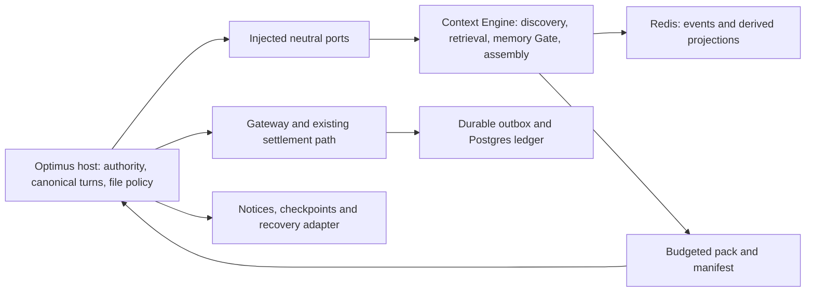

# Plan 12 memory: whole-feature design v4

**Date/base:** v4 revised 2026-10-29; the design text is v3's, whose source was rechecked at main `dbdfaa3210b329c9fae6de2fb80811174e361786`.

**Authority:** discovery scope is frozen at v12, SHA-256 `33670c6b84aceccd629437c14f03609ba4293d70cde95b242dd93a2b0ad4fb14`; operator acceptance is in the freeze record, SHA-256 `13880f7779a72a51a90444d0f659faaf8f9a251cc430e06cbdc37daa68c4073f`. The authoring brief has SHA-256 `f81a080b3b9065295dd47b817fbd411c00d2cba9b3614b1d69c41dc06796acd9`. These are provenance under `optimus-handoff/plan-12-discovery`, not runtime/test dependencies.

**Owners:** Codex authored v1–v3; Claude implements each slice plan after the operator's approval, and Codex reviews through the CLI under `AGENTS.md` `## Cross-agent review`. Filing this design is not an execution release. Agent-selected mechanisms/defaults below are proposals implementing the frozen requirements, not new operator quotations.

**v4 renumbering revision (2026-10-29):** complete successor to v3, `2026-10-22-plan12-memory-design_v3.md`, SHA-256 `a3f469df07f981eb516e16cbefb8ea12f4b19377b90bda3c2ed021e7d2ea96ab`, preserved in the handoff folder. The loop-control and Auto-mode plans took 12.3 and 12.4, so the evaluation slice is now Plan 12.5 ([#389](https://github.com/vibhanshu-agarwal/optimus-cost-agent/issues/389)). The foundations and feasibility slices are named by slice ID (M0a-1, [#390](https://github.com/vibhanshu-agarwal/optimus-cost-agent/issues/390); M0a-3, [#391](https://github.com/vibhanshu-agarwal/optimus-cost-agent/issues/391)) until they are picked up and numbered. Only plan names, links, the owner line, #385's handler and the §9 filing sentence change; the design is unchanged.

**Revision/sequence authority (v3):** complete successor to the preserved design v2 `2026-10-22-plan12-memory-design_v2.md`, SHA-256 `93b7cb47c896fd67232cbf369b4e5a38abed7585c3e309527420c53ad709d82e`. Claude's review is SHA-256 `1872834f0d8c344abd6dedbf18dd74f1797dc0ac5dcffd1086c9bca946dc7bac`; the endorsed cover note is `ebde0286753248ca7bdf3b230b4abc87579115a16debeebdaa5b887627941633`. §10 records R-1–R-3 and N-1–N-5 dispositions; prior review bytes remain unchanged. Frozen v12 stays byte-for-byte unchanged. The post-freeze operator amendment authorizes splitting M0a into three independently closable plans, postponing former Task 7, and adding optional purge with key rotation. It changes sequencing and adds the specified option; no earlier operator decision is reopened.

**First-slice plans:** [Plan 12.5, M0a-2 evaluation](../plans/2026-10-22-plan-12-5-memory-evaluation-implementation_v3.md) is filed. M0a-1 foundations and M0a-3 feasibility are approved review drafts held outside the repository until they are picked up and numbered. Later slices require their own plans.

## 1. Goal, decisions and boundaries

Give Optimus useful project context, durable cross-session memory and grounded dependency/project answers, so cheaper models can complete comparable work at lower fully loaded cost. Correctness, provenance and explicit uncertainty take priority over a universal “never stale” claim. The engine remains separately extractable under [ADR-001](https://github.com/vibhanshu-agarwal/optimus-cost-agent/blob/dbdfaa3210b329c9fae6de2fb80811174e361786/docs/decisions/ADR-001-context-engine-separate-product.md).

Carry the operator's decisions unchanged: automatic memory without a review queue; hybrid retrieval; GraphRAG for project Q&A; Redis first and no SQLite; Postgres for analytical facts; Option A for documentation code; seven-day brief plus `/welcome`; no inactivity deletion; configurable backups off by default; scheduled workspace recovery export; cloud opt-in; optional per-item encryption subject to CF-1; imported notes optional only; ranking-only strength decay. Memory never grants execution authority. No model picker, cost stops or full session replay is added. Existing `session/load` work stays separate. Existing diagnostic paths retain Q27's exclusion from B1.

The canonical delivery order stays **M0a → M0b → M1 → M3 → M2 → M5a → M7 → M6 → M5b**, with M0a now delivered as independently closable **M0a-1 foundations, M0a-2 evaluation (Plan 12.5) and M0a-3 feasibility** under the post-freeze amendment (§8.1). M0b gates complete-history/savings claims, not M1 development. M4 and the retrieval subagent remain deferred. C3/C4 affect M5a; OC-4 affects #248. Their unsettled choices do not block this design or M0a.

## 2. Components and ownership

`context_engine` owns knowledge contracts, retrieval/graph computation, admission policy, pure assembly and storage adapters. It imports none of `optimus`, `optimus_gateway`, `optimus_security`, `evidence_handoff*` or model-policy implementation. Preserve the existing AST/fresh-process boundary tests. Use flat modules initially, matching the current package; no framework or new service loop.

The host injects authorized file reads, source-origin envelopes, sanitization, Gateway/model calls, filesystem events, clock and opaque project/workspace identities. It owns ACP commands, authenticated user actions, notices, security decisions, the project registry, key custody and accounting. Engine output is re-sanitized before prompt use. Engine absence preserves existing Optimus behavior and history/approval contracts. Redis/Postgres outages degrade feature availability or accounting coverage; they never produce fresh authority or a cost stop.

## 3. Evidence, file access and retrieval

All evidence carries origin/revision, workspace/module/environment scope, observation and effective times, lineage, validation, trust/status and coverage. Keep observed facts distinct from inferred claims and user decisions. Runtime claims require runtime evidence; document acceptance does not prove implementation.

One host includable-files policy serves automatic context, indexing and anchor reads. It builds on #385's shared secret-path denial, including `.env.*`, then applies `.gitignore`, `.optimusignore` (Git wildmatch syntax), runtime-tree exclusions, binary detection and configurable size limits. Denial wins over ignore negation. Resolve aliases inside the trusted workspace before opening; recheck source identity after reading. Excluded named files return a reason without reading their contents. Existing explicit READ permissions remain authoritative; this does not grant access to ignored or denied content through the engine. A 1 MiB single-file indexing limit is an initial agent-selected default; exclusions and exhausted enumeration budgets appear in coverage and never imply absence.

Persist identifiers, signatures, summaries, paths, hashes, allowed documentation prose and vectors/pointers. Source bodies and raw tool results remain in bounded process RAM. Error-string/literal search reads disk at query time. Option A applies to every doc/issue code block: pointer, block hash/lines, parsed terms and permitted embedding, with body read and hash validation at answer time. Unavailable issue content stays unavailable offline. Generated summaries/extractions pass secret/source-overlap checks before every persistent sink; a failing item becomes pointer-only or is refused. Embeddings retain B1's acknowledged inversion risk.

A resumable in-process worker publishes coherent generation/coverage manifests; closing its owner pauses indexing visibly. Generation changes invalidate content and membership dependencies, including newly introduced callers. Selected unsaved buffers are capability-gated RAM overlays, used consistently for grounding; no global unsaved-buffer search is promised. FLAT vectors first; HNSW only after measured need. Fuse lexical, dense, structural, recency and memory channels with RRF, then budget-aware utility and stable tie-breaks. Persist an explanation manifest, not historical packs. Fixed-input pure assembly is deterministic; regenerated inference and approximate retrieval need not be.

Assembly order is protected host state, applicable user-origin constraints, required evidence, then optional context. The historical brief is removed before protected/required material under pressure. Missing required evidence produces explicit incomplete preparation. A status question does not replace the active objective. `/why` reports selection, scope, generation and coverage; it does not pretend RRF is confidence.

## 4. Project identity and memory lifecycle

Assign a local UUID per trusted canonical Git common directory; linked worktrees share it, clones/forks do not. Non-Git folders use a canonical-path registration. Store a versioned registry under the resolved per-user config root, outside Docker/workspaces; cross-process lock plus fsynced temporary file/atomic replacement protects concurrent allocation. Follow existing `msvcrt`/`fcntl` lock patterns without changing approval-store semantics. Missing/corrupt identity state with existing data requires recovery, not silent reassignment. Relocation/linking is an explicit host action, exported with the registry. Workspace security identities and branch/revision applicability remain separate.

Memory uses immutable versioned events and a rebuildable JSON/vector projection. Trust is `user-authored`, `agent-derived`, `legacy-import` or `off`; status is independently active/reverify/conflicted/superseded/withdrawn/purged. Scope, anchors, bitemporal validity, lineage, supersession and idempotency accompany each item. Pinning affects importance, not truth. Anchored changes trigger support revalidation; unsupported content becomes an explicitly unverified hint, never a current fact.

**Extraction rules:** a user-origin extraction sees only raw covered user text blocks, never model compaction summaries or tool/document payloads. Each candidate must identify supporting text spans and the speech act: assertion, preference, decision, quotation, question, hypothetical or retraction. Only actual assertions/preferences/decisions support immediate user-origin admission; questions and hypotheticals create no rules. A retraction withdraws/supersedes its identified item; ambiguity leaves an off candidate. This is automatic extraction, not user review. Host validation checks references/scope; model assertions outside the supplied spans do not gain user provenance.

Agent extraction sees completed work and host-issued evidence references. Only episode/procedure/lesson types are eligible, always optional; external or unresolved evidence lineage puts the candidate off. Provenance includes transitive dependencies, not just citations chosen by the model. Every candidate passes the injection and secret/B1 checks. A scanner ALLOW is not proof; short undetected pastes remain a measured residual. No model-callable write tool exists. Only the Gate commits admitted candidates. Compaction, repetition, tests and usage cannot improve trust.

An untrusted workspace is read-only for memory: automatic saves and memory mutations remain disabled until host trust is established. This never transfers file/approval authority from a linked worktree.

New user statements supersede older ones with history; agent conflicts go off without prompting. Off records hold only pointer, scanned display title and origin reference, capped initially at 200 plus a byte limit; overflow is unserved archival metadata with growth visibility. `/memory` marks source availability. Switch-on is a real user action, re-extracts the exact source revision, repeats scans and preserves the optional ceiling for imported/agent material; RAM-only sources disappear with the session. No fallback to diagnostic transcripts.

## 5. Durable writes, notices and continuity

One Redis append is the accepted-memory commit. Under a serialized Gate operation, check expected version/idempotency against authoritative events, not a lagging projection. One memory-instance stream carries project and item IDs; projection/version lookup and dedupe indexes are rebuildable, never required writes inside the append transaction. Serialize across processes with a fenced single-writer lease; recovery reconstructs indexes before admission. Fence checking and append occur atomically. A lost lease prevents publication. Qualify lookup/rebuild cost in M1/M3; do not replace this with a multi-key “atomic” claim.

On the same dedicated connection, append then `WAITAOF 1 0 <timeout>`; compare the returned local count. Preflight requires AOF. An unconfirmed write retains its idempotency key for retry and is never reported saved. Serve an accepted item only at its authoritative current projected version. [WAITAOF](https://redis.io/docs/latest/commands/waitaof/) confirms preceding writes on that connection; it is not a replica/volume-loss guarantee.

The host creates `MemoryNotice(event_id, item_id, version, action, durable_state, projection_state)` from the commit result, not from model prose. Only fsync-confirmed commits say “Remembered/Updated”; delayed projection is shown as pending availability. Failure/timeout says unconfirmed and offers retry. Render a runner-generated [ACP tool-call/update card](https://agentclientprotocol.com/protocol/v1/tool-calls) with a host-only `memory/<event_id>` identifier, plus appended text fallback where needed; this card is not a model-callable write tool. Escape/reserve matching model labels, but never rely on one prefix stripper. Reconnection can resend the same event notice idempotently; an undelivered notice stays in the host delivery backlog for the next available update or `/memory`. Do not invent or undo a save because notification delivery failed. Answers cite served memory IDs/versions.

At every turn settlement write a deterministic continuation checkpoint from host state, keyed by project/session with branch/worktree/revision and sequence. A project-level lookup finds the eligible predecessor, preferring the same branch/worktree. The seven-day brief appears at the first response, plus `/welcome`; unsolicited display is optional after K6. It contains dated prior work, pinned/applicable facts, relevant changes and invalidations, with “N of M” coverage. Missing/rewritten baselines are explicit. Target 1–2K tokens with detail on demand. Historical plans, approvals and tests never become current authority.

## 6. Recovery, keys and the inventory of copies

`/forget` withdraws by default: it immediately excludes retrieval and invalidates dependants, retaining history. Explicit purge requires host confirmation. Purge first durably records a payload-free exclusion/tombstone, then removes payloads/projections/vectors/summaries/export entries and completes AOF rewrite/RDB replacement. Track the workflow across crashes; it is not one atomic multi-store deletion. Report logical exclusion separately from erasure completion.

| Copy class | Recovery and deletion rule |
|---|---|
| Redis events, projection, vectors, AOF/RDB | Durability protects confirmed writes when the volume survives. Purge completion waits for all relevant rewrite/snapshot work; no forensic-media guarantee. |
| Scheduled `.optimus/` export | Plaintext Agent Memory Repo layout plus registry, tombstones and manifest. Atomic generation; scheduled and on demand. Same-drive recovery, not backup. A known sync root needs opt-in before first write; refusal means no export and an explicit larger loss window. |
| Configured backups | Off by default; daily, 30-day rotation when enabled, other drive/cloud as configured. Record last successful snapshot and failure domain. Local retention is not proof of cloud deletion. |
| Wrapped-key catalog/recovery envelopes | Versioned under per-user root, outside Redis; included in encrypted recovery bundles so drive loss is recoverable. Historical versions are decryption paths until proven inaccessible. |
| OS-keystore master secret and recovery phrase | Separate service namespace from credentials/approvals. Neither secret enters events, logs or exports. Recovery-secret delivery uses only the qualified channel in §6.1.1; never ACP chat text. Loss of both roots makes encrypted recovery unavailable. |
| Recovery-handoff file and external phrase copies | Temporary plaintext secret under a verified private per-user root, excluded from every feature export/backup/model-read path. Track deletion separately; a moved/copied phrase is an external attested recovery path. No secure-overwrite claim. |
| RAM, delivered prompts and Q27 diagnostics | RAM expires; already delivered model context and Q27 diagnostics are outside the feature's erasure promise. |

**Selected encryption mechanism:** independent random 256-bit item data keys, AES-256-GCM via `cryptography`, fresh nonces, and authenticated item/project/schema/version metadata. Wrap each data key with a keystore-protected master; seal a recovery envelope for that master using a separate random 256-bit recovery secret delivered as the recovery phrase through §6.1.1. Backups include ciphertext and the protected key catalog/envelope, never plaintext keys. Verify the package/platform and keyring backend before enabling; an unavailable encryption backend or unqualified phrase channel disables encrypted enablement/rotation rather than silently writing plaintext. This uses a maintained [authenticated-encryption primitive](https://cryptography.io/en/latest/hazmat/primitives/aead/), not custom cryptography.

**Recovery versus erasure:** the recovery-envelope design permits recovery from an old backup using its old phrase. A new master alone cannot revoke that path. Crypto-erasure is conditional on making every applicable old master, data key, recovery envelope/credential and plaintext copy inaccessible within the declared boundary (CF-1). This follows the key-hierarchy and external-key-copy conditions in [NIST SP 800-88 Rev. 2, §3.2.3](https://nvlpubs.nist.gov/nistpubs/SpecialPublications/NIST.SP.800-88r2.pdf). App-controlled keystore deletion is evidence about that backend, not proof that paper phrases, copied keys or cloud version histories were destroyed.

### 6.1 Optional purge with key rotation

Offer this explicitly at purge time. Explain before confirmation: a successful retirement prevents restoring older backup generations with current credentials, recovery now requires the new phrase, and plaintext `.optimus/` recovery copies are outside cryptographic erasure. Losing the new root and its phrase makes the new backup unrecoverable. Logical exclusion happens immediately; the longer rotation must not re-admit any purged item.

**Batching (N-2):** one explicit “rotate now” action may cover several pending purges. Snapshot the item IDs, versions and deletion-journal watermark into a payload-free rotation manifest. Exclude the entire batch from new live keys/ciphertext and backup generation. Purges after the cutover watermark remain immediately excluded but belong to the next rotation; do not silently amend an acknowledged manifest. Until rotation/erasure completes, each item keeps its own pending/unbounded status. One phrase-save acknowledgement and one manifest-bound destruction attestation can cover the declared batch.

### 6.1.1 Recovery-phrase channel (R-1)

There is no shipped confidential memory UI. ACP/Zed nonpersistent display is UNVERIFIED; no ACP message, card or model response is assumed private. **M3's concrete fallback is a restricted one-time handoff file**, written by the host under its private per-user root, for example `memory-recovery/<rotation-id>/recovery.txt`, outside the workspace and known sync roots. Create an owner-private directory and exclusive new file, reject symlinks/reparse points and unsafe ancestry, enforce/verify owner-only access (POSIX 0700 directory/0600 file; Windows restricted DACL for the current user and required OS principals, without inherited broad access). If the root, ACL or sync exclusion cannot be established, disable this option. These are planned M3 controls, not existing capability claims.

Only the path, rotation ID and instructions enter ACP. The phrase never enters chat history, model prompts, tool results, diagnostics, clipboard automation or feature exports/backups. Deny model/agent read and write access to the handoff root by resolved identity, including automatic context, file tools and native tool/shell mediation; keep the raw user-command channel separate from model-generated actions. A file used to hand off the phrase is an explicit temporary plaintext copy in the inventory, not “no plaintext persistence.” A same-user ACL alone does not isolate the file from an agent's unrestricted shell: M3 must prove mediation for every enabled model tool, or keep the channel unavailable. Do not imply protection against the human user's own unrestricted OS access. Ask the user to save it through a trusted channel outside IDE chat; any external viewer/history or extra copy is part of the external recovery-material attestation.

Do not overwrite or regenerate the phrase to redisplay it; after a crash reconcile the existing file and rotation state. Require a real-user acknowledgement bound to the rotation/generation manifest that the new phrase was saved, then remove the temporary file before retirement can complete. Missing acknowledgement, failed file deletion or unresolved copies keeps completion pending/unbounded. M3 tests ACLs, denial paths, crash recovery and deletion on Windows and Linux; encryption enablement and rotation remain unavailable until an accepted channel is qualified. No new CLI or separate GUI is assumed.

M0a-3 P5 probes nonpersistent Zed display using **synthetic canaries only**, across displayed history, reopen/restart, persisted thread state and accessible logs. An uninspectable history sink means INCONCLUSIVE. A card rendering successfully does not prove confidentiality. Any alternative to the file fallback needs an explicit accepted M3 decision and client/version-bound evidence before secrets use it.

### 6.1.2 Rotation protocol

**Proposed mechanism:** create a fresh master secret, fresh recovery phrase and fresh data keys for every retained item; re-encrypt retained live payloads into a new authenticated generation. Exclude purged/revoked payloads and their data keys. Merely rewrapping unchanged data keys is insufficient for the stronger generation-retirement goal: the current catalog could still unwrap a key capable of reading that item's historical ciphertext. Fresh data keys implement the operator's “live items are re-encrypted” requirement; Claude's review agrees with this correction to the brief's narrower rewrap step.

Use a durable two-phase rotation state machine, not an in-place sequence:

1. **Prepare:** journal a payload-free rotation ID, source head, old/new generation IDs, copy boundary and intended purge batch/watermark. Keep the old master and recovery material intact. Under a fenced generation writer, snapshot retained live items, encrypt with fresh keys/nonces and build a new sealed catalog, recovery envelope and backup generation. Drain concurrent writes through a recorded cutover watermark; all retained versions at that watermark must be represented. Prevent any old-generation backup writer from publishing after cutover.
2. **Verify:** authenticate and restore the new generation into staging, check the retained-item inventory and tombstones, and prove that the new OS-keystore root and new recovery path can read it. Deliver the new phrase through the qualified restricted-file channel in §6.1.1 (or a separately accepted, evidenced alternative). Require a real-user acknowledgement that the new phrase has been saved, bound to this rotation ID/generation manifest; the acknowledgement contains no secret. Do not destroy any old root before both verification and acknowledgement.
3. **Commit:** durably switch the current-generation pointer and record a commit marker. New writes use the new generation. Only then idempotently remove old app-controlled masters, catalogs, recovery envelopes and cached key material across the copy inventory, with native backend deletion checks. Do not delete the new root during recovery from a partial cleanup.
4. **Reconcile:** report which generations and recovery paths were retired and which remain. `key-generation-retired/current-credentials-rejected` is a narrower result than completed cryptographic erasure. A retained old phrase plus an old backup containing its envelope still decrypts that backup; generating a new phrase or deleting today's envelope does not destroy those historical copies. A separate real-user attestation of destruction of all relevant old recovery material may establish `completed-attested` under the conditions below; it is not independently verified evidence and is not implied by acknowledgement of saving the new phrase.

Before cutover, a crash resumes or aborts preparation with the old root still usable; the purge tombstone remains authoritative. After cutover, the verified new generation remains usable and cleanup resumes from durable progress. If verification, acknowledgement, old-key deletion or copy reconciliation is absent/fails, preserve the usable root and report rotation pending or erasure unbounded. Backups and restores honor the durable rotation/deletion journal, and a mixed-generation catalog is never published as complete. A no-longer-readable old generation is an intentional recovery tradeoff, not a damaged-backup success.

**Truthful completion (N-1):** keep logical exclusion, usable new generation and erasure status separate. Every completion result names its boundary, generation range, verified checks, outstanding copy paths and any attestation identity/time/manifest. Use these states:

| Erasure status | Meaning and condition |
|---|---|
| `pending` | A required rotation, verification, acknowledgement or managed deletion step is unfinished; current logical exclusion still holds. |
| `completed-within-declared-boundary` | All applicable recovery paths inside that boundary have verifiable deletion/inaccessibility evidence; no reliance on unverifiable external-secret destruction. Do not label external phrase destruction as verified. |
| `completed-attested` | App-controlled key/file deletion and native checks succeeded; no known unresolved recoverable copy exists in the declared inventory; the user separately attests destroying **all** applicable old phrases, copied masters/data keys and other external recovery material. The attestation is explicit, batch/generation-bound and records its limitations. This is an attested result, never proof against retained secret copies. |
| `unbounded/unavailable` | A known recovery/plaintext path remains, inventory is incomplete, a backend cannot establish deletion, or external destruction cannot be established or attested. Never upgrade merely because the new generation works. |

An assertion that old material is “probably gone” or that just one phrase was destroyed cannot establish attested completion. A known surviving old phrase/envelope combination blocks either completion state. Discovery of an additional recoverable copy reopens the affected result. Report boundaries together: for example, encrypted backups may be `completed-attested` while synced plaintext recovery remains `unbounded`; the overall item must not be displayed as fully erased. The feature cannot unconditionally erase cloud history, delivered context, diagnostic copies or plaintext recovery exports.

### 6.2 Additional K5 rotation cases

These are two added test obligations, represented in the 24 seed trajectory families in Plan 12.5; they do not execute here. M3 owns the full implementation and tests on each supported native keystore backend.

- **K5-R1, successful rotation and its boundary:** start with at least three encrypted live items and a historical backup; purge at least two items as one declared batch while retaining another, rotate, acknowledge the new phrase and restore the retained item using the new root and separately the new phrase. Verify fresh data keys/ciphertext, absence of the purged key, and rejection of old generations using current credentials in a fresh process. Test deletion of the old managed root on the actual platform. Include the negative control that an intentionally retained old phrase plus historical envelope can still decrypt its old backup: this must prevent both verified and attested completion while that known copy exists. Then test the separate destruction-attestation path with managed deletion checks and correctly scoped `completed-attested` output; do not treat the attestation as physical proof. Demonstrate the plaintext-export and temporary handoff-file limits explicitly.
- **K5-R2, interrupted rotation:** inject interruption before/after prepare, verification, acknowledgement, pointer commit and each old-root cleanup boundary. Reopen in a fresh process. At least one verified usable generation survives; no old root is destroyed before verification plus acknowledgement; purged items remain excluded; cleanup is idempotent and incomplete managed/backend deletion never reports completion; absent external attestation cannot produce `completed-attested`. Include interruption during handoff-file creation/deletion, batch membership changes after the cutover watermark, and restart before a required acknowledgement.

### 6.3 Restore and deletion continuity

Maintain a payload-free deletion journal under the per-user root and carry its sequence/checksum into every export/backup. Restore into staging, authenticate manifests, apply the freshest verified deletion state, re-key registry entries only through controlled mapping, and publish only after reconciliation. An old backup alone cannot prove there were no later purges: if the deletion high-watermark cannot be established, hold restored memory out of serving and report deletion continuity unknown. Journal co-loss is an acknowledged disaster limit, not fixed by calling the snapshot current. Imports from other tools are a different operation: they stay optional and cannot assert user trust through metadata.

## 7. Accounting, completeness and log retention

Extend the existing settlement path; do not create another debit calculation. The durable receipt key is attempt identity, with unique non-null Gateway request ID and the existing replay/conflict rules. Preserve unknown/unattributed/late attempts, requested/resolved route, nullable token/cache/reasoning fields and price snapshot ID. Duration is arrival bookkeeping, task class is turn-level, and memory calls use `stage=summarization` plus `purpose=memory.*`. Only allowlisted fields persist.

Original receipt facts remain immutable. Later independent reconciliation appends linked evidence; it does not enrich an old receipt silently or reinterpret a contradictory duplicate as a new charge.

**Selected completeness mechanism:** a durable coverage epoch plus attempt lifecycle. Before dispatch, append a sequenced intent; accepted settlement appends its receipt; terminal close records expected/settled identities and pending invocations. A complete epoch requires a durable begin before calls, every expected attempt durably accounted, no unknown/conflict and a durable close after all workers settle. Boot/restart never infers clean closure from a missing tail. A write failure leaves the affected span unknown/incomplete, keeps known subtotal and does not stop model work. If even the begin cannot persist, subsequent recovery starts an explicit unverifiable span after the last verified watermark; a later clean epoch cannot certify that gap retroactively.

Use an fsynced append-only outbox under per-user config as the local durable boundary; drain idempotently into Optimus-owned Postgres using committed cursors before compacting acknowledged segments. If neither boundary succeeds, no confirmed receipt claim. Record coverage gaps when persistence resumes; missing external usage stays unknown. All actual Gateway calls, including failed extraction/maintenance attempts, use this existing accounting path. Coordinate the narrow extension with #303; its broad consolidation remains separate. M0b starts durable coverage; history before it stays qualified.

Add the v12 per-user Gateway diagnostic copy; retain the current workspace path unchanged. **Proposed default for the new copy:** append-only segments, roll at 64 MiB or UTC day, retain 30 days subject to a 256 MiB total cap, remove oldest closed segments, and expose the retained date/sequence range and delivery failures. No in-place truncation of an active segment. An expired/unwritten segment is unavailable reconciliation evidence. These diagnostic limits never delete ledger/outbox rows. No rotation changes to Q27 paths are implied. Logging remains best effort; even surviving logs that agree cannot prove billing completeness. Match partial records without inventing receipt fields. Exact sink ownership/flush/retention tests belong in M0b.

Postgres is not a retrieval hot-path dependency. It owns the durable analytical ledger, later episode archive and evaluation results. No memory mirror is introduced. Usage tables show measured known cost with coverage. The comparison table reprices the same reported tokens at dated Sonnet 5.5, Opus 5.5 and GPT 6.1 Sol prices, explicitly estimated; missing categories/prices are unavailable, negative savings remain visible. A dated benchmark footnote reports quality, including below-margin results. Matched-run measured comparisons stay separate. #248 owns presentation; OC-4 remains open.

## 8. Dependency intelligence, graph and evaluation

Use typed authoritative dependency evidence: declarations, BOM/POM and compatibility mapping, locks, native approved resolution, deps.dev and advisories. Keep metadata facts, lock inventory, static estimate and resolved build evidence distinct under environment manifests. Gateway owns remote fetches; the engine sees sanitized results. Maven/Spring first, Gradle then uv. The change packet includes exact published inventory, minimal build change, why-paths, conflicts/advisory coverage, bounded static impact and next separately authorized verification. No false all-clear or invented coordinate. C3/C4 remain gated to M5a. Read-only Chat/Agent access and future directives follow those decisions; no unapproved build execution.

Project Q&A uses the discovery catalogue, typed deterministic G1′ graph first and G0 hybrid baseline; inferred edges stay labelled. Module/component map pages have membership and source dependencies. Larger graph stores/G2/G3 and L2 resolution require the frozen bounded experiments and later plans. No new framework owns Optimus's loop.

Evaluation uses pointer-based, snapshot/cutoff-bound golden cases and synthetic lifecycle fixtures, not a single prose answer string. A/B/C isolate ordinary tools, assembly and memory; one pinned generic D harness runs the three reference models; Sonnet D0 diagnoses harness differences; vendor arms are optional. Seed M0a with 24 synthetic memory trajectories and a small chronological localization set. Pin tools, effort and stopping rules. Human-calibrated judging is secondary to deterministic authority/lifecycle checks; held-out custody stays Q29. All overhead and failures count. Quality margins and targets are approved before acceptance runs; a small seed set proves no broad performance claim.

| Oracle | First proof and later obligation |
|---|---|
| K1 | M0a-1 real policy controls; Plan 12.5 fixture/oracle validation. M3 owns real automatic admission, hostile input, notice binding, import and conflict controls. Former Task 7's source/egress controls move to starts of M5a (Initializr) and M7 (graph). |
| K2 | M0a-3 package/worker and synthetic real-Redis feasibility through a dedicated probe marker/config/endpoint, independently dispositioned. M1 owns real-corpus qualification; M3 actual memory acknowledgement/erasure paths. Former Task 7's bounded compute/runtime feasibility moves to starts of M7 (graph) and M5b (L2). |
| K3 | Plan 12.5 expected-attempt/coverage fixtures; M0a-3 Postgres readiness only. M0b owns the real durable ledger, interrupted tails, outages and replay. |
| K4 | Plan 12.5 arithmetic/label fixtures; #248 owns actual tables and separately authorized comparisons. |
| K5 | M0a-1 registry/isolation; Plan 12.5 restore and rotation oracle definitions. M3 owns continuity, deletion continuity, backup, native keystore deletion and K5-R1/R2 execution. Former Task 7's source-hash/new-caller invalidation case moves to the start of M7. |
| K6 | M0a-3 version-bound real-client capability probes, separately closable, including host-generated notice cards with no model call and nonpersistent-display canaries. Unsupported/unreleased capability selects the explicit fallback or named follow-up. M1/M3 own integration; M3 qualifies the recovery channel before use. |

K1–K6 are **UNRUN** here. A probe failure/unknown is recorded honestly; a synthetic adapter is never a substitute for a tier's named real dependency. The three plans carry independent prerequisites, evidence and closure; Plan 12.5 validates oracle definitions without depending on the M0a-1 runtime or real probes. Fixture validity is never a production-capability pass. Later plans refine implementation without reopening frozen product decisions.

### 8.1 Sequencing amendment and delayed-probe custody

| Plan/slice | Scope and closure |
|---|---|
| M0a-1 foundations (#390) | Former Tasks 0–2: integrated #385 gate, shared file policy plus architecture ADR, project registry. Own production tests and platform checks; no probe prerequisite. |
| Plan 12.5 / M0a-2 evaluation (#389) | Former Task 3: case contract, 24 trajectories, 12 localization seeds, offline grader, pinned generic-harness choice. Independent of 12.3 and native-resource availability; actual harness/model results stay UNRUN. |
| M0a-3 feasibility (#391) | Former Tasks 4–6: package/parser/embedding/worker, Redis, Postgres and ACP/Zed probes. Each probe gets an observed result or an accepted named handoff with consequence; a blocked probe does not hold siblings or administrative closure. |
| Start of M5a | Former Task 7 Initializr probe: dated/hashed metadata and generated-POM/BOM compatibility evidence, fallible endpoint and authoritative fallback, no invented coordinate or unapproved build/private upload. |
| Start of M7 | Former Task 7 graph probe: bounded deterministic G1′ versus G0 over synthetic Java/Python modules, traversal/localization, new-caller invalidation, source hashes, node/time bounds and malformed/stale inputs. No LLM-invented edges. |
| Start of M5b | Former Task 7 L2 probe: installed JVM/LSP/runtime availability, bounded resolution and missing-runtime negative controls; no automatic download. |

Former Task 7's cases and acceptance content are retained with these owners; only timing changes. The three feasibility experiments are not hidden prerequisites for any M0a slice. Former Task 8's source-bound reporting and closure are distributed into each plan. The endorsed run order is **M0a-2 (Plan 12.5) → M0a-1 → M0a-3**. #385 is still open (`handler:claude`, hardening lane, since 2026-10-23), so M0a-1's dependent product work is blocked. This does not make the preceding plans prerequisites of the independent feasibility probes. M0b/M1 consume the relevant contracts and honest limitations rather than an invented all-probes-PASS gate. Their own plans must resolve any truly necessary handed-off prerequisite before dependent execution.

## 9. Alternatives and delivery conditions

Chosen: neutral engine plus host adapters and Redis-first stores. Rejected for this delivery: a replacement agent framework, a separate index daemon, a new accounting system, mandatory mirror/backups, semantic-answer serving and a review queue. Their tradeoffs and reconsideration triggers remain in frozen v12; this spec does not erase them. The durable outbox tolerates Postgres outages; its cost is explicit recovery/cursor work. Recoverable key envelopes preserve usability at the cost of conditional erasure, stated above.

Decision provenance is Source S10 in `docs/decisions/README.md`. The architecture ADR is written by M0a-1 under the next free number (ADR-024, named in earlier drafts, is taken). Index the current spec, and register each slice plan under ADR-022 when it is filed, with separate GitHub approval. Do not make tests or commands require the private handoff directory. ADR-001, ADR-005/012, existing compaction/shipping contracts, mode boundaries and evidence policy remain authoritative. This design changes neither current source nor the existing shipped empirical model qualification.

## 10. Response to Claude's review (2026-10-23)

All three required edits and five endorsed recommendations are incorporated as design/plan revisions (plan names updated to v4's); none is an execution, filing or assignment release.

| Point | Disposition and changed passage |
|---|---|
| R-1 | Applied: §6 copy inventory and §6.1.1 name the restricted-file fallback, its plaintext lifetime and access checks; unverified IDE privacy cannot carry a secret. M0a-3 Task 5 adds nonpersistent-display canaries; M3 gates encryption/rotation on qualification. |
| R-2 | Applied: M0a-3 owns a dedicated `requires_plan12_probe_redis` marker, default/profile exclusion plus matching run-context approved-marker update, explicit probe config and endpoint/instance protection. No shared preflight or fallback fixture. |
| R-3 | Applied within 24 families: Plan 12.5 M01 requires memory-ID/version citations, M13/M18 cover mixed-project import isolation and M21 covers registry-based restore re-keying. |
| N-1 | Applied with qualification: §6.1.2 adds `completed-attested`, separate from verified completion, requiring managed deletion plus a specific user attestation and no known unresolved path in its boundary. Global plaintext limits remain visible. |
| N-2 | Applied: §6.1 batches pending purges under one immutable watermark/manifest and one new generation; M23/M24 test batching and crash boundaries. |
| N-3 | Applied: run order M0a-2 → M0a-1 → M0a-3. #385 ownership remains a separate authorized hardening/GitHub action, not silently assigned here. |
| N-4 | Agree: M0a-1 is high/5 active days for cross-platform path/ignore and crash-safe registry proof; M0a-2 remains medium/3d and M0a-3 high/5d, excluding waits. Label writes remain at filing. |
| N-5 | Applied: M0a-3 P5 names host-only notice-card rendering, with zero model/provider calls and a client-only-versus-Optimus distinction. M3 still proves binding to actual saves. |

Reviewed predecessors, the review/cover note and frozen v12 inputs remain immutable. All implementation tests and K1–K6 probes are UNRUN in this authoring pass. Claude rechecks the changed passages; the operator approves the exact successor hashes in the owning chat before later filing/execution.

